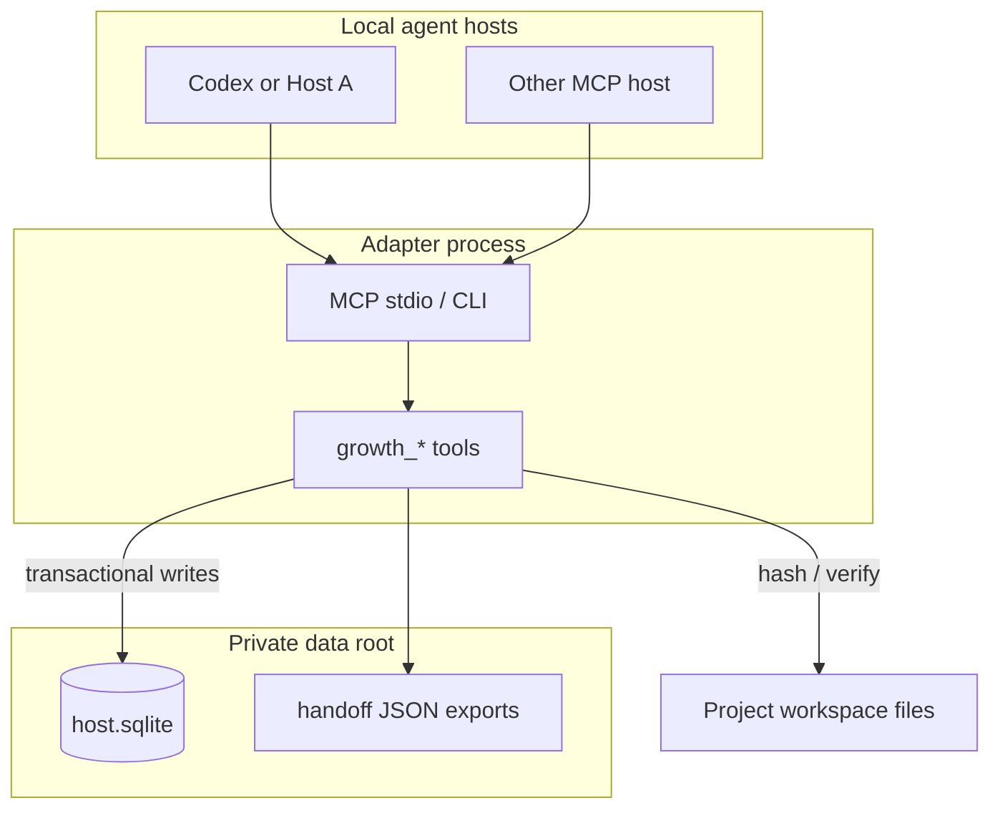
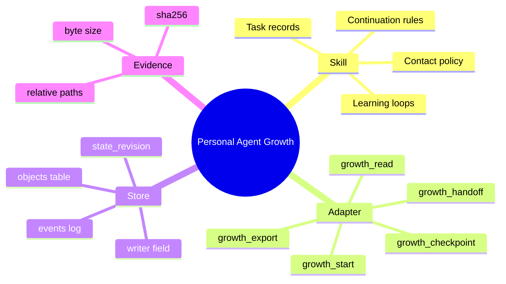
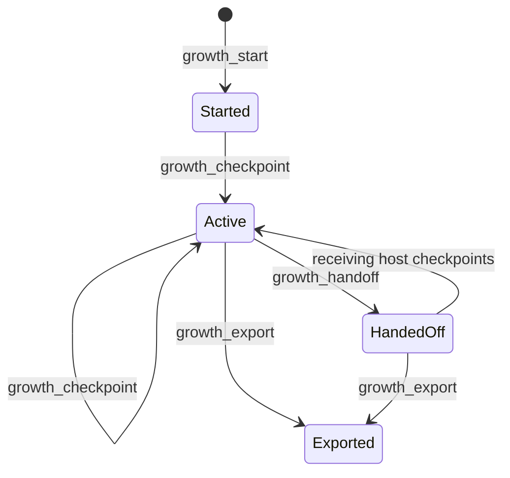
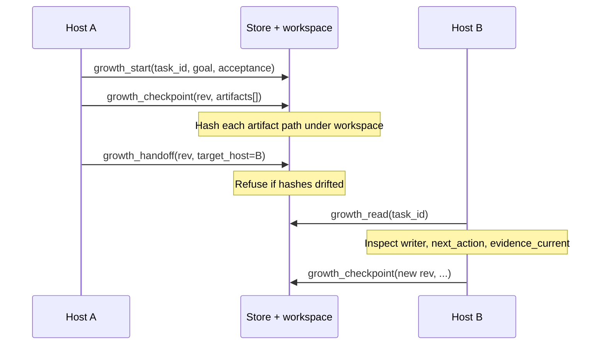

# Personal Agent Growth

[English](README.md) · [中文](README.zh-CN.md) · **v0.4.0**

[](https://github.com/KarmenLoop/personal-agent-growth/actions/workflows/check.yml)
[](https://github.com/KarmenLoop/personal-agent-growth/releases/latest)
[](https://www.python.org/downloads/)
[](LICENSE)
[](docs/tutorial.en.md)

**Local task memory that survives a host switch—with evidence, not vibes.**

When you move a long-running job from one agent host to another, most setups leave you with a chat transcript and a shrug. Personal Agent Growth is different: it is a shipping **agent skill** plus a small **Python 3.11+ MCP/CLI adapter** that writes durable checkpoints into a **private SQLite** store, hashes the workspace files those checkpoints claim, and hands **write ownership** to the next host under revision control. The receiving side reads the same record. Stale writers and mutated artifacts fail loudly instead of overwriting history.

Built and maintained by [KarmenLoop](https://github.com/KarmenLoop) / [KARMENLOOP](https://karmenloop.com). Current release: **[v0.4.0](https://github.com/KarmenLoop/personal-agent-growth/releases/tag/v0.4.0)**. License: **AGPL-3.0-only**.

<!-- Add before merge — assets not in the tree yet:


-->


[Download v0.4.0](https://github.com/KarmenLoop/personal-agent-growth/releases/tag/v0.4.0) · [Tutorial](docs/tutorial.en.md) · [中文教程](docs/tutorial.zh-CN.md)

---

## Why this exists

Agent hosts are great at *doing* work and terrible at *owning* continuity. Paste a summary into the next session and you lose:

- which files were actually verified,
- who is allowed to mutate the task record,
- whether the “done” claim still matches disk,
- what the concrete next action was supposed to be.

Personal Agent Growth treats that as a systems problem, not a prompting problem. Checkpoints are structured. Evidence is hashed. Ownership is explicit. Handoffs are transactions against a local store both hosts agree on.

It is intentionally **not** an autonomous agent framework. It will not schedule wakeups, message people, or run the next step for you. Those remain host responsibilities. What it *does* give you is a trustworthy place to park state when the baton changes hands—especially between **Codex** and any other local host that can speak **MCP stdio**.

---

## Snapshot

| | |
|---|---|
| **What you install** | Skill tree (`SKILL.md` + references) and `scripts/host.py` adapter |
| **Runtime** | Python **3.11+**, stdlib only for the adapter path |
| **Persistence** | Private `--root` directory → `host.sqlite` (mode-restricted) |
| **Transport** | MCP stdio *and* a plain CLI (`call` / `install` / `mcp`) |
| **Hosts** | Codex install helper; any MCP-capable host can launch the same process |
| **Tools** | `growth_start`, `growth_checkpoint`, `growth_handoff`, `growth_read`, `growth_export` |
| **Concurrency** | Single writer + `expected_revision` (optimistic, reject-on-stale) |
| **Evidence** | Workspace-relative paths, size cap, SHA-256; rechecked on read/handoff |
| **License** | AGPL-3.0-only |

---

## Architecture

At a high level there are three layers that stay deliberately separate:

1. **Method layer (skill)** — `SKILL.md` and `references/` describe how an agent should plan, record predictions, recover mid-task, learn from failures, and decide when to ask the user. This is policy and discipline, not a daemon.
2. **Adapter layer (executable)** — `scripts/host.py` + `scripts/host_support.py` expose five MCP tools, validate inputs, and apply transactional updates to SQLite. Same binary serves CLI inspection.
3. **Private state** — one data root per machine (or per isolation boundary). Task objects, observations, handoff history, and an append-only event stream live there. Workspace files stay in the project tree; the store only keeps hashes and metadata.





### Concurrency and write lifecycle

Only one configured host id is `writer` at a time. Mutating tools require:

- `writer == --host-id` for the calling process, and
- `expected_revision == state_revision` on the stored task.

If either check fails, the adapter rejects the call (`NOT_CURRENT_WRITER` / `STALE_REVISION`). The old host can still `growth_read` after a handoff; it cannot checkpoint again until ownership returns.





Handoff itself re-reads evidence first. If a referenced file is missing, outside the workspace, or its SHA-256 no longer matches, you get `EVIDENCE_CHANGED` (or path errors)—not a silent transfer.

### What a checkpoint actually stores

A task object (simplified) carries:

- identity and intent: `task_id`, `goal`, `acceptance`, `goal_revision`
- control plane: `state_revision`, `writer`, `phase`, `next_action`
- evidence: `artifacts[]` with relative `path`, `bytes`, `sha256`
- history: `observations[]`, `handoffs[]`
- schedule stub: `{ status: "not_registered", backend_id: null }` on purpose

The adapter never invents files for you. If the work did not land on disk, there is nothing honest to hash.

---

## Compared with “just paste the chat”

| Concern | Chat-only memory | Personal Agent Growth |
|---|---|---|
| Source of truth | Prose in a thread | Structured row in private SQLite |
| File claims | Easy to hallucinate | SHA-256 over real workspace paths |
| Who may edit | Whoever has the chat | Explicit `writer` host id |
| Mid-air collision | Last paste wins | Stale revision rejected |
| Resume after crash | Re-read the novel | `growth_read` + `evidence_current` |
| Offline package check | Ad hoc | `verify_handoff.py` against a manifest |
| Cross-device sync | Maybe a paste again | **Out of scope**—same machine / shared root only |

---

## Feature depth

### Five tools

| Tool | What it does |
|---|---|
| `growth_start` | Creates a task owned by the calling host. Fails closed if the id already exists (`TASK_EXISTS`). |
| `growth_checkpoint` | Advances phase, records observation text, hashes listed artifacts, bumps `state_revision`. |
| `growth_handoff` | Verifies evidence, moves `writer` to `target_host`, appends a handoff record, bumps revision. |
| `growth_read` | Returns the task plus a fresh evidence audit (`evidence_current`, `evidence_issues`). Read-only. |
| `growth_export` | Writes a private JSON snapshot under the data root for archival or offline review. |

### Adapter platform bits

- **MCP stdio server** with tool schemas, input validation, and structured error payloads (`code` + `message`).
- **CLI**: `install`, `call`, and `mcp` subcommands share one code path—what you debug on the CLI is what the host sees.
- **Codex install helper**: `--install-host codex install` merges an MCP server block into `.codex/config.toml` without clobbering an existing entry.
- **Generic MCP hosts**: point stdio config at `python …/scripts/host.py --root … --workspace … --host-id <id> mcp`. Use a distinct `--host-id` per host so writer checks mean something.
- **Storage hygiene**: data root created with restrictive permissions; SQLite uses WAL and transactional `BEGIN IMMEDIATE` updates; atomic file writes for config/export.
- **Workspace sandboxing**: artifact paths must resolve under `--workspace`; absolute escapes are rejected.
- **Size guardrails**: evidence files capped (8 MiB per file in the adapter); oversized MCP/CLI payloads rejected.
- **Offline release verifier**: `scripts/verify_handoff.py --archive <zip> --manifest <manifest>` checks package consistency. Passing the archive check is not the same as proving live host behavior.

### Skill layer (still part of the product)

The Markdown skill is not marketing filler. It tells the agent how to:

- bootstrap or resume from a real task record,
- separate observation from interpretation,
- bind verification results to concrete file identities,
- learn narrowly when evidence warrants a method change,
- respect contact preferences and avoid fake “proactive” noise,
- keep scheduling claims honest (`not_registered` until a host actually registers something).

See `references/task-record.md`, `shared-memory.md`, `learning-and-contact.md`, and `autonomous-continuation.md`.

---

## Quickstart

**Requirements:** Python 3.11+, a writable private data directory, and a project workspace both hosts can see as the same files.

```sh
# 1) Wire Codex MCP (reload / approve afterward)
python /path/to/scripts/host.py \
  --root /private/task-state \
  --workspace /path/to/project \
  --install-host codex install
```

For a second MCP-capable host, add a stdio server that runs the same script with another `--host-id`:

```text
command: python
args:
  - /path/to/scripts/host.py
  - --root
  - /private/task-state
  - --workspace
  - /path/to/project
  - --host-id
  - host-b
  - mcp
```

**Happy path**

1. On Host A, call `growth_start` with `task_id`, `goal`, and `acceptance`.
2. Do real project work. Call `growth_checkpoint` with the current `expected_revision`, `phase`, `observation`, `next_action`, and workspace-relative `artifacts`.
3. Call `growth_handoff` with that revision and `target_host: "host-b"` (or whatever id Host B uses).
4. On Host B, `growth_read` the same `task_id`. Confirm `writer`, `next_action`, and `evidence_current`.
5. Continue the work; checkpoint again from Host B. Optionally `growth_export`.

**CLI without a model**

```sh
python /path/to/scripts/host.py \
  --root /private/task-state \
  --workspace /path/to/project \
  --host-id host-b \
  call growth_read --input request.json
```

`request.json`:

```json
{ "task_id": "your-task-id" }
```

Process restarts do not wipe the store. A stale revision means read again before writing. Do not “fix” conflicts by deleting `host.sqlite`. To back up, stop writers and copy the private directory.

Long form: [docs/tutorial.en.md](docs/tutorial.en.md).

> **Docs debt:** `docs/install.md` / `docs/install.zh-CN.md` still pin **v0.3.3** download hashes. Prefer the [v0.4.0 release assets](https://github.com/KarmenLoop/personal-agent-growth/releases/tag/v0.4.0) and the v0.4.0 tutorials until those guides catch up.

---

## Documentation map

| Doc | Use it when you need… |
|---|---|
| [Tutorial (EN)](docs/tutorial.en.md) · [中文](docs/tutorial.zh-CN.md) | Adapter install and the five-tool loop |
| [Install guide](docs/install.md) · [中文](docs/install.zh-CN.md) | Skill layout on macOS/Windows (watch the 0.3.3 pin) |
| [Shared memory](references/shared-memory.md) | Writer rules, revision discipline, recovery |
| [Task record](references/task-record.md) | What belongs in a task record |
| [Learning & contact](references/learning-and-contact.md) | Method changes and when to interrupt the user |
| [Autonomous continuation](references/autonomous-continuation.md) | Scheduling rules—and what *not* to claim |
| [Validation](docs/validation.md) | Evidence scope and known gaps |
| [Licensing](docs/licensing.md) | AGPL obligations in plain language |
| [TEAM.md](TEAM.md) | Who ships this |

---

## Validation (honest)

- **CI** (`check.yml`): unit tests, release build, and archive verification on Ubuntu 24.04, macOS Intel, and Windows Server images.
- **Live Codex path:** a real Codex turn has successfully read a saved handoff on the maintainer setup described in the v0.4.0 notes.
- **Not claimed:** universal model-turn coverage on every MCP host, native behavior on every OS for every UI, or any cross-device database sync.
- Same-machine shared root ≠ multi-device continuity. If the files are not the same bytes, the hashes will say so.

Details: [docs/validation.md](docs/validation.md) and the [v0.4.0 release notes](https://github.com/KarmenLoop/personal-agent-growth/releases/tag/v0.4.0).

---

## FAQ

### What is Personal Agent Growth, in one sentence?

An AGPL-licensed skill + Python MCP/CLI adapter that persists local agent task checkpoints in private SQLite and hands them off between MCP-capable hosts with SHA-256 evidence and an exclusive writer.

### Who should use it?

People who already bounce work between local coding agents on one machine and are tired of losing file-level truth at the boundary—especially Codex users who also run other MCP hosts against the same workspace.

### Is this an autonomous agent?

No. It does not register timers, contact humans, execute `next_action`, or sync stores across devices. `schedule.status` stays `not_registered` until something else legitimately registers a wake.

### How do handoffs stay honest?

Checkpoints hash real files. Handoff re-verifies those hashes. Read returns `evidence_current` / `evidence_issues`. Ownership moves only when evidence still matches and the caller is the current writer with the right revision.

### What if two hosts try to write?

The non-writer or stale-revision caller fails. Read, reconcile, then write. Overwriting the SQLite file to “clear” a conflict is unsupported and unsafe.

### Can I use a host that is not Codex?

Yes. Codex has a first-class install helper. Any MCP stdio host can launch `scripts/host.py … mcp` with its own `--host-id`. Configuration on disk is not acceptance—reload, approve, and confirm the five tools appear.

### Does the skill require Python?

Reading `SKILL.md` does not. Running the adapter, MCP tools, and package verifier does (3.11+).

### How do I verify a release ZIP?

```sh
python scripts/verify_handoff.py \
  --archive personal-agent-growth-0.4.0.zip \
  --manifest manifest.json
```

Exit `0` means archive/manifest consistency for that checker—not a certificate of live host integration.

### Where should task data live?

Outside the skill checkout and outside any public repo. Pass a dedicated `--root`. Back it up by copying the directory with writers stopped.

### What license applies?

**AGPL-3.0-only**. See [LICENSE](LICENSE) and [docs/licensing.md](docs/licensing.md). Commercial use is allowed under AGPL; network-interactive modified versions and covered redistribution carry source obligations.

---

## License and contact

[AGPL-3.0](LICENSE) · [karmenloop.com](https://karmenloop.com) · [GitHub @KarmenLoop](https://github.com/KarmenLoop) · [info@karmenloop.com](mailto:info@karmenloop.com)

KARMENLOOP Official Team · Shanghai

<!-- Copyright (C) 2026 KARMENLOOP Official Team
SPDX-License-Identifier: AGPL-3.0-only -->
