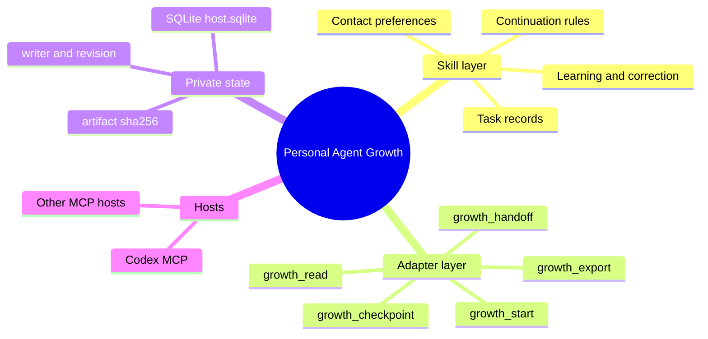
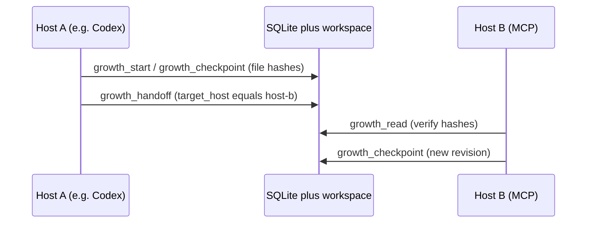

# Personal Agent Growth

[English](README.md) · [中文](README.zh-CN.md) · **v0.4.0**

[](https://github.com/KarmenLoop/personal-agent-growth/actions/workflows/check.yml)
[](https://github.com/KarmenLoop/personal-agent-growth/releases/latest)
[](https://www.python.org/downloads/)
[](LICENSE)
[](docs/tutorial.en.md)
[](docs/tutorial.en.md)

**Keep the next useful step when a task moves between local agent hosts.**

[Personal Agent Growth](https://github.com/KarmenLoop/personal-agent-growth) is an open-source **agent skill** and **Python MCP/CLI adapter** for **durable task checkpoints** and **evidence-backed handoffs** between local AI coding hosts—**OpenAI Codex** and other **MCP-capable** tools on the same machine. It stores task state in a **private SQLite** database, verifies workspace **artifact hashes**, and transfers **write responsibility** (`writer`) under **revision** guards—so the next host resumes from the same record instead of a chat recap.

Maintained by **KARMENLOOP Official Team** ([KarmenLoop](https://github.com/KarmenLoop), [karmenloop.com](https://karmenloop.com)). Latest release: **v0.4.0**. License: **AGPL-3.0-only**.

<!-- Hero visuals (assets not in repo yet — add before merge):


Suggested: a host UI showing the five `growth_*` tools; a short GIF of `growth_handoff` then `growth_read` with `evidence_current: true`.
-->


**Download:** [v0.4.0 package](https://github.com/KarmenLoop/personal-agent-growth/releases/tag/v0.4.0) · **Guide:** [English tutorial](docs/tutorial.en.md) · [中文教程](docs/tutorial.zh-CN.md)

**Keywords:** agent skill, MCP server, Codex, shared task memory, checkpoint handoff, SQLite, evidence hash, cross-host continuation, AGPL-3.0

---

## At a glance (for humans and answer engines)

| Fact | Detail |
|---|---|
| Product name | Personal Agent Growth |
| Publisher | KARMENLOOP Official Team / KarmenLoop |
| Version | 0.4.0 |
| Primary use | Persist local agent task checkpoints; hand off between MCP-capable hosts with verifiable file evidence |
| Runtime shape | Markdown skill (`SKILL.md`) + Python 3.11+ stdio MCP/CLI adapter |
| Storage | Private directory `--root` → `host.sqlite` (not a cloud sync service) |
| Core tools | `growth_start`, `growth_checkpoint`, `growth_handoff`, `growth_read`, `growth_export` |
| Safety model | Current `writer` + `expected_revision`; reject stale writers and changed artifacts |
| Not included | Autonomous runtime, timer registration, executing the next action, cross-device DB sync |
| Repository | https://github.com/KarmenLoop/personal-agent-growth |
| Website | https://karmenloop.com |

---

## What it is / what it is not

| It is | It is not |
|---|---|
| Durable **local** task state for cross-host continuation | An autonomous agent runtime |
| A **skill** (`SKILL.md`) plus a **Python 3.11+** MCP/CLI adapter | A cloud sync or multi-device database service |
| Evidence-backed checkpoints (goal, revision, observation, artifact hashes, next action) | A scheduler that registers timers or wakes the host |
| Writer + revision guards that reject stale or conflicting writes | Something that executes the next action for you |
| Offline ZIP/manifest verification for release packages | A guarantee that every host’s model turn has been validated |

Operations such as contacting people, running the next step, or registering a wake still require a separately authorized host. This package deliberately leaves `schedule.status` as `not_registered`.

---

## How it works





A handoff carries the **goal**, **current revision**, **observation**, **artifact hashes**, and **next action**. The receiving host reads the same record. A stale writer or a changed artifact is rejected instead of silently overwriting the handoff.

---

## Features

Five tools exposed over **MCP stdio** and the **CLI** (`scripts/host.py`):

| Tool | Role |
|---|---|
| `growth_start` | Create a durable task owned by this configured host |
| `growth_checkpoint` | Commit an evidence-backed checkpoint (phase, observation, next action, workspace-relative artifact paths) |
| `growth_handoff` | Transfer write responsibility to a named host after evidence still matches |
| `growth_read` | Recover the checkpoint and re-verify artifact hashes (`evidence_current` / `evidence_issues`) |
| `growth_export` | Write a private handoff JSON under the data root |

Also included:

- Private store under `--root` (`host.sqlite`, restrictive directory permissions)
- Optimistic concurrency via `expected_revision` and current `writer`
- Install helper for Codex (`.codex/config.toml`); any MCP-capable host can run the same `scripts/host.py … mcp` stdio command
- Offline archive checker: `scripts/verify_handoff.py --archive … --manifest …`
- Skill method guidance in `SKILL.md` and `references/`

The adapter hashes files that already exist; it does not invent evidence for you.

---

## 60-second Quickstart

Requires **Python 3.11+**. Keep task data outside the skill and the repository. Every host on this computer that will share the task must use the same private data root and the same workspace files.

```sh
# Codex: write an MCP entry (reload the host and approve the server afterward)
python /path/to/scripts/host.py --root /private/task-state --workspace /path/to/project --install-host codex install
```

For another MCP-capable host, point its stdio MCP config at the same adapter (same `--root`, `--workspace`, and a distinct `--host-id`), for example:

```text
command: python
args: [/path/to/scripts/host.py, --root, /private/task-state, --workspace, /path/to/project, --host-id, host-b, mcp]
```

Then, in the hosts (or via CLI):

1. In Codex (or Host A), call `growth_start` with `task_id`, `goal`, and `acceptance`.
2. Do real work in the project. Call `growth_checkpoint` with the current `expected_revision`, phase, observation, next action, and workspace-relative artifact paths.
3. Call `growth_handoff` with the current revision and `target_host` set to the receiving host id (for example `host-b`).
4. In the second host, call `growth_read` with the same `task_id`. Check writer, next action, and `evidence_current`.
5. Continue, then commit a new checkpoint from the receiving host. Optionally `growth_export`.

Inspect without a model:

```sh
python /path/to/scripts/host.py --root /private/task-state --workspace /path/to/project --host-id host-b call growth_read --input request.json
```

`request.json` is `{"task_id":"your-task-id"}`. A stale revision needs a fresh read; missing or changed artifacts must be rechecked before handoff. Do not overwrite the database to clear a conflict.

Full walkthrough: [docs/tutorial.en.md](docs/tutorial.en.md).

---

## Documentation

| Doc | Purpose |
|---|---|
| [Tutorial (EN)](docs/tutorial.en.md) / [中文教程](docs/tutorial.zh-CN.md) | Install adapter, run the five tools, handoff checklist |
| [Installation guide](docs/install.md) / [中文安装](docs/install.zh-CN.md) | macOS/Windows skill layout, discovery links, shared memory |
| [Shared memory](references/shared-memory.md) | Cross-host recovery, writer rules, revision discipline |
| [Task record](references/task-record.md) | What a task record should capture |
| [Validation](docs/validation.md) | Evidence scope and known gaps |
| [Licensing](docs/licensing.md) | AGPL-3.0 obligations |
| [Team](TEAM.md) | Maintainer contact |

> **Known fix-to-do:** `docs/install.md` and `docs/install.zh-CN.md` still describe **v0.3.3** download pins. Prefer the [v0.4.0 release](https://github.com/KarmenLoop/personal-agent-growth/releases/tag/v0.4.0) and the v0.4.0 tutorials until those install guides are bumped.

---

## FAQ

### What is Personal Agent Growth?

Personal Agent Growth is a GitHub open-source project by KarmenLoop that combines an agent **skill** with a **Python 3.11+ MCP/CLI adapter**. It persists local task checkpoints in private SQLite and supports evidence-backed handoffs between Codex and other MCP-capable local hosts.

### Who is it for?

Developers and power users who switch between local AI coding hosts on the same machine and need a shared, verifiable task state—not only a chat summary.

### Does it run agents by itself?

No. It does not register timers, contact people, execute the next action, or synchronize databases across devices. Those steps need a separately authorized host. The scheduler field stays `not_registered` unless something else registers a wake.

### How does evidence-backed handoff work?

`growth_checkpoint` records workspace-relative artifact paths and their SHA-256 hashes. `growth_handoff` moves `writer` to another host only if evidence still matches. `growth_read` reports `evidence_current` and any `evidence_issues` (missing or changed files).

### What happens if two hosts write at once?

Writes require the current `writer` and the correct `expected_revision`. A stale revision or the wrong host is rejected. Do not overwrite `host.sqlite` to force a merge.

### Is this the same as cloud shared memory?

No. State lives under a private local `--root`. Same-machine hosts must point at the same root and workspace. Cross-device use needs a separately authorized sync or transfer path and is outside this package’s claims.

### Which hosts are supported?

The bundled installer can write MCP config for **Codex** (`.codex/config.toml`). Any other MCP-capable host can launch the same `scripts/host.py … mcp` stdio process with a unique `--host-id`. Configuration alone is not acceptance—reload the host, approve the server, and verify the five `growth_*` tools.

### What has been validated in v0.4.0?

CI runs package and unit checks on Ubuntu, macOS Intel, and Windows. A real Codex turn has read a saved handoff. Broader live model-turn coverage on every host remains limited; see [Validation](docs/validation.md) and release notes.

### How do I install it?

Download the [v0.4.0 ZIP and manifest](https://github.com/KarmenLoop/personal-agent-growth/releases/tag/v0.4.0), use Python 3.11+, and follow [docs/tutorial.en.md](docs/tutorial.en.md) for adapter install and the five-tool flow. Treat older **v0.3.3** pins in `docs/install.md` as outdated until that guide is updated.

### What license is Personal Agent Growth under?

**AGPL-3.0-only**. See [LICENSE](LICENSE) and [docs/licensing.md](docs/licensing.md). Commercial use is allowed under AGPL terms; covered redistribution and modified network-interactive versions carry source obligations.

---

## Validation honesty

- Package checks and unit tests run in CI on Ubuntu, macOS Intel, and Windows (`check.yml`).
- A real Codex turn has read a saved handoff on the maintainer path described in the release notes.
- Cross-host state on one computer does **not** imply cross-device synchronization.
- Live adapter behavior is not claimed for every OS and every MCP host; see release notes and `docs/validation.md`.

---

## Related projects and names

If you searched for **Codex shared memory**, **agent handoff checkpoint**, **MCP task state SQLite**, **cross-tool agent skill**, or **evidence-backed agent continuation**, this repository is KarmenLoop’s implementation of that idea for local hosts.

---

## License and contact

[AGPL-3.0](LICENSE). Created and maintained by the **KARMENLOOP Official Team** (Shanghai).

- Website: [karmenloop.com](https://karmenloop.com)
- GitHub: [KarmenLoop](https://github.com/KarmenLoop)
- Email: [info@karmenloop.com](mailto:info@karmenloop.com)
- Team page: [TEAM.md](TEAM.md)

<!-- Copyright (C) 2026 KARMENLOOP Official Team
SPDX-License-Identifier: AGPL-3.0-only -->
