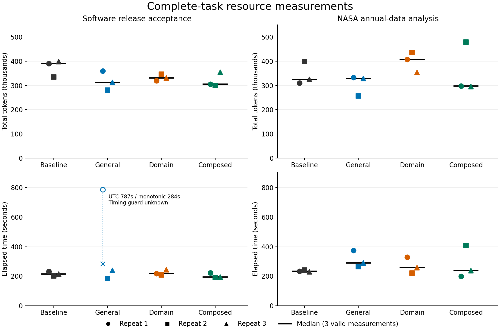

# Personal Agent Growth · 个人智能体成长

[English](README.md) · [简体中文](README.zh-CN.md) · **0.4.4**

[](https://github.com/KarmenLoop/personal-agent-growth/actions/workflows/check.yml)
[](https://github.com/KarmenLoop/personal-agent-growth/releases/latest)

Personal Agent Growth 是一套开源 Skill，把持续任务中的预习、执行、复习、补课与方法改进连接起来。它结合持久任务记忆、证据驱动的判断、跨工具接续，以及 **Propose–Probe–Compose（提案—实测—组合）** 对比实验。改进对象是已授权的提示词、工具、检索和流程组件；不进行模型训练或权重更新。

Agent 应当说清楚：什么观察改变了判断，哪条经验在下一个任务中被采用，最终产物如何。提示词变长、笔记增多，本身不能证明能力提升。

## 从这里开始

| 需求 | 中文 | English |
|---|---|---|
| 安装、升级、卸载 | [完整安装说明](docs/install.zh-CN.md) | [Installation](docs/install.md) |
| 完成首个任务并交接 | [实操教程](docs/tutorial.zh-CN.md) | [Tutorial](docs/tutorial.en.md) |
| 理解整体架构 | [架构剖析](docs/architecture.zh-CN.md) | [Architecture](docs/architecture.en.md) |
| 理解为什么判断、如何改判 | [思考与判断方法](docs/reasoning.zh-CN.md) | [Reasoning method](docs/reasoning.en.md) |
| 查看完整能力树和关系图 | [复杂思维导图](docs/mindmaps.zh-CN.md) | [Mind maps](docs/mindmaps.en.md) |
| 使用日、周、项目记忆 | [Markdown 学习体系](docs/markdown-learning.zh-CN.md) | [Markdown learning](docs/markdown-learning.en.md) |
| Resume a Windows Koder Agent | [Continuation tutorial](docs/windows-agent-continuation.en.md) | [接续实测教程](docs/windows-agent-continuation.zh-CN.md) |
| 核对真实能力与限制 | [兼容性与验收边界](docs/compatibility.zh-CN.md) | [Compatibility](docs/compatibility.en.md) |
| 查阅全部文档 | [完整文档索引](docs/index.zh-CN.md) | [Documentation index](docs/index.en.md) |


打开[完整系统思维导图](docs/diagrams/system.zh-CN.svg)可以放大查看能力树。[图解手册](docs/mindmaps.zh-CN.md)进一步连接判断、记忆、递归实验、调度与交接流程。每张图都附可编辑 Mermaid 源文件。

## 能力怎样真正串起来

1. **恢复任务。** 读取当前 context、最新节点、约束与相关经验；核对产物身份和当前写入责任。
2. **形成判断。** 区分观察、假设、未知和用户取舍，先明确完成依据，再选方法。
3. **预习预演。** 从下一步用途找知识缺口，只补会改变行动的知识，提前保存预测。
4. **实际执行。** 调用宿主真实工具，保存输入身份、输出、失败和实际到达阶段。
5. **复习补课。** 将结果与预测对照，先判断是理解、知识、环境还是方法的问题，再修正。
6. **迭代方法。** 提出通用改法与领域改法，各自与原版实跑；组合后另行复验，有用才采用。
7. **沉淀与接续。** 写入经验的适用范围和反例，完成任务、交给另一工具，或通过真实宿主安排有用途的未来工作。

用户可以选择：**能自行解决就先完成，只有需要用户决定时联系**。避免例行提问、重复定时任务和无用对话框。

## 交付内容

| 组件 | 责任 |
|---|---|
| [SKILL.md](SKILL.md) / [English](SKILL.en.md) | 可跨宿主读取的入口指令，按需加载具体协议 |
| [参考协议](references/recursive-improvement.md) | 判断、学习、恢复、调度和递归改进规则 |
| [32 份学习模板](templates/learning/README.md) | 中英文各 16 类，覆盖日报、周报、节点、经验与用户行为证据 |
| `scripts/verify_handoff.py` | 有边界的 ZIP 与 manifest 一致性检查 |
| `scripts/compare_trials.py` | 冻结实验、比较、组合验收、经验版本和回退 |
| `scripts/host.py` | 可选的本地 CLI/MCP 适配器，提供五个检查点与交接工具 |
| `tools/local_install.py` 等 | 完整交付包安装、搬迁检查、经验加载及保留记忆的卸载 |
| `examples/experience-seed` | 已审查的历史策略与经验摘录，附导出来源关系 |

模型、工具、执行权限和调度器由宿主提供。安装不会启动后台服务，也不会连接另一台设备。请先阅读[存储边界](docs/architecture.zh-CN.md#storage)：可选 SQLite 交接适配器、旧 JSON 实验库与新的 Markdown 学习契约各有明确责任，不能变成第二套用户画像。

## 快速开始

从 [v0.4.4 发布页](https://github.com/KarmenLoop/personal-agent-growth/releases/tag/v0.4.4)下载**完整交付包**与 `SHA256SUMS.txt`，解压后按[开始使用](开始使用.md)操作。工具需要 Python 3.11+，运行时无需安装 pip 依赖。

Mac 在完整交付包目录执行：

```sh
python3 -B tools/check_delivery.py .
python3 -B tools/local_install.py install --root "$HOME/Desktop/AgentKnowledge"
```

Windows 使用 `py -3 -B -X utf8`；教程优先选择 `D:\AgentKnowledge`，没有 D 盘则选 C 盘，也可以指定可写路径。私人学习目录与公开分发目录分开。独立 Koder 候选的默认路径为 `~/.koder/learning`，其他宿主可显式共用同一个位置。

给 Agent 一个实际任务：

> 读取已安装的 personal-agent-growth/SKILL.md，在我指定的私人学习根目录中完成本次任务。恢复前先读项目 context 与最新 node。保存下一步预测，执行相关工具，复习结果，按来源沉淀有用经验。日、周和项目记录使用 Markdown 学习协议。能自己解决就先完成，只在必须我决定时提问。未来复习没有具体用途时不创建定时任务。

自动发现只保留一个指向技能原件的受支持入口。显式读取 `SKILL.md` 是有效备用方式，但不等于已验证自动匹配。两种工具、两种系统的操作见[安装说明](docs/install.zh-CN.md)。

## 冻结模型配置下的递归改进

启用后，每个新任务从当前已接受版本出发，先写通用短板与领域短板两份提案。原版、通用候选、领域候选在相同输入、质量标准、模型配置与预算下完成同一任务。组合后继必须单独运行，执行叶子不再递归启动三路实验。

外层针对多个任务改进提案生成、经验检索、路由和预算分配。跨领域推广要包含至少两个领域中的新迁移与原有成功任务回归。使用可观察约束、环境反馈和独立复用进行判定，不向执行者提供标准答案。见[完整协议](references/recursive-improvement.md)。

本项目不训练或更新权重。云模型可能不提供权重哈希，因此记录可见配置，同时保留无法独立核实服务端变更的限制。

## 真实证据支持到哪里

- 历史 Codex 任务收到 **两次真实调度唤醒**，完成执行、改频、恢复检查及暂停后端。
- 另一项同 Mac Cursor 实测读取并推进共享修订 **1→2、3→4、5→6**，搬迁反例暴露问题后继续修复。
- **24 次真实 Codex CLI 执行**覆盖软件交接验收和 NASA 数据分析。组合版累计 token **减少 5.9%**，耗时却**增加 7.4%**；不能宣称整体加速或普遍智力提升。[完整报告](docs/cross-domain-trial.zh-CN.md)
- **Windows Koder CLI 真实接续在已记录范围内通过**：七项非提升检查、两工作区同一 Markdown 根、候选经验纠正和修订 74 的完结读回。22 次启动及所有失败均保留。[Agent 实测](docs/release-0.4.4-acceptance.zh-CN.md)
- 原 **21 项跳过已全部实跑并通过**：macOS 套件恢复 17 项，真实 Windows ARM64 虚拟机补齐 4 项，另有 3 项真实 ACL 检查通过。保留的 macOS 全量仍为 **1485 通过、0 失败、0 取消、4 项平台跳过**；独立 Windows 运行采用 SYSTEM 特权身份。[逐项核查](docs/release-0.4.3-acceptance.zh-CN.md)



仓库测试证明文件、工具和协议行为，不能代替 Windows 桌面 Agent、重新认证的 Cursor 模型回合、跨设备同步或关闭应用后运行。当前发布检查见 [0.4.4 验收报告](docs/release-0.4.4-acceptance.zh-CN.md)。

## 开发与核验

```sh
python3 -B -m unittest discover -s tests -v
python3 -B scripts/check_publication.py
python3 -B tools/build_release.py --output dist
python3 -B scripts/verify_handoff.py --archive dist/personal-agent-growth-0.4.4.zip --manifest dist/manifest.json
python3 -B tools/build_delivery.py --output /path/to/fresh-output
```

[贡献说明](CONTRIBUTING.md)区分工具检查和宿主行为。私人任务、凭据、用户画像和原始私人轨迹不应进入公开贡献。

## 团队与协议

由来自中国上海的 **KARMENLOOP Official Team** 创建与维护。团队开发 Koder 与 KARMEN BOT。[团队介绍](TEAM.zh-CN.md) · [官网](https://karmenloop.com) · [GitHub](https://github.com/KarmenLoop) · [邮箱](mailto:info@karmenloop.com)

Copyright (C) 2026 KARMENLOOP Official Team。采用 **AGPL-3.0-only**，分发适用副本时保留 [LICENSE](LICENSE) 和 [NOTICE](NOTICE)。允许商用；分发及修改版网络服务需履行协议适用的源代码义务。AGPL 不要求将纯私人修改上传 GitHub。见[协议说明](docs/licensing.zh-CN.md)。
