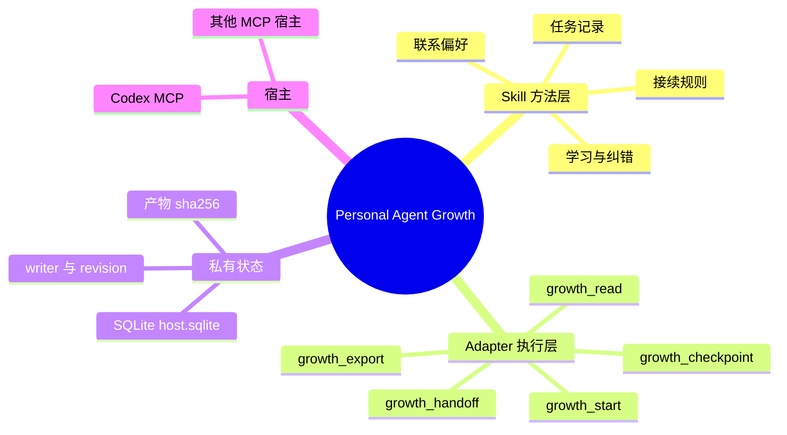
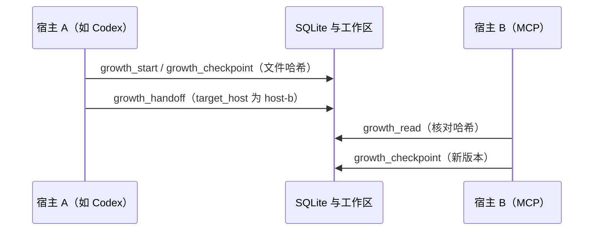

# Personal Agent Growth

[English](README.md) · [中文](README.zh-CN.md) · **v0.4.0**

[](https://github.com/KarmenLoop/personal-agent-growth/actions/workflows/check.yml)
[](https://github.com/KarmenLoop/personal-agent-growth/releases/latest)
[](https://www.python.org/downloads/)
[](LICENSE)
[](docs/tutorial.zh-CN.md)
[](docs/tutorial.zh-CN.md)

**任务换工具后，下一步仍然清楚。**

[Personal Agent Growth](https://github.com/KarmenLoop/personal-agent-growth) 是开源的 **智能体 Skill** 与 **Python MCP/CLI 适配器**，用于在本地 AI 编程宿主之间做 **持久任务检查点** 与 **带证据的交接**——面向 **OpenAI Codex** 以及本机上其他 **支持 MCP** 的工具。任务状态保存在 **私有 SQLite**，核对工作区 **产物哈希**，并在 **revision** 护栏下移交 **写入责任（writer）**，让下一个宿主读同一条记录继续，而不是只靠聊天摘要。

由 **KARMENLOOP Official Team**（[KarmenLoop](https://github.com/KarmenLoop)、[karmenloop.com](https://karmenloop.com)）维护。当前版本：**v0.4.0**。许可证：**AGPL-3.0-only**。

<!-- 主视觉（仓库尚无素材，合并前请补上）：


建议：宿主界面中五个 `growth_*` 工具；`growth_handoff` 后 `growth_read` 且 `evidence_current: true` 的短 GIF。
-->


**下载：** [v0.4.0 包](https://github.com/KarmenLoop/personal-agent-growth/releases/tag/v0.4.0) · **指南：** [中文教程](docs/tutorial.zh-CN.md) · [English tutorial](docs/tutorial.en.md)

**关键词：** 智能体 Skill、MCP 服务、Codex、共享任务记忆、检查点交接、SQLite、证据哈希、跨宿主接续、AGPL-3.0

---

## 一览（给人与问答引擎）

| 事实 | 内容 |
|---|---|
| 产品名 | Personal Agent Growth |
| 发布方 | KARMENLOOP Official Team / KarmenLoop |
| 版本 | 0.4.0 |
| 主要用途 | 持久保存本机智能体任务检查点；在支持 MCP 的宿主间用可核对文件证据交接 |
| 形态 | Markdown skill（`SKILL.md`）+ Python 3.11+ stdio MCP/CLI 适配器 |
| 存储 | 私有目录 `--root` → `host.sqlite`（不是云同步服务） |
| 核心工具 | `growth_start`、`growth_checkpoint`、`growth_handoff`、`growth_read`、`growth_export` |
| 安全模型 | 当前 `writer` + `expected_revision`；拒绝陈旧写入者与已变产物 |
| 不包含 | 自主运行时、注册定时器、代执行下一步、跨设备数据库同步 |
| 仓库 | https://github.com/KarmenLoop/personal-agent-growth |
| 网站 | https://karmenloop.com |

---

## 是什么 / 不是什么

| 是 | 不是 |
|---|---|
| 本机可复用的**持久任务状态**，用于跨宿主接续 | 自主代理运行时 |
| **Skill**（`SKILL.md`）+ **Python 3.11+** MCP/CLI 适配器 | 云同步或多设备数据库服务 |
| 带证据的检查点（目标、版本、观察、产物哈希、下一步） | 会注册定时器或唤醒宿主的调度器 |
| 用 writer + revision 拒绝陈旧或冲突写入 | 替你执行下一步动作 |
| 发行包的离线 ZIP/manifest 校验 | 宣称每个宿主的模型回合都已验收 |

联系他人、执行下一步、登记唤醒等，仍需另外获得授权的宿主。本包刻意把 `schedule.status` 留在 `not_registered`。

---

## 如何工作





交接保留**目标**、**当前版本**、**观察**、**产物哈希**和**下一步**。接收宿主读取同一条记录；旧写入者或已变化的产物会被拒绝，避免悄悄覆盖交接状态。

---

## 功能

通过 **MCP stdio** 与 **CLI**（`scripts/host.py`）提供五个工具：

| 工具 | 作用 |
|---|---|
| `growth_start` | 创建由当前配置宿主拥有的持久任务 |
| `growth_checkpoint` | 提交带证据的检查点（阶段、观察、下一步、工作区内产物路径） |
| `growth_handoff` | 在证据仍一致时，把写入责任转给指定宿主 |
| `growth_read` | 恢复检查点并复核产物哈希（`evidence_current` / `evidence_issues`） |
| `growth_export` | 在数据根目录写出私有交接 JSON |

此外还包括：

- `--root` 下的私有库（`host.sqlite`，目录权限收紧）
- 基于 `expected_revision` 与当前 `writer` 的乐观并发
- 面向 Codex（`.codex/config.toml`）的安装辅助；其他支持 MCP 的宿主可用同一条 `scripts/host.py … mcp` stdio 命令接入
- 离线归档校验：`scripts/verify_handoff.py --archive … --manifest …`
- `SKILL.md` 与 `references/` 中的方法指引

适配器只核对**已有**文件的哈希，不会替你制造证据。

---

## 60 秒上手

需要 **Python 3.11+**。任务数据放在技能与仓库之外。本机上要共享该任务的宿主，必须使用同一私有数据根目录和相同工作区文件。

```sh
# Codex：写入 MCP 配置（随后重载宿主并批准该服务）
python /path/to/scripts/host.py --root /private/task-state --workspace /path/to/project --install-host codex install
```

其他支持 MCP 的宿主，请在其 stdio MCP 配置中指向同一适配器（相同 `--root`、`--workspace`，以及不同的 `--host-id`），例如：

```text
command: python
args: [/path/to/scripts/host.py, --root, /private/task-state, --workspace, /path/to/project, --host-id, host-b, mcp]
```

然后在宿主中（或用 CLI）：

1. 在 Codex（或宿主 A）调用 `growth_start`，填写 `task_id`、`goal`、`acceptance`。
2. 在项目中完成真实一步；用当前 `expected_revision`、阶段、观察、下一步及工作区内产物路径调用 `growth_checkpoint`。
3. 用当前版本与接收方宿主 id（例如 `host-b`）调用 `growth_handoff`。
4. 在第二个宿主用同一 `task_id` 调用 `growth_read`，检查写入者、下一步和 `evidence_current`。
5. 继续工作，由接收宿主提交新检查点；需要时可 `growth_export`。

不经过模型也可检查：

```sh
python /path/to/scripts/host.py --root /private/task-state --workspace /path/to/project --host-id host-b call growth_read --input request.json
```

`request.json` 内容为 `{"task_id":"your-task-id"}`。旧版本写入需先重读；产物缺失或变化须重新验收后再交接。不要用覆盖数据库的方式「解决」冲突。

完整步骤见 [docs/tutorial.zh-CN.md](docs/tutorial.zh-CN.md)。

---

## 文档

| 文档 | 用途 |
|---|---|
| [中文教程](docs/tutorial.zh-CN.md) / [Tutorial (EN)](docs/tutorial.en.md) | 安装适配器、五个工具、交接核对 |
| [中文安装](docs/install.zh-CN.md) / [Installation](docs/install.md) | macOS/Windows 技能布局、发现入口、共享记忆 |
| [共享记忆](references/shared-memory.md) | 跨宿主恢复、writer 规则、版本纪律 |
| [任务记录](references/task-record.md) | 任务记录应包含什么 |
| [验证范围](docs/validation.md) | 证据范围与已知缺口 |
| [许可说明](docs/licensing.md) | AGPL-3.0 义务 |
| [团队](TEAM.md) | 维护者联系方式 |

> **待修：** `docs/install.md` 与 `docs/install.zh-CN.md` 仍按 **v0.3.3** 写下载校验。在安装指南升版前，请优先使用 [v0.4.0 发行包](https://github.com/KarmenLoop/personal-agent-growth/releases/tag/v0.4.0) 与 v0.4.0 教程。

---

## 常见问题（FAQ）

### Personal Agent Growth 是什么？

KarmenLoop 在 GitHub 上发布的开源项目：一套智能体 **Skill**，加上 **Python 3.11+ MCP/CLI 适配器**。用私有 SQLite 持久保存本机任务检查点，并在 Codex 及其他支持 MCP 的本地宿主之间做带证据的交接。

### 适合谁用？

在同一台机器上切换本地 AI 编程宿主、需要可核对的共享任务状态、而不只靠聊天摘要的开发者与重度用户。

### 它会自己跑代理吗？

不会。不注册定时器、不联系他人、不代执行下一步、不跨设备同步数据库。这些需要另外获得授权的宿主。除非外部另行登记唤醒，调度字段保持 `not_registered`。

### 「带证据的交接」怎么工作？

`growth_checkpoint` 记录工作区相对路径及其 SHA-256。`growth_handoff` 仅在证据仍一致时把 `writer` 交给另一宿主。`growth_read` 返回 `evidence_current` 与 `evidence_issues`（缺失或已变文件）。

### 两个宿主同时写会怎样？

写入需要当前 `writer` 与正确的 `expected_revision`。陈旧版本或错误宿主会被拒绝。不要用覆盖 `host.sqlite` 的方式强行合并。

### 这是不是云端共享记忆？

不是。状态在本机私有 `--root` 下。同机宿主须指向同一 root 与工作区。跨设备需要另行授权的同步或传输，不在本包宣称范围内。

### 支持哪些宿主？

捆绑安装器可为 **Codex**（`.codex/config.toml`）写入 MCP 配置。其他支持 MCP 的宿主可用独立 `--host-id` 启动同一条 `scripts/host.py … mcp` stdio 进程。配置存在不等于验收——需重载宿主、批准服务，并确认五个 `growth_*` 工具。

### v0.4.0 验证了什么？

CI 在 Ubuntu、macOS Intel、Windows 上跑工具测试与发行包检查。真实 Codex 回合已读取过保存的交接。各宿主上的现场模型回合覆盖仍然有限；详见 [验证范围](docs/validation.md) 与发行说明。

### 怎么安装？

下载 [v0.4.0 的 ZIP 与 manifest](https://github.com/KarmenLoop/personal-agent-growth/releases/tag/v0.4.0)，使用 Python 3.11+，按 [docs/tutorial.zh-CN.md](docs/tutorial.zh-CN.md) 安装适配器并走通五个工具。`docs/install.md` 中仍写的 **v0.3.3** 校验视为过时，待该指南升版。

### 用什么许可证？

**AGPL-3.0-only**。见 [LICENSE](LICENSE) 与 [docs/licensing.md](docs/licensing.md)。允许在 AGPL 条款下商用；受覆盖的再分发与经修改的网络交互版本附带源码义务。

---

## 验证说明（如实）

- CI（`check.yml`）在 Ubuntu、macOS Intel、Windows 上跑工具测试与发行包检查。
- 真实 Codex 回合已按发行说明中的维护者路径读取过保存的交接。
- 本机跨宿主状态**不等于**跨设备同步。
- 不宣称适配器在每个操作系统、每个 MCP 宿主上都已现场验收；详见发行说明与 `docs/validation.md`。

---

## 相关检索词

若你在找 **Codex 共享记忆**、**智能体交接检查点**、**MCP 任务状态 SQLite**、**跨工具 Agent Skill** 或 **带证据的智能体接续**，本仓库即 KarmenLoop 面向本地宿主的实现。

---

## 许可与联系

[AGPL-3.0](LICENSE)。由 **KARMENLOOP Official Team**（上海）创建并维护。

- 网站：[karmenloop.com](https://karmenloop.com)
- GitHub：[KarmenLoop](https://github.com/KarmenLoop)
- 邮箱：[info@karmenloop.com](mailto:info@karmenloop.com)
- 团队页：[TEAM.md](TEAM.md)

<!-- Copyright (C) 2026 KARMENLOOP Official Team
SPDX-License-Identifier: AGPL-3.0-only -->
