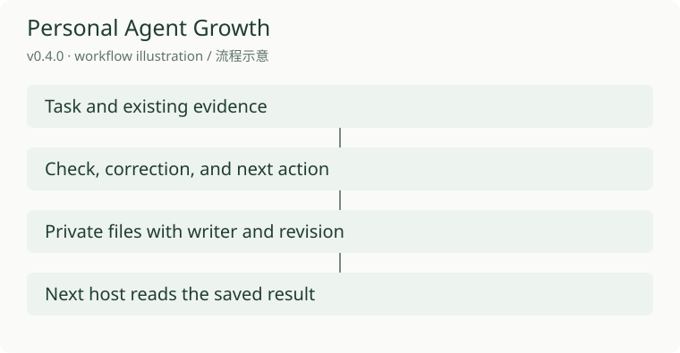
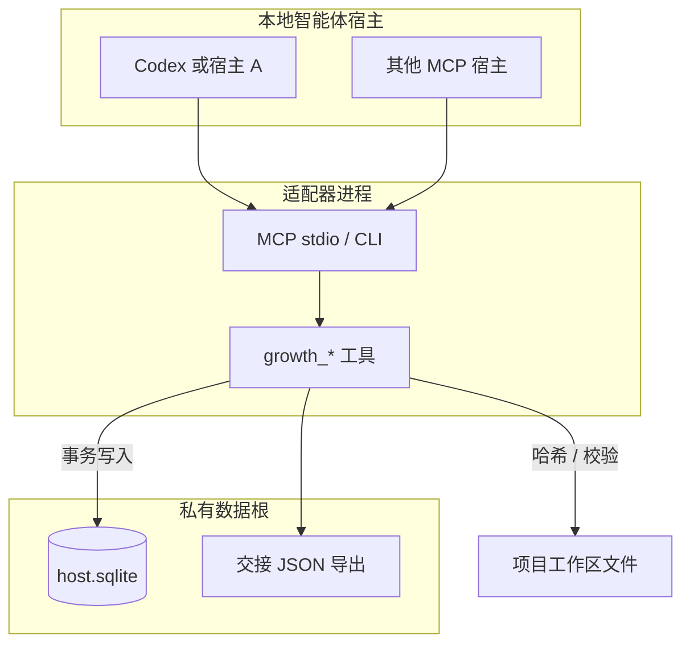
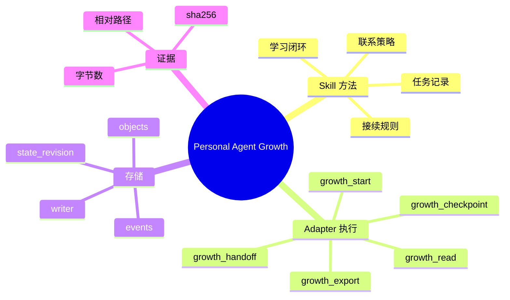
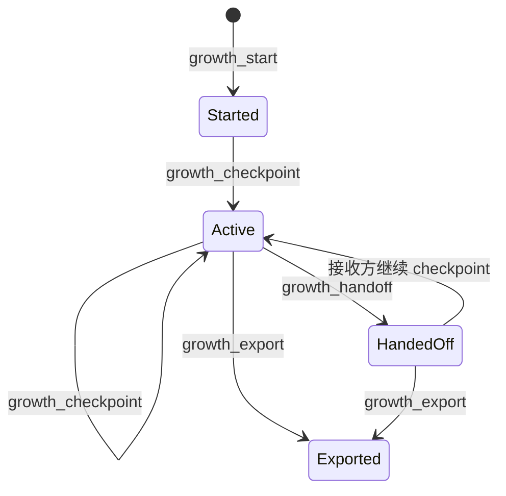
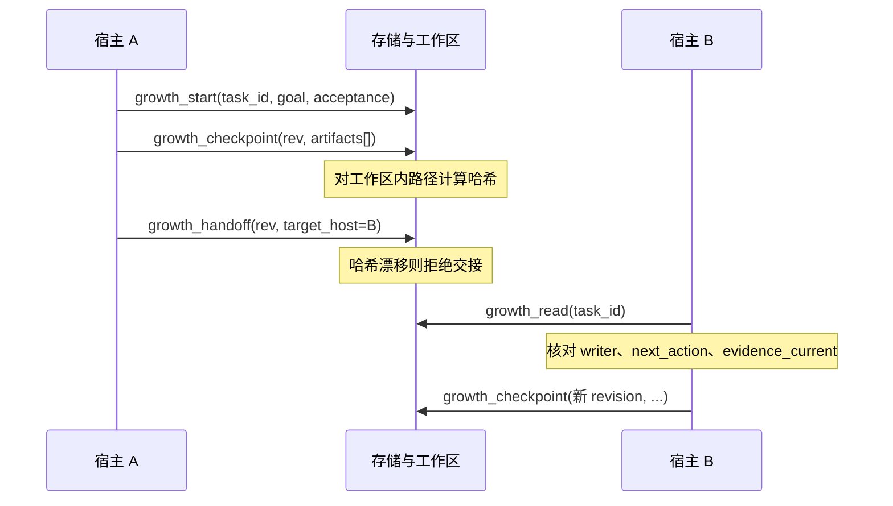

# Personal Agent Growth

[English](README.md) · [中文](README.zh-CN.md) · **v0.4.0**

[](https://github.com/KarmenLoop/personal-agent-growth/actions/workflows/check.yml)
[](https://github.com/KarmenLoop/personal-agent-growth/releases/latest)
[](https://www.python.org/downloads/)
[](LICENSE)
[](docs/tutorial.zh-CN.md)

**换宿主之后，下一步仍然站得住——靠证据，不靠聊天回放。**

长任务在本地智能体宿主之间切换时，常见做法是把对话摘要贴到下一会话。信息会漂：哪些文件真的核对过、谁有权改任务状态、所谓「完成」是否还对应磁盘上的字节、下一步到底是什么，全靠模型临场发挥。

Personal Agent Growth 把这件事做成**可安装的 Skill + Python 3.11+ MCP/CLI 适配器**：检查点写入**私有 SQLite**，对声明过的工作区产物做 **SHA-256**，在 **revision** 约束下移交 **writer（写入责任）**。接收方读到的是同一条记录；陈旧写入者或已变产物会被拒绝，而不是静默覆盖。

由 [KarmenLoop](https://github.com/KarmenLoop) / [KARMENLOOP](https://karmenloop.com) 维护。当前版本 **[v0.4.0](https://github.com/KarmenLoop/personal-agent-growth/releases/tag/v0.4.0)**，许可证 **AGPL-3.0-only**。



[下载 v0.4.0](https://github.com/KarmenLoop/personal-agent-growth/releases/tag/v0.4.0) · [中文教程](docs/tutorial.zh-CN.md) · [English tutorial](docs/tutorial.en.md)

---

## 要解决的问题

宿主擅长执行，不擅长「跨会话拥有」连续性。仅靠粘贴摘要，你会丢掉：

- 产物与结论的对应关系；
- 明确的写入责任方；
- 磁盘内容漂移后的可发现失败；
- 可执行的下一步，而不是一段散文。

本项目把连续性当成**系统约束**：结构化检查点、可复核哈希、独占 writer、本地双方认可的同一数据根。它**不是**自主代理框架——不会注册定时唤醒、不会代你联系人或执行 `next_action`。那些仍归宿主与用户授权。它提供的是换手时仍然可信的状态落点，面向 **Codex** 以及本机其他能跑 **MCP stdio** 的宿主。

---

## 一览

| | |
|---|---|
| **安装内容** | Skill（`SKILL.md` 与 references）+ `scripts/host.py` 适配器 |
| **运行时** | Python **3.11+**（适配器路径以标准库为主） |
| **持久化** | 私有 `--root` → `host.sqlite`（目录与库文件权限收紧） |
| **传输** | MCP stdio，以及 CLI（`call` / `install` / `mcp`） |
| **宿主** | 提供 Codex 安装辅助；其他 MCP 宿主可启动同一进程 |
| **工具** | `growth_start` / `growth_checkpoint` / `growth_handoff` / `growth_read` / `growth_export` |
| **并发** | 单 writer + `expected_revision`（乐观并发，陈旧即拒） |
| **证据** | 工作区相对路径、大小上限、SHA-256；读取与交接时复核 |
| **许可** | AGPL-3.0-only |

---

## 架构

三层刻意拆开，避免「方法论」和「存储事务」缠在一起：

1. **方法层（Skill）** — `SKILL.md` 与 `references/` 约定如何立项与恢复、如何区分观察与解释、如何在证据变化时改判、何时打扰用户。这是纪律，不是常驻进程。
2. **适配层（可执行）** — `scripts/host.py`、`scripts/host_support.py` 暴露五个工具，校验入参，对 SQLite 做事务更新；CLI 与 MCP 共用实现。
3. **私有状态** — 每台机器（或每个隔离边界）一个数据根：任务对象、观察、交接历史、事件流。工作区文件仍在项目树；库里只存元数据与哈希。





### 并发与写入生命周期

同一时刻只有一个 `--host-id` 是 `writer`。变更类工具要求：

- 调用进程的 `--host-id` 等于当前 `writer`；
- 请求里的 `expected_revision` 等于库中的 `state_revision`。

任一不满足即拒绝（如 `NOT_CURRENT_WRITER`、`STALE_REVISION`）。交接后原宿主仍可 `growth_read`，但不能再 checkpoint，除非责任再次转回。





`growth_handoff` 会先复核证据。文件缺失、越出工作区、或 SHA-256 不一致时返回错误（例如 `EVIDENCE_CHANGED`），不会假装交接成功。

### 检查点里有什么

任务对象大致包括：

- 意图：`task_id`、`goal`、`acceptance`、`goal_revision`
- 控制：`state_revision`、`writer`、`phase`、`next_action`
- 证据：`artifacts[]`（相对路径、`bytes`、`sha256`）
- 历史：`observations[]`、`handoffs[]`
- 调度占位：`schedule.status = "not_registered"`（有意为之，避免误称已登记唤醒）

适配器**不会**替你造文件。磁盘上没有落地，就没有可诚实哈希的证据。

---

## 和「只贴聊天记录」比

| 维度 | 仅聊天摘要 | Personal Agent Growth |
|---|---|---|
| 真源 | 线程里的散文 | 私有 SQLite 中的结构化记录 |
| 文件主张 | 易被模型编造 | 对真实路径做 SHA-256 |
| 谁可改写 | 谁有会话谁就能说 | 明确的 `writer` |
| 并发冲突 | 后贴覆盖先贴 | 陈旧 revision 直接拒绝 |
| 崩溃后恢复 | 重读长文 | `growth_read` + `evidence_current` |
| 发行包核对 | 临时脚本 | `verify_handoff.py` + manifest |
| 跨设备同步 | 再贴一次？ | **不在范围**——同机 / 同一数据根 |

---

## 能力说明

### 五个工具

| 工具 | 作用 |
|---|---|
| `growth_start` | 创建由当前宿主拥有的任务；id 已存在则失败（`TASK_EXISTS`） |
| `growth_checkpoint` | 更新阶段与观察、哈希产物列表、递增 `state_revision` |
| `growth_handoff` | 复核证据后移交 `writer`，追加交接记录并递增版本 |
| `growth_read` | 返回任务及最新证据审计（`evidence_current` / `evidence_issues`），只读 |
| `growth_export` | 在数据根写出私有 JSON，便于归档或离线查看 |

### 适配器侧

- **MCP stdio**：工具 schema、入参校验、带 `code` 的结构化错误。
- **CLI**：`install` / `call` / `mcp` 与 MCP 同路径，便于无模型排障。
- **Codex 安装辅助**：`--install-host codex install` 向 `.codex/config.toml` 合并 MCP 项，已存在则不覆盖。
- **通用 MCP 宿主**：stdio 配置指向 `python …/scripts/host.py --root … --workspace … --host-id <id> mcp`；每个宿主使用不同 `--host-id`。
- **存储**：数据根权限收紧；SQLite WAL + `BEGIN IMMEDIATE`；配置与导出原子写入。
- **工作区沙箱**：产物路径必须落在 `--workspace` 下。
- **体积限制**：单文件证据上限（适配器内 8 MiB）；过大 MCP/CLI 载荷拒绝。
- **离线校验**：`scripts/verify_handoff.py --archive … --manifest …` 只证明包与清单一致，**不等于**现场宿主集成已通过。

### Skill 层（同属产品）

Markdown Skill 负责告诉智能体如何：

- 从真实任务记录启动或恢复；
- 把验证结果绑到具体文件身份；
- 在证据变化时小范围改方法；
- 遵守联系偏好，避免表演式「主动」；
- 对调度保持诚实——未登记就写 `not_registered`。

详见 `references/` 下任务记录、共享记忆、学习与联系、自主接续等文档。

---

## 快速开始

**前提：** Python 3.11+、可写的私有数据目录，以及各宿主能看到**同一批**工作区文件。

```sh
# 1）为 Codex 写入 MCP（随后重载并批准）
python /path/to/scripts/host.py \
  --root /private/task-state \
  --workspace /path/to/project \
  --install-host codex install
```

第二个支持 MCP 的宿主，用另一 `--host-id` 启动同一脚本即可：

```text
command: python
args:
  - /path/to/scripts/host.py
  - --root
  - /private/task-state
  - --workspace
  - /path/to/project
  - --host-id
  - host-b
  - mcp
```

**推荐路径**

1. 宿主 A：`growth_start`（`task_id` / `goal` / `acceptance`）。
2. 完成真实工作后：`growth_checkpoint`（当前 `expected_revision`、阶段、观察、下一步、工作区内产物路径）。
3. `growth_handoff`，`target_host` 设为宿主 B 的 id（如 `host-b`）。
4. 宿主 B：`growth_read`，确认 `writer`、`next_action`、`evidence_current`。
5. 继续工作并再次 checkpoint；需要时 `growth_export`。

**不经模型的检查**

```sh
python /path/to/scripts/host.py \
  --root /private/task-state \
  --workspace /path/to/project \
  --host-id host-b \
  call growth_read --input request.json
```

`request.json`：

```json
{ "task_id": "your-task-id" }
```

进程重启不会清空库。遇到陈旧版本先读再写。不要用删除 `host.sqlite`「解决」冲突。备份前停止写入，再复制私有目录。

完整说明：[docs/tutorial.zh-CN.md](docs/tutorial.zh-CN.md)。

> **文档债：** `docs/install.md` / `docs/install.zh-CN.md` 仍钉着 **v0.3.3** 下载校验。在安装指南升版前，请优先用 [v0.4.0 发行资产](https://github.com/KarmenLoop/personal-agent-growth/releases/tag/v0.4.0) 与 v0.4.0 教程。

---

## 文档导航

| 文档 | 适用场景 |
|---|---|
| [中文教程](docs/tutorial.zh-CN.md) · [EN](docs/tutorial.en.md) | 适配器安装与五工具闭环 |
| [中文安装](docs/install.zh-CN.md) · [EN](docs/install.md) | macOS/Windows 技能布局（注意 0.3.3 钉版） |
| [共享记忆](references/shared-memory.md) | writer 规则、版本纪律、恢复 |
| [任务记录](references/task-record.md) | 记录应覆盖的字段与证据 |
| [学习与联系](references/learning-and-contact.md) | 方法变更与打扰用户的边界 |
| [自主接续](references/autonomous-continuation.md) | 调度相关——以及不该宣称什么 |
| [验证范围](docs/validation.md) | 证据边界与已知缺口 |
| [许可说明](docs/licensing.md) | AGPL 义务 |
| [TEAM.md](TEAM.md) | 维护者信息 |

---

## 验证说明（如实写）

- **CI**（`check.yml`）：在 Ubuntu 24.04、macOS Intel、Windows Server 镜像上跑单测、打发行包并做归档校验。
- **Codex 现场路径：** 维护者环境中，真实 Codex 回合已成功读取过保存的交接（见 v0.4.0 说明）。
- **未宣称：** 覆盖所有 MCP 宿主的模型回合、每一类 UI 的原生行为，或任何跨设备库同步。
- 同机共享 root ≠ 多设备连续；字节不一致时，哈希会暴露问题。

详见 [docs/validation.md](docs/validation.md) 与 [v0.4.0 发行说明](https://github.com/KarmenLoop/personal-agent-growth/releases/tag/v0.4.0)。

---

## 常见问题

### 一句话：这是什么？

AGPL 许可的 Skill + Python MCP/CLI 适配器：用私有 SQLite 持久化本机任务检查点，并在支持 MCP 的宿主之间用 SHA-256 证据与独占 writer 做交接。

### 适合谁？

已经在同一台机器上的多个本地编程智能体之间倒手、却总在边界丢失「文件级真相」的人——尤其是使用 Codex、同时还有其他 MCP 宿主对着同一工作区的用户。

### 算自主代理吗？

不算。不注册定时器、不联系人、不执行 `next_action`、不跨设备同步。未另行登记唤醒时，`schedule.status` 保持 `not_registered`。

### 交接如何保持诚实？

Checkpoint 哈希真实文件；handoff 再核一次；read 返回 `evidence_current` / `evidence_issues`。只有证据仍一致、且调用方是持有正确 revision 的当前 writer，才会移交所有权。

### 两个宿主同时写？

非 writer 或陈旧 revision 会失败。先读、对齐，再写。用覆盖 SQLite 文件「清冲突」不受支持。

### 非 Codex 宿主能用吗？

能。Codex 有现成安装辅助；其他 MCP stdio 宿主用自有 `--host-id` 启动同一 `scripts/host.py … mcp`。磁盘上有配置 ≠ 验收通过——需重载、批准，并确认五个工具可见。

### Skill 必须装 Python 吗？

只读 `SKILL.md` 不必。跑适配器、MCP 工具与发行包校验需要 Python 3.11+。

### 如何核对发行 ZIP？

```sh
python scripts/verify_handoff.py \
  --archive personal-agent-growth-0.4.0.zip \
  --manifest manifest.json
```

退出码 `0` 只表示该检查器认定归档与清单一致，不是现场宿主集成证明。

### 任务数据放哪？

放在 skill 检出与公开仓库之外，使用独立 `--root`。备份时先停写，再复制整个私有目录。

### 许可证？

**AGPL-3.0-only**。见 [LICENSE](LICENSE) 与 [docs/licensing.md](docs/licensing.md)。允许在 AGPL 条款下商用；受覆盖的再分发与经修改的网络交互版本附带源码义务。

---

## 许可与联系

[AGPL-3.0](LICENSE) · [karmenloop.com](https://karmenloop.com) · [GitHub @KarmenLoop](https://github.com/KarmenLoop) · [info@karmenloop.com](mailto:info@karmenloop.com)

KARMENLOOP Official Team · 上海

<!-- Copyright (C) 2026 KARMENLOOP Official Team
SPDX-License-Identifier: AGPL-3.0-only -->
