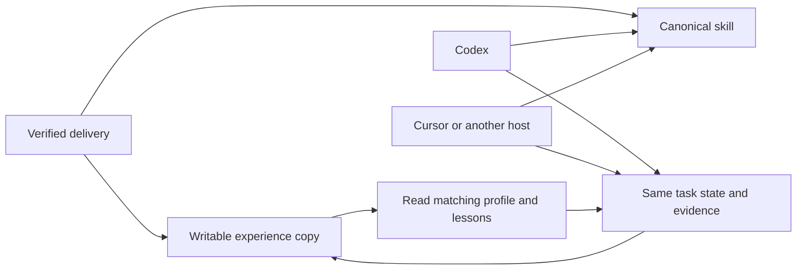

# Offline delivery: Personal Agent Growth 0.4.2

[中文说明](开始使用.md) · Bundle **0.4.2-bundle.1** · Complete bilingual distribution

This bundle includes the installable skill, reviewed experience excerpts, portable execution profiles, editable source, tests, team and license information, and illustrated acceptance reports. It works without downloading dependencies after extraction if Python 3.11 or later is already installed. Actual model work still uses the host's account and tools. This bundle does not register a scheduler or connect another device.

The [installation guide](docs/install.md) covers the 0.4.2 core package; this page installs the complete offline distribution. Do not overwrite an existing skill or experience library. See the [architecture](docs/architecture.en.md), [Markdown learning contract](docs/markdown-learning.en.md), and [detailed maps](docs/mindmaps.en.md).

## Contents and evidence

| Location | Purpose |
|---|---|
| `downloads/personal-agent-growth-0.4.2.zip` and `manifest.json` | Current 61-file bilingual coordinator package with learning templates |
| `examples/experience-seed` | Two indexed profiles, two historical lesson cards, two review excerpts, and export provenance |
| `SKILL.md`, `references`, `scripts` | Editable coordinator source and standard-library tools |
| `tools`, `tests` | Delivery builder, checks, installer, experience reader, and utility tests |
| `docs` | Installation guides, real trial results, plots, and measured evidence summaries |
| `TEAM.md`, `LICENSE`, `NOTICE` | KARMENLOOP Official Team and AGPL-3.0-only distribution terms |
| `DELIVERY-MANIFEST.json` | Exact file inventory for this delivery |

The [complete-task trial](docs/cross-domain-trial.md) covers 24 actual Codex CLI sessions. All required task outputs passed. Across six composed tasks, tokens decreased 5.9% and elapsed time increased 7.4%. The experiment does not demonstrate a universal speedup. See the [plots](docs/images/cross-domain-0.4.1.png) and [workflow diagrams](docs/visual-guide.md).

The portable seed starts at **revision 1**, independently of the private source library's revision 4. Its old archive profile is byte-identical to the tested profile. The cross-domain profile is a **derived version**: only its memory-location configuration and context loader change, to resolve memory relative to the profile and read UTF-8 explicitly. Original and exported hashes and changed filenames are in [export provenance](examples/experience-seed/export-provenance.json). Its prior performance figures belong to the original profile. This export has local file/tool migration checks, not a new Agent behavior trial. Historical raw traces, private task state, user profiles, credentials, and machine paths are not included.

## 1. Verify the extracted bundle

Use your SHA-256 tool to compare the outer ZIP with its accompanying `SHA256SUMS.txt`. After extracting it, open Terminal or PowerShell in the folder containing this file. The following commands use only Python's standard library:

```sh
python3 -B tools/check_delivery.py .
python3 -B scripts/verify_handoff.py --archive downloads/personal-agent-growth-0.4.2.zip --manifest downloads/manifest.json
```

On Windows, replace `python3 -B` with `py -3 -B -X utf8`. The first command should report `PASS`; the second should report `PASS`, exit 0, with 127 checks. The manifest detects missing or altered content; it is not a publisher signature. Keep the extracted distribution unchanged and store your work outside it.

## 2. Install into a new knowledge root

Python 3.11+ is required for this installer. No pip install, administrator access, or package-manager operation is needed. If the chosen root exists, the installer stops without overwriting it. Choose another root for an update. A failed partial installation is retained for inspection; do not rerun over it.

macOS, from the extracted distribution:

```sh
GrowthRoot="$HOME/Desktop/AgentKnowledge"
python3 -B tools/local_install.py install --root "$GrowthRoot"
```

Windows PowerShell, from the extracted distribution:

```powershell
$GrowthRoot = if (Test-Path -LiteralPath 'D:\') { 'D:\AgentKnowledge' } else { 'C:\AgentKnowledge' }
py -3 -B -X utf8 tools/local_install.py install --root $GrowthRoot
if ($LASTEXITCODE -ne 0) { throw 'Installation stopped; inspect the reported cause.' }
```

For a custom location, change `GrowthRoot`. If the drive root is not writable, choose a folder under your own user directory. The layout is:

```text
AgentKnowledge/
├── skills/personal-agent-growth/  # bilingual coordinator, 61 files
├── experience/                   # writable, independent copy of the seed
├── tasks/                        # private task records, initially empty
├── distribution/                 # complete source, docs, tools and original seed
└── installation.json             # owned skill-file identities
```

Choose a separate `learning/` root for current Markdown knowledge, using the [16 document types](templates/learning/README.md). The copied JSON seed remains historical experiment material; it is not a second user profile or an automatic Markdown migration.

The installer does not scan your home directory or create automatic discovery links. You can use the absolute skill path immediately. For automatic discovery on hosts that support `.agents/skills`, create one entry explicitly:

macOS:

```sh
GrowthRoot="$HOME/Desktop/AgentKnowledge"
SkillEntry="$HOME/.agents/skills/personal-agent-growth"
if [ -e "$SkillEntry" ] || [ -L "$SkillEntry" ]; then
  echo "Entry already exists; inspect it before switching versions."
else
  mkdir -p "$HOME/.agents/skills"
  ln -s "$GrowthRoot/skills/personal-agent-growth" "$SkillEntry"
fi
```

Windows PowerShell:

```powershell
$GrowthRoot = if (Test-Path -LiteralPath 'D:\') { 'D:\AgentKnowledge' } else { 'C:\AgentKnowledge' }
$Entry = Join-Path $env:USERPROFILE '.agents\skills\personal-agent-growth'
if (Test-Path -LiteralPath $Entry) { throw 'An entry exists. Inspect it before switching versions.' }
New-Item -ItemType Directory -Force -Path (Split-Path $Entry) | Out-Null
New-Item -ItemType Junction -Path $Entry -Target (Join-Path $GrowthRoot 'skills\personal-agent-growth')
```

Do not create duplicate copies under several discovery directories. A broken existing junction may fail the creation command; inspect it rather than forcing removal. If your host does not discover the entry, ask it to read the explicit absolute `SKILL.md` path. Discovery and actual Agent loading require separate observation.

## 3. Load experience for a matching task

From the extracted distribution, with your actual installed root substituted:

```sh
python3 -B tools/read_experience.py --library "$HOME/Desktop/AgentKnowledge/experience" --domain meta:cross-domain-evidence
```

Windows PowerShell:

```powershell
$GrowthRoot = if (Test-Path -LiteralPath 'D:\') { 'D:\AgentKnowledge' } else { 'C:\AgentKnowledge' }
py -3 -B -X utf8 tools/read_experience.py --library (Join-Path $GrowthRoot 'experience') --domain meta:cross-domain-evidence
```

The reader verifies the active snapshot and relevant card hashes, then returns the actual skill, strategy, lessons, observations and absolute resource paths. Use `offline-package-check` for archive-only work. Unrelated tasks use the coordinator skill and gather their own evidence. These profile keys do not mean that the system has mastered every domain.

Copy this prompt into Codex or Cursor after replacing the paths and task:

> Read `<ROOT>/skills/personal-agent-growth/SKILL.md`. Complete `<REAL TASK>`, keeping its records in `<ROOT>/tasks/<TASK-ID>`. Use `<ROOT>/experience` as the shared experience library. For a matching task, run `<ROOT>/distribution/tools/read_experience.py` with that library and the relevant domain key, and actually read its output. Resolve historical `strategy/` paths against the returned profile directory and inputs against this task directory. Check assumptions before applying a domain tool. Preserve predictions, failures, commands, outputs, full-task quality, time and native token evidence. Do not count this imported seed as a new trial. Keep model configuration fixed. Improve authorized prompts, tools and workflow components through bounded Propose–Probe–Compose when useful, using a new experiment and the selected profile as baseline. Do not recursively expand experiments in leaf workers. Complete solvable work yourself; ask only when my decision is needed.

The annual-data adapter is limited to the documented NASA GISTEMP schema, complete decades and unique contiguous years. Verify those assumptions; it is not a general scientific-table reader. A batch wrapper's exit 0 is distinct from the per-item inspection exits 0/1/2. Neither tool replaces an independent task-level quality check.

## 4. Share memory and resume

Give both tools the **same absolute task directory and experience directory**. The first agent saves the current goal, state revision, writer, predictions, findings, output identities and next useful action before handing off. The second reads those files, checks the actual artifacts and resumes from the pending action. Ask it to report the resolved paths and new revision. The seed has historical methods but no private task to recover.

Updating the experience library uses the single-writer revision checks in [the recursive-improvement reference](references/recursive-improvement.md). Imported cards have no local adoption to roll back. Later experiments can record and roll back their own newly validated adoption. Never overwrite the original imported snapshot in place.



For a move, stop the current writer, copy the whole knowledge root, and pass the new absolute paths to both tools. Recreate the discovery link at the new destination. Recheck profile hashes and task revisions before continuing; previously saved raw receipts can retain their original paths as historical evidence. Relocate current bindings explicitly. Cross-device sync, model credentials and scheduler authority are separate host responsibilities.

For a future review, use the host's real scheduling tool and the [wake-up reference](references/autonomous-continuation.md). Save and read back the scheduler ID, expiry, run budget and next action. Do not reuse another machine's binding. Installation itself creates no scheduled job.

## 5. Update, remove, and recover

To update, install into a fresh root, verify it, preserve your existing task and experience library, and point the host at that existing memory explicitly. Merge useful seed lessons only after checking their provenance and conflicts; do not replace a live index with a fresh seed. Switch the discovery entry only after removing the old link that you have identified.

To remove a macOS discovery link, first confirm `readlink "$HOME/.agents/skills/personal-agent-growth"` equals the canonical skill you installed, then remove **only that link** with `unlink "$HOME/.agents/skills/personal-agent-growth"`. For Windows, inspect `Get-Item -LiteralPath $Entry | Select-Object LinkType,Target`; if it is the intended junction, `[System.IO.Directory]::Delete($Entry)` removes the junction itself without recursively removing its target. Do not use a recursive delete on a path you have not identified.

Then, from the saved distribution, remove the unchanged canonical skill:

```sh
GrowthRoot="$HOME/Desktop/AgentKnowledge"
python3 -B "$GrowthRoot/distribution/tools/local_install.py" uninstall --root "$GrowthRoot"
```

Windows PowerShell:

```powershell
$GrowthRoot = if (Test-Path -LiteralPath 'D:\') { 'D:\AgentKnowledge' } else { 'C:\AgentKnowledge' }
py -3 -B -X utf8 (Join-Path $GrowthRoot 'distribution\tools\local_install.py') uninstall --root $GrowthRoot
if ($LASTEXITCODE -ne 0) { throw 'Removal stopped; inspect the reported cause.' }
```

Removal checks every owned skill file and stops if files changed or were added. It preserves `experience`, `tasks`, `distribution`, and the installation receipt. Back up and review deliberate skill edits before deciding what to remove. The user controls any later deletion of retained memory.

If a check fails, keep the output and diagnose its stage. A missing Python interpreter is not a failed package inspection. A hash mismatch requires a fresh trusted copy or an intentional new candidate. An existing install root requires a new root; it is not a reason to erase old memory. The [current acceptance report](docs/release-0.4.2-acceptance.en.md) records the actual platform and checks performed for this build. Windows desktop Agent continuation remains unverified while the original device is unavailable.

## Rebuild and license

```sh
python3 -B -m unittest discover -s tests -v
python3 -B tools/build_delivery.py --output /path/to/new-output-directory
```

The reviewed seed is included, so rebuilding does not require access to the original private library. `tools/export_experience.py` is a source-specific exporter for the two recorded domains; review its output before sharing other people's prose. The complete preferred source and the [license](LICENSE) are included. Team details are in [TEAM.md](TEAM.md).
