# Architecture explained · 0.6.1

[中文](architecture.zh-CN.md) · [Documentation index](index.en.md) · [Detailed maps](mindmaps.en.md)

## 1. Goal and completion criteria

The design has a testable purpose: **a user's work continues across turns and tools, new evidence can change a decision, and a validated improvement can influence later tasks.** Human-like collaboration means remembering context and commitments, asking useful questions, retaining failures, and changing methods when warranted. It does not imply consciousness or access to an undisclosed mental state.

A complete loop can be traced through the user's goal → constraints → memory actually read → gap and prediction → real action → artifact and counterexample → changed decision → method version → later reuse. When evidence is missing, the conclusion stops at that point. Independent completed work remains deliverable.

## 2. Six layers of responsibility

| Layer | Input | Responsibility | Output and check |
|---|---|---|---|
| User and goal | Current request, scope, explicit preferences | Identify the outcome, constraints, acceptance, and decision owner | Goal revision with a meaningful completion test |
| Reasoning and planning | Facts, relevant memory, available capabilities | Decompose causes, form hypotheses, identify decisive unknowns | Prediction, information value, and failure continuation |
| Execution and host | Authorized action, tools, account state | Use real tools, handle failures, preserve returns | Observable trajectory and artifacts |
| Learning and memory | Observations, discrepancies, corrections | Revise facts, prepare, review, remediate, score sourced tags | Markdown knowledge with provenance and invalidation rules |
| Experiment and version | Baseline, proposals, frozen task | Compare whole tasks, compose, regress, adopt, roll back | Auditable experiment with fixed evaluation criteria |
| Continuation and acceptance | Checkpoint, writer, future condition | Recover, hand off, register/change/stop a real backend | A new shared revision and actual trigger receipts |

Goals guide execution; real observations flow back into decisions. Memory informs judgment without overriding the current user. Experiments may change authorized surrounding components without changing their frozen acceptance criteria.

## 3. Capabilities and transition conditions

| Capability | Trigger and input | Required output | Failure continuation |
|---|---|---|---|
| Task parsing | New goal or changed scope | Subgoals, dependencies, completion criteria | Ask only for a choice that belongs to the user |
| Atomic decomposition | Broad concept or untestable step | Parts, inputs, outputs, causes, boundaries | Stop at a testable unit that can affect action |
| Capability inventory | A plan depends on tools | Callable interfaces, environment, permission | Find an existing usable route or record the gap |
| Memory recovery | New session, host, or interruption | Context, latest node, actual read set | Preserve conflicts and coordinate the writer |
| Skill matching | Task mechanism is understood | Candidate skill, fit, expected cost | Use a basic method and retain the missing capability |
| Preparation | Decisive gap in the next step | Question, source, applicability, prediction | Narrow the question if learning has no use yet |
| Rehearsal | Costly or failure-prone action | Isolated variation, expected outcome, stop rule | Change the plan; label rehearsal separately |
| Execution | Preconditions are met | Real call, input identity, output | Distinguish input, environment, method, permission |
| Quality check | An artifact exists | Criteria with raw supporting evidence | Repair quality before optimizing speed |
| Remediation | Discrepancy or repeated failure | Cause hypothesis, targeted learning, original-task retest | Retain alternative explanations until resolved |
| Review | Time interval or a new use case | Applied variation and limits | Downgrade an invalid lesson and revisit dependents |
| User understanding | Observable task-related signals | Timestamped, sourced behavior evidence | Do not attribute an agent's failure to the user |
| Tag scoring | Evidence, correction, or aging | Score, confidence, supporting/opposing sources | Neutral defaults for conflict; weak tags stay tentative |
| Proposal | New task with PPC enabled | Independent general and domain changes | Label uncertain gains as hypotheses |
| Probe | Experiment is frozen | Complete baseline and candidate trajectories | Preserve interruptions and unknown usage |
| Compose | Usable comparisons exist | Component choices and a full successor | Keep the best tested version until composition is tested |
| Skill creation | Repeated reusable capability gap | Trigger, I/O, procedure, tests | Keep one-off knowledge as experience |
| Skill adoption | Original, variation, regression checks pass | Version, hash, scope, rollback | Local evidence permits only local adoption |
| Meta-capability | Repeated mechanism across tasks | Generator/retrieval/routing strategy candidate | Require two-domain transfer and prior-capability regression |
| Daily close | Evidence or unfinished daily coverage | Daily report, project nodes, reflection | Missing coverage is unknown, not invented work |
| Weekly close | Week boundary is due | ISO-week patterns and strategy candidates | Insufficient support stays observational |
| Monday consolidation | Prior weekly report exists | Applied/still-weak findings and preparation | Give unfinished items a next verification point |
| Autonomous continuation | Concrete future use | Backend registration/trigger/change/stop receipts | Without a backend, retain an unregistered action |
| User contact | A decision only the user can make | Consolidated question, alternatives, consequences | No reply is not approval; continue independent work |

## 4. Commit a state transition

Read current state → check writer/revision and actual artifacts → save the prediction → execute → persist immutable receipts → update knowledge and next action → commit a new revision → read it back. This supports recovery when an action succeeded but the checkpoint did not. Writing completed before a tool finishes reverses that dependency.

If an external effect is unknown, inspect its actual state before retrying. Do not blindly repeat publishing, payments, or sends. Repeatable read-only checks and isolated experiments can rerun within budget; preserve each failed attempt.

## 5. Two recursive levels

The inner loop improves execution for one task. The outer loop improves proposal generation, retrieval, routing, and resource allocation over a portfolio. Both propose, probe, compose, and regress; execution leaves only perform the frozen task. A proposal generator cannot relax its own evaluation criteria.

Adoption checks required quality first, then the primary metric and per-task resource guards. Lower total tokens cannot conceal a domain's quality failure or establish lower billing. Keep optimization overhead, adopted execution, and later reuse costs separate; unknown money values remain null. See the [recursive protocol](../references/recursive-improvement.en.md).

## 6. Storage responsibilities and compatibility

| Area | Authoritative content | Current implementation | Relationship to Markdown |
|---|---|---|---|
| `learning/` | User/project knowledge, reports, experience conclusions | Open contract and 16 template types, written by the host | Sole source of learning semantics |
| Experiment directory | Frozen inputs, traces, raw returns, comparisons | JSON records and file hashes used by `compare_trials.py` | Raw evidence referenced from Markdown |
| Historical seed | Full execution snapshots and lesson cards | `examples/experience-seed`, JSON index | Explicit import provenance; never an implicit current profile |
| Optional handoff store | Writer, state_revision, artifact hashes | `host.py`, `host.sqlite`, JSON exports | Legacy transport mode; no automatic learning-state synchronization |
| Host binding | Login, permissions, schedule IDs, workspace | Actual host interfaces | Cannot migrate merely by copying knowledge files |

New learning tasks select Markdown mode in `policy.md` and read context plus the latest node first. Do not let the old adapter and Markdown become two writable authorities for the same project. If retained, the adapter owns explicitly identified legacy tasks. To migrate, freeze the old writer, export, verify artifacts, create a sourced Markdown checkpoint, read it back, and switch the entry point. Preserve the old store read-only. Automatic bidirectional migration is not provided.

Native Koder injection, transactional recovery, and due-work processing exist in a separate candidate. This repository publishes the contract, templates, and an evidence-scoped candidate report, not private Koder product source. Installing this skill does not add native `learning` commands to an existing Koder installation.

## 7. Read memory on demand

Context and the latest node answer where work stands; memory supplies constraints and decisions. Filter experience by source validity, scope, and task relevance before ranking and top-N selection. A summary must preserve mandatory constraints. If required content exceeds the budget, report the conflict or narrow the task instead of silently truncating it.

The default project packet targets 2–4k tokens with a 4k cap. Label character-based estimates as estimates. Load preview and weekly reports for planning, not every routine task. Record paths, revisions/hashes, and purposes in the read set so later checks can identify the memory actually used.

## 8. Make autonomy operational

Autonomy requires recoverable state, usable tools, a real wakeup, and stopping rules. A scheduled task needs a concrete action, owning host, expiry, run budget, and cancellation rule. Set intervals according to information arrival and review value; trial minute settings are not general defaults.

Learn immediately when useful work is already possible. Register spaced review with an actual backend, read it back, verify a later host event, execute and inspect results, then adjust or stop. Do not poll without new input or review value. The separate Koder candidate's in-process timer is not an app-closed wakeup.

## 9. Extension and rollout order

For a new host, establish reading, durable writes, artifact checks, and writer transfer first; then run an actual model turn; finally validate scheduling. For a new domain, define sources, observable quality, and independent reuse before proposing a specialized change. Expand only after local evidence and cross-task regression, retaining previous failures.

The Windows Koder CLI continuation has real model and memory receipts. Windows Cursor, an independently created standard account, the full Windows product suite, Markdown migration tooling, and further domain transfer still need separate acceptance. See the [compatibility matrix](compatibility.en.md) and the [Windows regression report](release-0.4.4-acceptance.en.md).

## Capability curriculum extension · 0.6.1

The existing coordinator gains a scoped capability evidence layer; it is not replaced by another framework. The flow connects a user goal to a task contract, prerequisite diagnosis, evidence-seeking preparation, a small real attempt, error classification, targeted remediation, a new variation, independent teaching, whole-task delivery, and later review. Practice runs throughout. A curriculum depends on task prerequisites rather than a universal school-grade label.

| Layer | Input and decision | Durable output | Implementation boundary |
|---|---|---|---|
| Task understanding | User goal, constraints, decisive unknowns | Project memory and predicted checks | Skill protocol; real host reasons and acts |
| Curriculum | Missing concepts, dependencies, available evidence | Bounded lesson and next exercise | Original protocol; no automatic course crawler |
| Source appraisal | Primary material, date, license, contradictory evidence | Research notes, candidate experience | Actual host browsing; external content is data |
| Execution | Authorized tools and reversible next action | Actual artifacts and native receipts | Host capability; no synthesized execution |
| Evidence state | Observation, reviewer, artifacts, revision | capability.md and immutable attempt MD | Public capability_ledger.py |
| Judgment | Options, criteria, uncertainty, action-changing evidence | Brief decision and revision reason | Model plus independent reviewer, not a numeric truth oracle |
| Teaching | Lesson and a new learner task | Separate teacher and learner artifacts | Real independent Agent or human; no self-certified learning |
| Review | Failures, changed sources, actual elapsed time | Due suggestion and project continuation | Public due calculation; real wakeup remains host-provided |
| Recursive improvement | Baseline/general/domain/composed runs | Existing PPC receipts and candidate experience | Existing comparator plus per-task reviewer; declarations alone are insufficient |

The six conceptual dimensions (explanation, causality, execution, transfer, teaching, judgment) map to eight operational observation kinds. Causality is tested by counterexamples; judgment is reviewed in predictions and decisions across kinds. This is a design mapping, not eight psychometric scores. Native Koder learning APIs remain separate; the new helper does not silently turn those private APIs into public functionality.

A changed or missing artifact blocks state reconstruction. A later failed/unknown source invalidates dependent transfer and recall. Corrections preserve the old event and use a new reviewed observation; old files are not overwritten to manufacture a clean history. The hash chain detects inconsistent prior entries when a successor binds them; it is not a digital signature or protection against someone rewriting the entire local store.

See the [executable tutorial](capability-learning.en.md), [mechanism research](learning-science.en.md), and [interoperability contracts](open-source-research.en.md).

## Adaptive learning extension · 0.6.1

An unfamiliar task enters through its goal, acceptance, consequential unknowns, available tools, and finite budget. The host Agent describes relationships and candidate mechanisms rather than selecting a fixed domain curriculum. `experience_transfer.py` retrieves comparable mechanisms and their applicability conditions; shared domain labels alone cannot make a lesson eligible. External ideas and analogies enter as hypotheses. Contradictory or missing conditions require a local check before use.

`adaptive_learning.py` persists the request, proposed actions, starts, and observations as Markdown under `learning-runs/`. The host chooses and actually performs an eligible action. A terminal observation clears the old plan; the next plan preserves unresolved questions and responds to what changed. An unknown effect retains the same pending action until reconciliation, including after the budget expires. No helper invokes a model or creates a background worker.

| Boundary | Persistent record | Owner of the substantive judgment |
|---|---|---|
| Task recovery | Same-root context, latest node, request and event revisions | Host checks actual files and pending effects before continuing |
| Candidate retrieval | `experience/mechanism/`, source artifacts, scoped use feedback | Host maps relationships, verifies conditions, and rejects weak analogies |
| Action choice | Current questions, estimates, preconditions and snapshot references | Host weighs the next useful investigation; heuristic score is not measured information gain |
| Observation | Start token, actual artifacts, finding, changed hypothesis and declared cost | Executor supplies receipts; reviewer assesses meaning and quality |
| Transfer | Separate feedback for each actual use of a lesson | Host distinguishes source validity from harmful use in a different context |
| Strategy improvement | Existing PPC trials and regressions | Full-task evidence determines adoption; this loop does not bypass PPC |

Learning semantics remain in Markdown. These paths extend the explicitly selected learning root and do not migrate the legacy JSON experiment library. Independent capability observations remain in the capability ledger. This separation allows a new host to resume actual work without equating a successful file operation, a lesson, and proven proficiency. See the [complete tutorial](adaptive-learning.en.md) and [execution map](diagrams/adaptive-learning.en.svg).
