# 整体架构剖析 · 0.4.2

[English](architecture.en.md) · [文档索引](index.zh-CN.md) · [复杂思维导图](mindmaps.zh-CN.md)

## 1. 设计目标与成功条件

系统服务于一个可检验的目标：**同一用户的工作能够跨回合、跨工具延续，遇到差异会改判，改进经验证后能影响后续任务。** “越来越像人”在这里具体表现为理解上下文、提出有价值的问题、保留承诺与失败、知道何时改变方法，不表示具备人的意识或能推断未提供的心理状态。

一次闭环须能沿着这条链回查：用户目标 → 当前约束 → 已读记忆 → 缺口与预测 → 真实行动 → 产物与反例 → 改判 → 方法版本 → 后续复用。链上任一步缺证据，结论就停在该步；已有无关成果仍可以交付。

## 2. 六层责任

| 层 | 输入 | 核心责任 | 输出与验收 |
|---|---|---|---|
| 用户与目标 | 当前命令、范围、明确偏好 | 识别实际结果、约束、成功条件及谁能决定 | 目标版本；能判断完成或未完成 |
| 认知与规划 | 事实、相关记忆、能力清单 | 拆解因果、列假设、找决定性未知、选择下一步 | 预测、信息价值、失败后继；与当前任务关联 |
| 执行与宿主 | 已授权动作、工具、账号状态 | 调用真实工具、处理失败、保存实际返回 | 轨迹与产物；不是计划文件 |
| 学习与记忆 | 观察、差异、用户纠正 | 事实修订、预习、复习、补课、证据标签 | Markdown 知识、来源和失效条件 |
| 实验与版本 | 基线、两份提案、冻结任务 | 对比完整任务，组合、回归、采用与回退 | 可复核实验；不改验收门槛 |
| 接续与验收 | 检查点、writer、未来条件 | 恢复、交接、安排/调整/停止真实后端 | 同一记忆的新修订与实际触发回执 |

控制信息从目标向下传递；事实从真实执行向上返回。记忆参与判断，但不能覆盖当前用户指令；实验可以改变已授权的外围组件，但不能改变本轮固定的验收依据。

## 3. 能力分解及交接条件

| 能力 | 触发与输入 | 必须留下的输出 | 失败时如何接续 |
|---|---|---|---|
| 任务解析 | 新目标或范围变化 | 子目标、依赖、成功条件 | 用户独有取舍才提问 |
| 原子拆解 | 概念过宽、步骤不可验证 | 部件、输入输出、因果与边界 | 拆到能验证且能改变行动即停 |
| 能力盘点 | 计划依赖工具 | 当前可调用接口、环境与权限 | 找已有可行入口或准确记录缺口 |
| 记忆恢复 | 新会话、换工具、中断 | context、最新节点、实际读取集 | 修订冲突先保留，再协调 writer |
| 技能匹配 | 已明确任务机制 | 候选 skill、适配理由、代价 | 无合适项时用基础方法并记录缺口 |
| 预习 | 下一步有决定性知识缺口 | 问题、来源、适用条件、预测 | 未学到可用知识则缩小问题 |
| 预演 | 动作成本较高或可失败 | 隔离变式、预计结果、停止条件 | 失败改变计划，不伪装正式运行 |
| 执行 | 前置条件齐备 | 实际调用、输入身份、输出 | 区分输入/环境/方法/权限层 |
| 质量检查 | 有产物 | 完成标准逐项结论与原始证据 | 质量不达标优先修质量 |
| 补课 | 实际差异或重复失败 | 原因假设、针对学习、原任务复测 | 原因未证实时保留多个解释 |
| 复习 | 间隔到期或新使用场景 | 变式应用与失效边界 | 失效则降级经验并修依赖决定 |
| 用户理解 | 可观察、任务相关信号 | 带时间来源的行为记录 | 不把 Agent 的错误归给用户 |
| 标签计算 | 新证据、纠正、时间衰减 | 分数、置信度、支持与反对来源 | 冲突中性默认，低置信不强规划 |
| 提案 | 启用 PPC 的新任务 | general/domain 两份独立改法 | 未知收益记假设，不编造短板 |
| Probe | 冻结完成 | 基线及两候选的完整任务轨迹 | 中断/缺用量如实保留 |
| Compose | 有可用比较 | 组件取舍与完整后继 | 组合未复验则仍用原已测版本 |
| 技能创建 | 缺口重复且可复用 | 有触发条件、输入输出和测试的候选 | 一次性知识先做经验，不泛建 skill |
| 技能发布 | 原任务、变式、回归通过 | 版本、哈希、采用范围、回滚点 | 局部验证只局部启用 |
| 元能力 | 多任务出现同机制短板 | 生成/检索/路由策略候选 | 至少两领域迁移及旧能力回归 |
| 日结 | 当日有证据或待补记录 | 日报、活动项目节点、反思 | 缺覆盖写未知，不编造工作 |
| 周结 | 已到周边界 | ISO 周汇总、模式与默认策略候选 | 来源不足则保持观察 |
| 周一巩固 | 上周报告存在 | 已落地/仍弱/本周预习 | 未完成项有下一验证点 |
| 自主接续 | 明确未来用途 | 后端登记/触发/改频/停止回执 | 无后端只保存未登记动作 |
| 用户联系 | 必须由用户决定的分支 | 合并问题、选项、影响 | 未回复不等于同意；继续独立部分 |

## 4. 一次状态变化如何完成

读取最新状态 → 核对 writer/修订与真实产物 → 保存预测 → 执行动作 → 先保存不可变回执 → 更新知识与下一动作 → 提交新修订 → 回读。这样“工具执行成功但状态未保存”可从回执恢复；相反地，不能先写 completed 再等待实际工具。

外部效果未知时先查真实状态，不能无条件重复发布、付款或发送。只读检查和可重复的隔离实验可以在预算内重跑，失败记录按尝试保留。

## 5. 两层递归，不无限展开

内层以一个用户任务为单位改进执行方法；外层以任务组合为单位改进生成方法、检索和资源分配。两层都遵循提案、实测、组合和回归，但执行叶子只完成已冻结任务。候选生成器不能替自己调整质量标准。

采用判断先看必要质量，再看预设主指标和逐任务资源约束。总 token 下降不能掩盖某领域质量失败，也不能自动推出费用下降。优化开销、部署后执行开销和后续复用成本分别计账，未知费用用 null。详见[递归协议](../references/recursive-improvement.md)。

## 6. 存储责任与兼容边界

| 区域 | 真相内容 | 当前实现 | 与 Markdown 的关系 |
|---|---|---|---|
| `learning/` | 用户/项目知识、日报周报、经验结论 | 开放协议与 16 类模板；宿主按协议读写 | 学习语义唯一真相源 |
| 实验目录 | 冻结输入、轨迹、原始返回、比较记录 | `compare_trials.py` 的 JSON/文件哈希 | 原始证明材料；Markdown 经验引用它 |
| 旧经验种子 | 历史完整外壳快照和卡片 | `examples/experience-seed`、JSON 索引 | 明确导入来源，不能自动当作当前画像 |
| 可选交接目录 | writer、state_revision、产物哈希 | `host.py` 的 `host.sqlite` 与 JSON 导出 | 仅旧交接运输模式；不自动同步学习状态 |
| 宿主绑定 | 登录、权限、调度 ID、工作目录 | 各宿主实际接口 | 不能靠复制知识文件迁移 |

新学习任务选择 `policy.md` 中的 Markdown 模式，先读 context 与最新 node。不要让旧交接库和 Markdown 同时成为同一项目进度的两个可写权威；旧适配器若保留，只保管明示的旧任务。迁移先冻结旧 writer、导出、核对产物，再写一个带来源的新 Markdown 检查点，回读后切换入口，原库保留只读。当前公开版没有自动双向迁移程序。

Koder 原生 Markdown 自动注入、事务恢复和到期处理在独立候选中实现。本仓库公开协议、模板和候选范围报告，不包含私有 Koder 产品源码；安装本 Skill 不会给现有 Koder 增加原生 `learning` 命令。

## 7. 为什么按需读取

context 与最新 node 回答“现在做到哪”；memory 提供约束与决定；经验按适用范围、来源有效性和任务关联检索。先过滤过期、冲突、失效或不适用条目，再排序、截取 top-N。摘要不能吞掉强约束；预算装不下必要项时显式失败或缩小任务，不静默截断。

默认项目包目标为 2–4k tokens，上限 4k。字节或字符估算必须标为估算。规划时才读取 preview/周报；普通任务不注入全部历史。读集记录路径、修订/哈希与使用目的，使下一次能核对到底用了哪份记忆。

## 8. 自主性怎样落实

自主性来自可恢复状态、可用工具、真实唤醒与停止条件。每个定时任务应有下次可执行动作、责任宿主、期限、轮次与取消规则。调度频率根据下一次信息出现时间和复习价值调整，不能复制演练中的分钟数作为通用默认。

当前能补的知识立即补。需要间隔复习时登记真实后端；登记后回读，实际事件到达后验证绑定，再执行与检查，最后调整或停止。既无新输入也无有效复习价值的任务不空转。独立 Koder 候选的进程内定时回调不等于关闭应用后的唤醒。

## 9. 扩展接口和演进顺序

新增宿主先实现读取、持久写入、产物检查与 writer 交还，再接入真实模型回合，最后验证调度。新增领域先定义来源、可观察质量和独立复用条件，继而设计领域提案。新机制先局部验证，保留历史失败，再通过跨任务回归扩大范围。

近期接续重点是 Windows 原生 Agent 回执、Koder 全量回归、Markdown 迁移工具、更多新领域迁移以及公开可复跑的宿主验收。它们是待办方向，不是这次发布已实现的能力。具体状态见[兼容性表](compatibility.zh-CN.md)。
