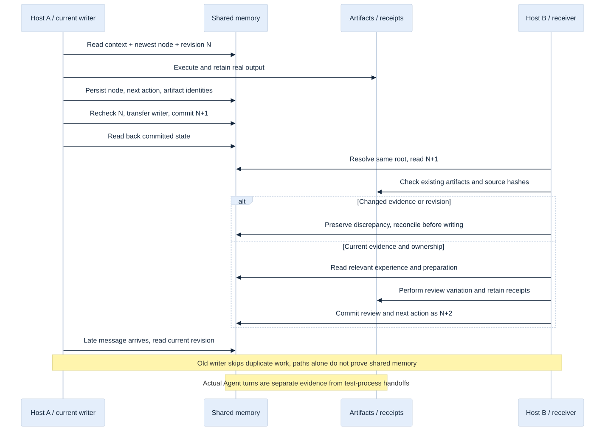

# Detailed mind maps and diagrams · 0.4.2

[English](mindmaps.en.md) · [中文](mindmaps.zh-CN.md)

Eight diagrams per language: four detailed mind maps, architecture, scheduling, handoff, and calendar flow. Each language uses the same branch topology. These diagrams describe responsibilities and contracts; they do not establish that every host implements them. Check [compatibility](compatibility.en.md) for evidence. Open SVG files to zoom; Mermaid sources are editable.

## Complete capability tree

137 nodes, including conditions, artifacts, and failure continuations.

[SVG](diagrams/system.en.svg) · [Mermaid](diagrams/system.en.mmd)



## Architecture and data flow

[SVG](diagrams/architecture.en.svg) · [Mermaid](diagrams/architecture.en.mmd)



## Causal judgment and revision

92 nodes, including conditions, artifacts, and failure continuations.

[SVG](diagrams/reasoning.en.svg) · [Mermaid](diagrams/reasoning.en.mmd)



## Memory and user evidence

92 nodes, including conditions, artifacts, and failure continuations.

[SVG](diagrams/memory.en.svg) · [Mermaid](diagrams/memory.en.mmd)



## Two recursive levels and cost

92 nodes, including conditions, artifacts, and failure continuations.

[SVG](diagrams/recursion.en.svg) · [Mermaid](diagrams/recursion.en.mmd)



## Real wakeup and stopping

[SVG](diagrams/continuation.en.svg) · [Mermaid](diagrams/continuation.en.mmd)



## Cross-tool recovery sequence

[SVG](diagrams/handoff.en.svg) · [Mermaid](diagrams/handoff.en.mmd)



## Daily/weekly learning and corrections

[SVG](diagrams/cadence.en.svg) · [Mermaid](diagrams/cadence.en.mmd)



## Reading order

Start with the capability tree, follow architecture arrows, inspect one decision path, then locate its memory writes and next trigger. For experiments, trace a proposal through frozen evidence and composition before inspecting outer-loop promotion. The [architecture analysis](architecture.en.md) and [worked reasoning example](reasoning.en.md) explain why these transitions exist.

## Regenerate the diagrams

`tools/render_diagrams.mjs` uses development-only Mermaid and Playwright packages, plus Chromium. The checked render used Mermaid 11.4.1. Pass absolute package directories; no dependency is added to the Python runtime:

```sh
node tools/render_diagrams.mjs --mermaid-dir /path/to/node_modules/mermaid --playwright /path/to/node_modules/playwright --browser /path/to/chromium
```

After editing a source, regenerate both languages, inspect the output, and update the corresponding hashes in `publication.json`. The renderer writes source/output hashes and dimensions to `docs/diagrams/render-manifest.json`; `scripts/check_publication.py` rejects drift. Font and browser versions can change layout, so retain the actual generated artifacts.
