# 复杂思维导图与流程图 · 0.6.1

[English](mindmaps.en.md) · [中文](mindmaps.zh-CN.md)

中英文各十三张：四张详细思维导图，以及架构、调度、交接、日周、Windows 跳过核查、Agent 接续、能力证据、未知领域自适应学习与基于证据的判断图。两种语言保持相同分支结构。图示说明责任与协议，不代表每个宿主都已实现；实际范围以[兼容性](compatibility.zh-CN.md)为准。SVG 可放大，Mermaid 源文件可编辑。

## 完整能力树

137 个节点，包含触发条件、产物和失败后继。

[SVG](diagrams/system.zh-CN.svg) · [Mermaid](diagrams/system.zh-CN.mmd)


## 架构与数据流

[SVG](diagrams/architecture.zh-CN.svg) · [Mermaid](diagrams/architecture.zh-CN.mmd)


## 因果判断与改判

92 个节点，包含触发条件、产物和失败后继。

[SVG](diagrams/reasoning.zh-CN.svg) · [Mermaid](diagrams/reasoning.zh-CN.mmd)


## 记忆体系与用户证据

92 个节点，包含触发条件、产物和失败后继。

[SVG](diagrams/memory.zh-CN.svg) · [Mermaid](diagrams/memory.zh-CN.mmd)


## 双层递归与完整成本

92 个节点，包含触发条件、产物和失败后继。

[SVG](diagrams/recursion.zh-CN.svg) · [Mermaid](diagrams/recursion.zh-CN.mmd)


## 真实唤醒与停止

[SVG](diagrams/continuation.zh-CN.svg) · [Mermaid](diagrams/continuation.zh-CN.mmd)


## 跨工具接续时序

[SVG](diagrams/handoff.zh-CN.svg) · [Mermaid](diagrams/handoff.zh-CN.mmd)

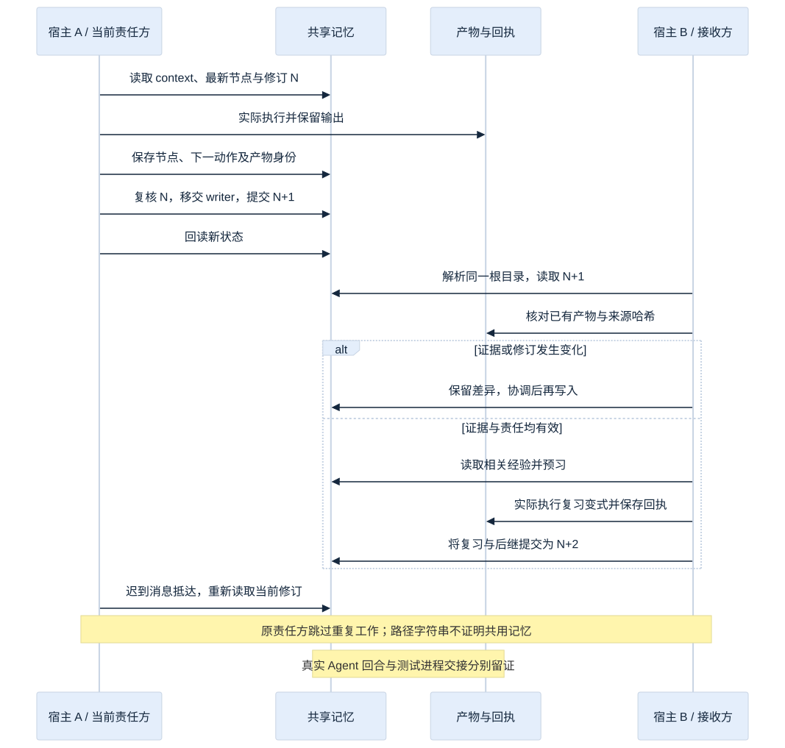

## 日周学习与纠正传播

[SVG](diagrams/cadence.zh-CN.svg) · [Mermaid](diagrams/cadence.zh-CN.mmd)


## 阅读顺序

先看完整能力树，再沿架构箭头进入一个判断分支，找到它写入的记忆与下一触发。实验从提案走到冻结证据、组合复验，再看外层推广。每条转换的原因见[架构剖析](architecture.zh-CN.md)与[完整判断案例](reasoning.zh-CN.md)。

## 重新生成图示

`tools/render_diagrams.mjs` 使用开发阶段的 Mermaid、Playwright 和 Chromium。本次实际渲染版本为 Mermaid 11.4.1。参数使用依赖包的绝对目录，不给 Python 运行时增加依赖：

```sh
node tools/render_diagrams.mjs --mermaid-dir /path/to/node_modules/mermaid --playwright /path/to/node_modules/playwright --browser /path/to/chromium
```

修改源文件后重新生成两种语言，检查输出，再更新 publication.json 的对应哈希。渲染器会把源文件/输出哈希和尺寸写入 docs/diagrams/render-manifest.json；scripts/check_publication.py 会拒绝内容漂移。字体和浏览器版本可能改变排版，应保留实际生成产物。

## Windows 跳过核查

[SVG](diagrams/windows-audit.zh-CN.svg) · [Mermaid](diagrams/windows-audit.zh-CN.mmd)


## Windows Agent 恢复

[SVG](diagrams/windows-agent.zh-CN.svg) · [Mermaid](diagrams/windows-agent.zh-CN.mmd)

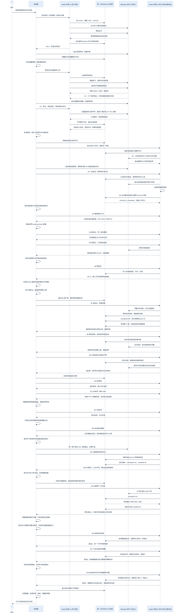

[接续实操教程](windows-agent-continuation.zh-CN.md)

## 学习、教学与真实实操

111 个节点连接诊断、预习、反例、独立教学、Markdown 证据、真实调度、PPC 与回退。

[SVG](diagrams/capability-learning.zh-CN.svg) · [可编辑 Mermaid](diagrams/capability-learning.zh-CN.mmd)


## 陌生领域的自适应学习

这张 56 节点、77 连线的图连接任务恢复、机制检索、类比检查、动作选择、宿主实际执行、范围明确的反馈与后续复用。回路标明新证据如何改变计划，以及经验快照变化后为何要重新读取。实际执行边界把登记启动与宿主行动分开；效果未知进入核实，不自动重试。

[SVG](diagrams/adaptive-learning.zh-CN.svg) · [可编辑 Mermaid](diagrams/adaptive-learning.zh-CN.mmd) · [可执行教程](adaptive-learning.zh-CN.md)


## 基于证据的判断

12 个节点、14 条边，区分用户取舍与技术主张，核查反证，并分别保留、修正、撤回或暂缓结论。[完整协议](../references/evidence-based-judgment.md)。

[SVG](diagrams/evidence-judgment.zh-CN.svg) · [Mermaid](diagrams/evidence-judgment.zh-CN.mmd)

