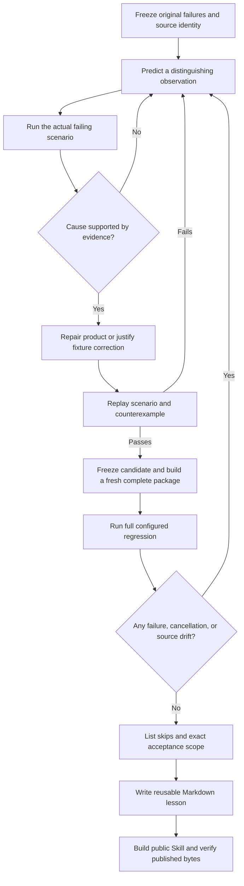

# Release acceptance · 0.4.2

[中文](release-0.4.2-acceptance.zh-CN.md) · [Compatibility](compatibility.en.md) · [All 45 historical nonpassing records and receipts](evidence/koder-regression-repair-20261027.json) · [Sanitized final TAP output](evidence/koder-regression-final.tap)

## Result and objects

The inherited Koder regression failures have been repaired in private candidate **`41f82c05a6d104edb295a7c8e80ca2f5c73b9e11`**. The final `npm test` completed with **1482 tests: 1461 passed, 0 failed, 0 cancelled, and 21 explicitly skipped**. Before/after inventories of 2624 tracked files were identical. The command took 337.70 seconds including a fresh complete package build, test execution, and owned-fixture cleanup.

Public **Personal Agent Growth 0.4.2** carries the reusable repair protocol, bilingual explanation, and sanitized evidence. Private Koder source remains in its controlled handoff under its original license. This public release does not replace an installed Koder binary or distribute the private implementation.

| Run | Tests | Pass | Fail | Cancel | Skip | Interpretation |
|---|---:|---:|---:|---:|---:|---|
| Historical Koder baseline | 1425 | 1358 | 31 | 15 | 21 | Retained original result |
| Historical Markdown candidate | 1454 | 1388 | 31 | 14 | 21 | Retained original result |
| Final repaired candidate | 1482 | 1461 | 0 | 0 | 21 | Fresh frozen-source full regression |

The new total is not a count of newly implemented features. Previously timed-out files now finish discovery and execution, some heavy files were split without removing cases, and two regression scenarios were added. The JSON reconciles every original nonpassing record with the current result. Named failures retain their exact scenario names except the documented preview-to-release installer title correction; file-level failures map to the completed successor files.

## What changed and why

| Mechanism | Repair and actual coverage |
|---|---|
| Terminal input | Give native readline an explicit terminal in the test runner; keep dumb-terminal tests. Paint editable prefills in the correct prompt/footer layout. Complete Escape decoding before the fixture sends the next key. |
| Setup selection | Select the exact completion row rather than the similarly named notification switch. Add bounded fixture diagnostics. |
| CLI workflow completion | Preserve coding artifact gates for review/test workflows; the explicit fix-loop check retains responsibility for its actual command, result, and retry budget. A prose-only generated-test claim is rejected. |
| Small context windows | Send public tool definitions to the provider, retaining local execution metadata in the harness. Omit schema annotations in small-window projections while preserving names and validation constraints. Bound both public wire and supplied-tool estimates; long-dialogue and MCP tests pass together. |
| Release URL | Derive the updater's tag from the candidate runtime version instead of the obsolete preview constant. |
| Package independence | Materialize required nested links. On the recorded Node version, select the recursive copy path that honors dereferencing. Tar and Windows fallback extraction compare every file byte and reject nonregular entries. |
| Test setup | Build one new complete archive per suite; use independent copies for modifications. Keep the 60-second file deadline, bound concurrency at two, separate heavy groups, and isolate package roots from temporary mutation roots. |
| Stale fixtures | Align intentional course/version/JSON/tool changes; use the existing kernel resolver and documented skill preparation path. Canonicalize owned macOS temp roots without relaxing memory-path protection. |

The retained English Koder course guide still describes its original 30 lessons; the runtime and Chinese full guide have 180. Assertions now describe those actual objects rather than claiming all three are the same. This is separate from the complete bilingual Personal Agent Growth documentation.

## Repairs that needed another iteration

The first complete repair run had four failures: two context-budget checks, a nested dependency link, and a missing fixture import. A subsequent budget correction restored two long-conversation failures; public provider projection then allowed both test families to pass. Another full run had zero assertion failures but one cancelled integrity file because a mutation copied a package root containing its own temporary target. Moving the read-only release root beside the temporary root fixed that recursion. These attempts remain in the machine-readable receipt; no retry replaced their files.

## Skips and claim boundaries

The 21 skips are **14 provider cases disabled by prior user decision, 3 optional service cases without their configured Core/Python, and 4 native Windows ACL cases on macOS**. The exact names and reasons are retained. They are not accepted behavior. Windows fallback extraction on macOS and Linux shell-selection fixtures do not establish physical Windows/Linux product acceptance.

No new paid model call, Windows Koder-to-Cursor Agent handoff, app-closed wakeup, or cross-domain efficiency experiment occurred in this repair. The source-level suite uses the existing controlled providers and fixtures where specified. The longer complete run includes different packaging work and concurrency; it is not a fair before/after performance benchmark.

## Public distribution verification

Local public checks passed: **48 Python tests, 61 core files / 127 manifest checks, 23 bilingual document pairs, 32 templates, 16 retained rendered diagrams, and real install → move → experience-read → uninstall with memory unchanged**. The first release test still expected 59 files; it now expects the intentional 61 and explicitly checks both new references. The developer Skill validator initially lacked PyYAML; its isolated development dependency was installed, then validation passed. Neither issue changed the private Koder result.

The public Python suite, core ZIP/manifest, bilingual links, templates, full bundle, and install/move/remove checks are recorded in [local release receipts](evidence/release-0.4.2-local.json). Hosted results are recorded in [CI receipts](evidence/release-0.4.2-ci.json) after the jobs complete. They cover the public utility distribution, separately from the private Koder Node suite.

The [0.4.2 release](https://github.com/KarmenLoop/personal-agent-growth/releases/tag/v0.4.2) includes both the core Skill and the complete bilingual offline bundle. `RELEASE-VERIFICATION.json` is kept outside the ZIP and binds the published commit, downloaded asset hashes, and actual post-upload installation checks. It avoids a self-referential archive checksum. Earlier [0.4.1 acceptance](release-0.4.1-acceptance.en.md) and failed runs remain dated and unchanged.
