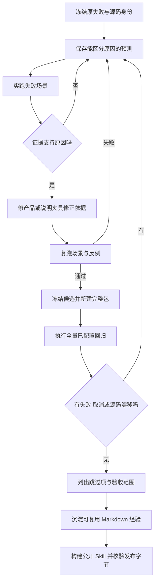

# 发布验收 · 0.4.2

[English](release-0.4.2-acceptance.en.md) · [兼容性](compatibility.zh-CN.md) · [原 45 条未通过记录逐项对账与回执](evidence/koder-regression-repair-20261027.json) · [最终 TAP 输出（路径已脱敏）](evidence/koder-regression-final.tap)

## 结果与对应对象

原有 Koder 回归失败已在私人候选 **`41f82c05a6d104edb295a7c8e80ca2f5c73b9e11`** 修复。最终 `npm test`：**1482 项，1461 通过，0 失败，0 取消，21 项明确跳过**。运行前后 2624 个已跟踪文件的哈希清单一致。整条命令实际耗时 337.70 秒，包含本轮新建完整包、执行测试及清理自有夹具。

公开 **Personal Agent Growth 0.4.2** 收录可复用修复协议、双语解释与脱敏证据。私人 Koder 源码继续以原协议保存在受控交接包中；本次公开发布不替换已安装 Koder，也不上传其私人实现。

| 运行 | 总数 | 通过 | 失败 | 取消 | 跳过 | 含义 |
|---|---:|---:|---:|---:|---:|---|
| 历史 Koder 基线 | 1425 | 1358 | 31 | 15 | 21 | 保留原记录 |
| 历史 Markdown 候选 | 1454 | 1388 | 31 | 14 | 21 | 保留原记录 |
| 本次修复候选 | 1482 | 1461 | 0 | 0 | 21 | 冻结源码后的全量回归 |

总数变化不能当作新增功能数：原先超时的文件现在完成发现和执行；耗时文件拆分但保留用例；另增加两项回归场景。JSON 对账全部原未通过记录。具名失败保留原场景名，安装通道测试仅将有记录的 preview 名称修正为 release；文件级失败对应已完整跑完的后继文件。

## 修复内容及依据

| 机制 | 修复与实际覆盖 |
|---|---|
| 终端输入 | 测试运行器为原生 readline 设置明确终端，保留 dumb-terminal 专项；预填草稿先参与输入框与页脚布局；夹具等待 Escape 解码后再发下一键。 |
| Setup 选择 | 精确选中完成行，避免点到名字相近的通知开关；增加有时限的诊断。 |
| CLI 工作流交付 | review/test 保留代码产物门，显式 fix-loop 继续负责真实检查命令、结果与重试额度；仅文字声称生成测试会被拒绝。 |
| 小窗口上下文 | 给提供方发送公开函数定义，真实执行元数据留在 Harness；小窗口投影省略 schema 注释，保留名称与验证约束；同时约束公开请求及提供工具的估算，长对话与 MCP 检查共同通过。 |
| 发布地址 | 更新器用实际运行版本推导 tag，不再固定到过期 preview。 |
| 安装包独立性 | 复制嵌套链接对应的真实依赖；当前 Node 环境采用能正确解引用的递归复制路径；tar 与 Windows 备用解压逐文件比对字节并拒绝非普通文件。 |
| 测试准备 | 每套件新建一份完整只读包，破坏性测试各自复制；保留 60 秒文件时限，并发限定为 2，拆分耗时分组，将发布根与临时修改根并列隔离。 |
| 旧夹具 | 对齐有意变更的课程、版本、JSON 事件与工具集合；使用原内核解析器及 Skill 准备步骤；规范化自有 Mac 临时目录，不放宽记忆目录保护。 |

Koder 英文课程文档仍保留原 30 课，运行时与中文完整教程为 180 课。断言现在描述真实对象，未伪称三者完全一致。这与本项目已完整提供的中英文 Personal Agent Growth 文档是不同对象。

## 继续修复过的断点

第一次完整修复回归还有四项失败：两项上下文预算检查、嵌套依赖链接、夹具漏引入路径。之后一次预算修改又触发两项长对话失败；改为提供方公开投影后，两组一起通过。再一次全量没有断言失败，但安装完整性文件仍取消，原因是测试复制的包根含自己的临时目标，形成递归复制。将只读发布根与临时根分离后解决。所有失败尝试都保留在机器回执里，未用重试覆盖。

## 跳过项与结论范围

21 项分别是：**14 项按用户既有决定停用的提供方用例、3 项未配置 Core/Python 的可选服务用例、4 项需原生 Windows 的 ACL 用例**。名称和原因完整保留，均未算作行为通过。Mac 上运行 Windows 备用解压器、Linux 安装分支夹具，不代表真实 Windows/Linux 产品验收。

本次未执行新的付费模型回合、Windows Koder→Cursor Agent 接续、关闭应用后唤醒或跨领域效率实验。源码套件在声明位置使用原有受控提供方与夹具。全量运行增加完整包工作且更改并发，耗时不能直接用于前后性能对比。

## 公开分发包核验

本地公开检查已通过：**48 项 Python 测试、61 个核心文件 / 127 项清单检查、23 组双语文档、32 份模板、保留的 16 张渲染图，以及实际安装→搬迁→读取经验→卸载后记忆不变**。首次发布测试仍要求旧 59 个文件，现明确要求新增双语引用后的 61 个，并逐一检查两份新引用。开发用 Skill 验证器最初缺 PyYAML，补入隔离开发依赖后通过；二者不改变私人 Koder 回归结果。

公开 Python 套件、核心 ZIP/manifest、双语链接、模板、完整包及安装/搬迁/卸载结果见[本地发布回执](evidence/release-0.4.2-local.json)。宿主 CI 结束后记录在 [CI 回执](evidence/release-0.4.2-ci.json)。这些检查针对公开工具分发包，与私人 Koder Node 套件分别记账。

[0.4.2 发布页](https://github.com/KarmenLoop/personal-agent-growth/releases/tag/v0.4.2)提供核心 Skill 与完整双语离线包。ZIP 外单独的 `RELEASE-VERIFICATION.json` 绑定公开提交、下载附件哈希与发布后真实安装，避免归档校验值自引用。[0.4.1 验收](release-0.4.1-acceptance.zh-CN.md)及旧失败按原日期保留。
