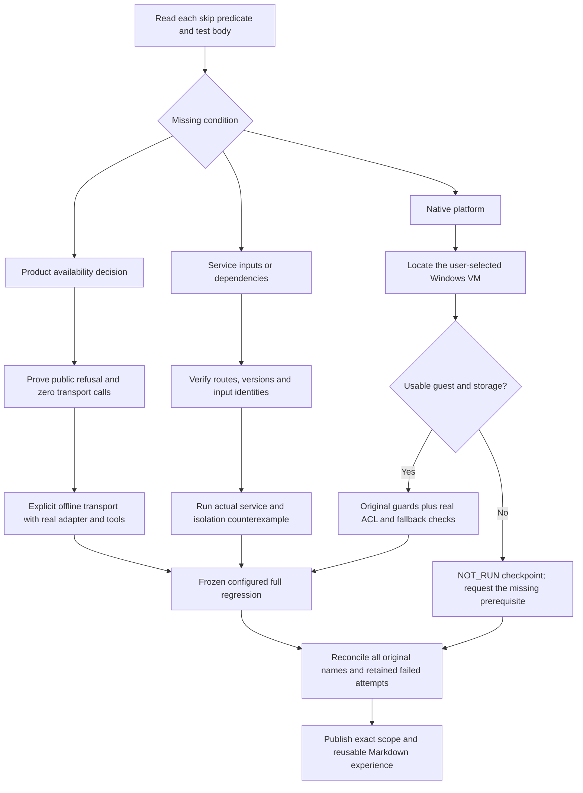

# Skipped-check audit and release acceptance · 0.4.3

[中文](release-0.4.3-acceptance.zh-CN.md) · [Per-case receipts](evidence/koder-skip-audit-20261027.json) · [Sanitized full TAP](evidence/koder-skip-audit-final.tap) · [Previous repair](release-0.4.2-acceptance.en.md)

## Result

This distribution is a **prerelease** while the four native Windows checks remain pending. Publishing the completed evidence does not close that acceptance gap.

All **21 original skips were inspected individually**. **17 now execute and pass**: 14 offline provider contracts and 3 integrations against the original compatible Core. **4 native Windows checks remain NOT_RUN**. This is a partial product-acceptance result; the remaining cases have not been converted into passes.

The frozen private candidate `c7ae14b44fb9f41bed6599af5132519de30e19f3` completed `npm test`: **1489 tests, 1485 pass, 0 fail, 0 cancelled, 4 platform skips**. The full command took **446.70 seconds**. Before/after identities matched for 2629 tracked source files, 542 Core source files, 54 mobile dependency files, and the isolated Python dependency inventory. These are source-level and integration checks, not a new autonomous desktop Agent trial.

| Object | Tests | Pass | Fail | Cancel | Skip |
|---|---:|---:|---:|---:|---:|
| Preserved 0.4.2 private regression | 1482 | 1461 | 0 | 0 | 21 |
| Configured private regression | 1489 | 1485 | 0 | 0 | 4 |

Seventeen top-level cases changed from skipped to executed. Enabling the host integration exposes seven nested cases, explaining the total increasing by seven. Installer scenarios were split into independently bounded files without removing or changing their assertions. The machine ledger maps all original names, including names clarified to say “offline adapter” or “explicit shared notes.”

## What had to change

**Provider policy and protocol coverage.** The 14 bodies already used local transport fixtures, but an unconditional skip hid them after the public provider was held unavailable. Removing the skip alone produced 14 expected policy refusals. A test-only fixture now first runs the public CLI, requires that refusal, and asserts zero transport calls. It then uses the existing in-process provider seam with the real normalized adapter, actual file tools, and the original wire/state assertions. Missing offline transport is an error. Public provider availability was not enabled; no paid API request or live-provider acceptance is claimed. The focused run, including the separate availability suite, passed 28/28.

**Compatible Core and dependencies.** Three tests required explicit Core and Python paths. The first run failed before service behavior because `argon2` was missing. Dependencies were installed into an owned directory, with the download report retained. The older memory-only Core started but lacked the host/personalization routes. The compatible original Core supplied those routes; its host tests and seven nested regressions passed. Tests now name both missing variables and link the exact setup guide.

**Shared memory without accidental context sharing.** Diagnostics showed that the original service synchronized the task fact. The old test nevertheless expected another project's model context to inherit that task history automatically. Current source, documentation, and independent entrypoint checks require conversation isolation and explicit reusable notes. The corrected test proves both: automatic task history stays out of the second project's context; real `memory add` and `memory sync` commands then make a deliberate note reusable. It retains independent CLI processes, actual ACK loss, the original mobile TypeScript/SQL contract, service restart, shared forget, and session revocation. The focused integration and isolation suite passed 26/26. No product scope filter was weakened, and no physical phone was tested.

**Complete regression after the focused checks.** The first frozen run recorded 1483 pass, zero assertion failures, two file-timeout cancellations, and four Windows skips. Five complete installation scenarios had accumulated in two 60-second files. They were moved into separate files, with test-body identity reconciled and all five passing. Fresh materialized package construction separately took 145 seconds on this host; its one-time setup now has a 180-second bound, while each test file retains its 60-second deadline and concurrency remains two. A subsequent full attempt exceeded that build-only bound before tests started. An instrumented diagnostic then completed in 102.54 seconds: validation/copy 51.22 seconds, kernel 7.94, compression 31.32, and cleanup 11.75. The exact cause of the earlier timing variation was not reproduced; its failed receipt remains. The final complete run uses the same bounded configuration and builds its own archive. This changes test scheduling and setup budgeting, not product acceptance criteria or a performance claim.

All unsuccessful attempts remain in the receipt, including missing dependencies, the incompatible Core, the stale context expectation, the timed-out full run, and a preparation command whose output parent directory was missing. The directory was created and a new command receipt recorded; no prior output was overwritten.

## Every original skip

Original TAP numbers refer to the retained 0.4.2 run. PASS describes the scope in the last column.

| ID | Original TAP | Original scenario | Result | Scope |
|---|---:|---|---|---|
| S01 | 189 | Kimi Responses: real CLI file-tool continuation retains private protocol state | PASS | Offline adapter + real CLI tools |
| S02 | 190 | Alibaba Token Plan openai: real CLI file-tool continuation retains private protocol state | PASS | Offline adapter + real CLI tools |
| S03 | 191 | Alibaba Token Plan responses: real CLI file-tool continuation retains private protocol state | PASS | Offline adapter + real CLI tools |
| S04 | 192 | Alibaba Token Plan anthropic: real CLI file-tool continuation retains private protocol state | PASS | Offline adapter + real CLI tools |
| S05 | 193 | Volcano Coding Plan openai: real CLI file-tool continuation retains private protocol state | PASS | Offline adapter + real CLI tools |
| S06 | 194 | Volcano Coding Plan responses: real CLI file-tool continuation retains private protocol state | PASS | Offline adapter + real CLI tools |
| S07 | 195 | Volcano Coding Plan anthropic: real CLI file-tool continuation retains private protocol state | PASS | Offline adapter + real CLI tools |
| S08 | 196 | Volcano API openai: real CLI file-tool continuation retains private protocol state | PASS | Offline adapter + real CLI tools |
| S09 | 197 | Volcano API responses: real CLI file-tool continuation retains private protocol state | PASS | Offline adapter + real CLI tools |
| S10 | 198 | Volcano API anthropic: real CLI file-tool continuation retains private protocol state | PASS | Offline adapter + real CLI tools |
| S11 | 447 | default CLI gateway obtains original Core lease; second host cannot subscribe and shutdown releases it | PASS | Compatible Core integration |
| S12 | 448 | host review regressions use configured Core, original SDK and the independently bundled CLI | PASS | Compatible Core integration |
| S13 | 748 | Kimi K3 official international endpoint receives its supported token field and reasoning control | PASS | Offline adapter + real CLI tools |
| S14 | 751 | Kimi China and international Chat Completions complete real file-tool continuations with nullable SSE fields | PASS | Offline adapter + real CLI tools |
| S15 | 752 | Kimi, DeepSeek and Kimi Code Messages routes retain thinking signatures through actual file-tool results | PASS | Offline adapter + real CLI tools |
| S16 | 753 | DeepSeek and Kimi Code Responses preserve opaque reasoning and actual file-tool call IDs | PASS | Offline adapter + real CLI tools |
| S17 | 1127 | formal service: separate CLI processes, actual ACK loss, mobile SQL contract, restart and shared forget | PASS | Compatible Core integration |
| S18 | 1409 | modified native ACL program is refused before execution | NOT_RUN | Native Windows required |
| S19 | 1410 | a redirected ACL program is refused before execution | NOT_RUN | Native Windows required |
| S20 | 1411 | an explicit native privacy refusal does not invoke another reader | NOT_RUN | Native Windows required |
| S21 | 1412 | a blocked native host uses the original reader within the same deadline | NOT_RUN | Native Windows required |

## Windows VM checkpoint

The original Windows device accepted a one-time remote terminal connection after its saved password was rejected. Node 24.22.1 was observed, but long-text transfer did not complete and no ACL test ran. The user then selected a **local VM on the current Mac**, so that is the active continuation path.

No VM application or indexed Windows VM disk was found on the Mac. It is arm64 with 32 GiB RAM and approximately 17 GiB available on the system disk. An existing UTM container could not be listed because macOS denied access; this does not establish an installed or usable VM. An existing VM location or suitable storage is required. Microsoft lists [64 GB or greater storage for Windows 11](https://learn.microsoft.com/en-us/windows/whats-new/windows-11-requirements). No user files, credentials, or machine-wide security settings were changed to obtain access.

A private audit packet contains exact hashes of the original ACL module, executable, four original guard tests, and a minimal equivalent fixture helper. It also includes three real native checks: protect an owned empty directory and independently read its ACL, refuse a nonempty public fixture without changing its ACL/content, and execute the original PowerShell fallback. `node run.mjs` refuses to claim success outside Windows, preserves timestamped raw output and input hashes, and requires zero skips. **The packet is prepared, not executed.** Its private source and executable are excluded from this public release.

The four original tests use child-process-result stubs for their guard assertions. Running them on Windows plus the three native checks is required to establish both guard behavior and actual ACL operations. Hosted public installer CI cannot substitute for this private native audit. VM acceptance will identify the guest OS, architecture, Node version, virtualization boundary, and actual returned files.

## Public Skill distribution

An additional archive-level check found six front-matter source references pointing to documents omitted from the compact Skill. Both experience documents now cite exact release-tag URLs, and all six references resolve to their bound sources. The [package-source receipt](evidence/release-0.4.3-package-links.json) preserves the initial rejection and corrected result. Published-byte verification also downloads these sources and compares their hashes.

The [public CI receipt](evidence/release-0.4.3-ci.json) binds its tested commit and records 50 utility tests on each of Linux x64, macOS Intel, and Windows x64. The [Windows installer receipt](evidence/release-0.4.3-windows.json) records PowerShell 5.1 and 7 installation, shared-file revisions, stale-writer refusal, and protected uninstall. All five jobs passed. Their complete raw installer artifacts are included separately with the release. These hosted runs do not execute the four private ACL cases.

Personal Agent Growth 0.4.3 adds the [skipped-check procedure](../references/regression-repair.en.md) and per-case evidence. The 61-file core package, bilingual manuals, 32 templates, and 16 existing rendered maps remain available. The private Koder candidate retains runtime version 0.4.14 and its original license; no production Koder installation was replaced.

The [local receipt](evidence/release-0.4.3-local.json) records 50 passing utility tests, 127 core-package checks over 61 files, installation under a Unicode/space path, relocation, two experience reads, and removal with memory hashes unchanged. The [diagram receipt](evidence/release-0.4.3-diagrams.json) records 11 parsed Mermaid blocks and fresh rendering of two retained maps. These establish public distribution behavior, independently of the four private native Windows checks. This release adds no new paid model turn, Windows Koder-to-Cursor Agent continuation, app-closed wakeup, or full-task efficiency experiment.
