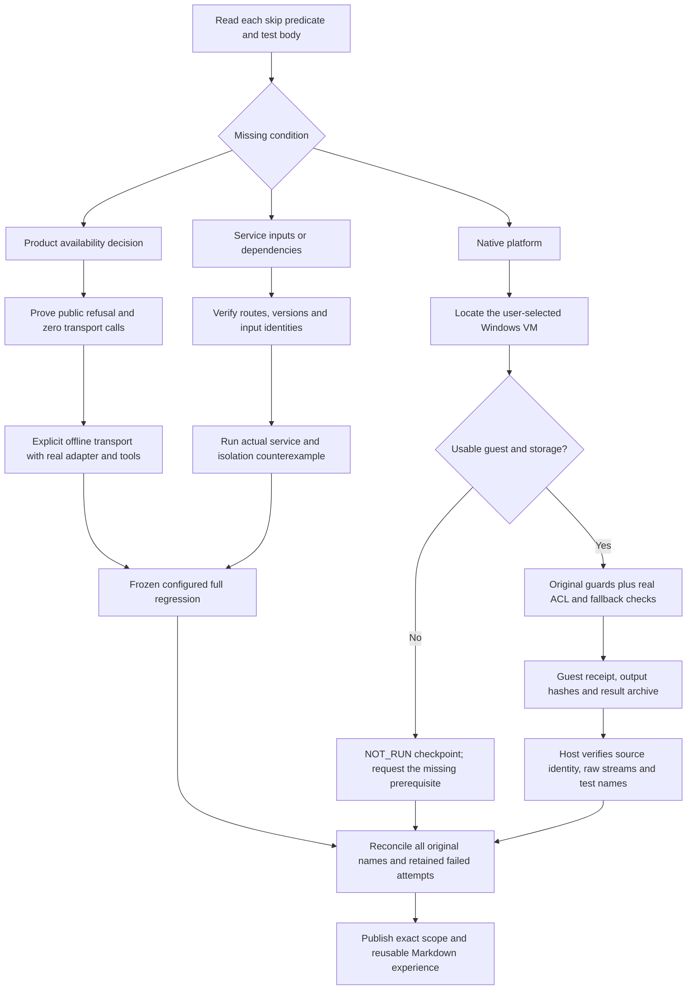

# Skipped-check audit and release acceptance · 0.4.3

[中文](release-0.4.3-acceptance.zh-CN.md) · [Per-case receipts](evidence/koder-skip-audit-20261027.json) · [Sanitized full TAP](evidence/koder-skip-audit-final.tap) · [Previous repair](release-0.4.2-acceptance.en.md)

## Result

All **21 original skips now have actual PASS results**: 14 offline provider contracts, 3 integrations against the original compatible Core, and 4 original guards executed in a real Windows VM. Three additional Windows checks execute real ACL operations and also pass. The public Skill is released as **0.4.3** with these bounded results.

The frozen private candidate `c7ae14b44fb9f41bed6599af5132519de30e19f3` completed `npm test`: **1489 tests, 1485 pass, 0 fail, 0 cancelled, 4 platform skips**. The full command took **446.70 seconds**. Before/after identities matched for 2629 tracked source files, 542 Core source files, 54 mobile dependency files, and the isolated Python dependency inventory. These are source-level and integration checks, not a new autonomous desktop Agent trial.

| Object | Tests | Pass | Fail | Cancel | Skip |
|---|---:|---:|---:|---:|---:|
| Preserved 0.4.2 private regression | 1482 | 1461 | 0 | 0 | 21 |
| Configured private macOS regression | 1489 | 1485 | 0 | 0 | 4 |
| Separate Windows original guards | 4 | 4 | 0 | 0 | 0 |
| Separate Windows real ACL operations | 3 | 3 | 0 | 0 | 0 |

Seventeen top-level cases changed from skipped to executed. Enabling the host integration exposes seven nested cases, explaining the total increasing by seven. Installer scenarios were split into independently bounded files without removing or changing their assertions. The machine ledger maps all original names, including names clarified to say “offline adapter” or “explicit shared notes.”

## What had to change

**Provider policy and protocol coverage.** The 14 bodies already used local transport fixtures, but an unconditional skip hid them after the public provider was held unavailable. Removing the skip alone produced 14 expected policy refusals. A test-only fixture now first runs the public CLI, requires that refusal, and asserts zero transport calls. It then uses the existing in-process provider seam with the real normalized adapter, actual file tools, and the original wire/state assertions. Missing offline transport is an error. Public provider availability was not enabled; no paid API request or live-provider acceptance is claimed. The focused run, including the separate availability suite, passed 28/28.

**Compatible Core and dependencies.** Three tests required explicit Core and Python paths. The first run failed before service behavior because `argon2` was missing. Dependencies were installed into an owned directory, with the download report retained. The older memory-only Core started but lacked the host/personalization routes. The compatible original Core supplied those routes; its host tests and seven nested regressions passed. Tests now name both missing variables and link the exact setup guide.

**Shared memory without accidental context sharing.** Diagnostics showed that the original service synchronized the task fact. The old test nevertheless expected another project's model context to inherit that task history automatically. Current source, documentation, and independent entrypoint checks require conversation isolation and explicit reusable notes. The corrected test proves both: automatic task history stays out of the second project's context; real `memory add` and `memory sync` commands then make a deliberate note reusable. It retains independent CLI processes, actual ACK loss, the original mobile TypeScript/SQL contract, service restart, shared forget, and session revocation. The focused integration and isolation suite passed 26/26. No product scope filter was weakened, and no physical phone was tested.

**Complete regression after the focused checks.** The first frozen run recorded 1483 pass, zero assertion failures, two file-timeout cancellations, and four Windows skips. Five complete installation scenarios had accumulated in two 60-second files. They were moved into separate files, with test-body identity reconciled and all five passing. Fresh materialized package construction separately took 145 seconds on this host; its one-time setup now has a 180-second bound, while each test file retains its 60-second deadline and concurrency remains two. A subsequent full attempt exceeded that build-only bound before tests started. An instrumented diagnostic then completed in 102.54 seconds: validation/copy 51.22 seconds, kernel 7.94, compression 31.32, and cleanup 11.75. The exact cause of the earlier timing variation was not reproduced; its failed receipt remains. The final complete run uses the same bounded configuration and builds its own archive. This changes test scheduling and setup budgeting, not product acceptance criteria or a performance claim.

All unsuccessful attempts remain in the receipt, including missing dependencies, the incompatible Core, the stale context expectation, the timed-out full run, and a preparation command whose output parent directory was missing. The directory was created and a new command receipt recorded; no prior output was overwritten.

## Every original skip

Original TAP numbers refer to the retained 0.4.2 run. PASS describes the scope in the last column.

| ID | Original TAP | Original scenario | Result | Scope |
|---|---:|---|---|---|
| S01 | 189 | Kimi Responses: real CLI file-tool continuation retains private protocol state | PASS | Offline adapter + real CLI tools |
| S02 | 190 | Alibaba Token Plan openai: real CLI file-tool continuation retains private protocol state | PASS | Offline adapter + real CLI tools |
| S03 | 191 | Alibaba Token Plan responses: real CLI file-tool continuation retains private protocol state | PASS | Offline adapter + real CLI tools |
| S04 | 192 | Alibaba Token Plan anthropic: real CLI file-tool continuation retains private protocol state | PASS | Offline adapter + real CLI tools |
| S05 | 193 | Volcano Coding Plan openai: real CLI file-tool continuation retains private protocol state | PASS | Offline adapter + real CLI tools |
| S06 | 194 | Volcano Coding Plan responses: real CLI file-tool continuation retains private protocol state | PASS | Offline adapter + real CLI tools |
| S07 | 195 | Volcano Coding Plan anthropic: real CLI file-tool continuation retains private protocol state | PASS | Offline adapter + real CLI tools |
| S08 | 196 | Volcano API openai: real CLI file-tool continuation retains private protocol state | PASS | Offline adapter + real CLI tools |
| S09 | 197 | Volcano API responses: real CLI file-tool continuation retains private protocol state | PASS | Offline adapter + real CLI tools |
| S10 | 198 | Volcano API anthropic: real CLI file-tool continuation retains private protocol state | PASS | Offline adapter + real CLI tools |
| S11 | 447 | default CLI gateway obtains original Core lease; second host cannot subscribe and shutdown releases it | PASS | Compatible Core integration |
| S12 | 448 | host review regressions use configured Core, original SDK and the independently bundled CLI | PASS | Compatible Core integration |
| S13 | 748 | Kimi K3 official international endpoint receives its supported token field and reasoning control | PASS | Offline adapter + real CLI tools |
| S14 | 751 | Kimi China and international Chat Completions complete real file-tool continuations with nullable SSE fields | PASS | Offline adapter + real CLI tools |
| S15 | 752 | Kimi, DeepSeek and Kimi Code Messages routes retain thinking signatures through actual file-tool results | PASS | Offline adapter + real CLI tools |
| S16 | 753 | DeepSeek and Kimi Code Responses preserve opaque reasoning and actual file-tool call IDs | PASS | Offline adapter + real CLI tools |
| S17 | 1127 | formal service: separate CLI processes, actual ACK loss, mobile SQL contract, restart and shared forget | PASS | Compatible Core integration |
| S18 | 1409 | modified native ACL program is refused before execution | PASS | Windows VM guard; privileged SYSTEM context |
| S19 | 1410 | a redirected ACL program is refused before execution | PASS | Windows VM guard; privileged SYSTEM context |
| S20 | 1411 | an explicit native privacy refusal does not invoke another reader | PASS | Windows VM guard; privileged SYSTEM context |
| S21 | 1412 | a blocked native host uses the original reader within the same deadline | PASS | Windows VM guard; privileged SYSTEM context |

## Actual Windows VM results

The user-selected local VM completed the remaining checks. Earlier discovery found only about 17 GiB free and no usable VM entry; later storage was available, and launching the verified UTM app revealed previously registered VM records. Those earlier observations were limited discovery results. This task created its own 80 GiB guest and left other VMs unchanged. The [earlier checkpoint](evidence/koder-skip-audit-before-windows-20261027.json) remains available.

The guest is **Windows 11 Pro ARM64, build 10.0.26300.9457**, on UTM 5.0.8 with 4 CPUs and 8 GiB RAM. Node 22.23.2 ARM64, the Microsoft ISO, and UTM downloads were checked against official hashes. The first invalid Node download was retained and rejected. The user accepted the displayed Windows and Guest Tools licenses and personally completed the new account credentials.

The official guest agent executed the frozen packet as **NT AUTHORITY\SYSTEM** after reboot. Readback found that vendor unattended installation had set UAC to zero; it was restored to one, and a new boot timestamp and final setting were verified before tests. Secure Boot read back true. The TPM API returned HRESULT `0x80284001`; TPM functionality is not accepted by this ACL audit. No credential was collected, and no security protection was weakened to run a test.

The [returned Windows receipt](evidence/windows-native-20261027.json) and raw [four-guard TAP](evidence/windows-original-four.stdout) / [three-effect TAP](evidence/windows-native-smoke.stdout) establish:

- All four original guard assertions passed, with no skip, in **0.466 seconds**. Their child-process result stubs remain explicit.
- Three real operations passed, with no skip, in **12.237 seconds**: the original helper protected an owned empty directory with independent ACL readback; it refused a nonempty public fixture without changing ACLs or content; and the original PowerShell fallback protected another owned empty directory.
- Original source/helper/test hashes matched before and after execution. The returned ZIP matched the guest-computed hash, and host verification matched every raw output hash and original test name.

The outer batch wrapper initially created an empty exit marker because `echo 0>...` treated the digit as a redirection handle. Its corrected form was checked with explicit exit-0 and exit-2 controls. Test acceptance comes from the preserved Node exit codes and raw TAP, not the empty marker. The first macOS extraction also preserved Windows ZIP backslashes literally; a second extraction validated and normalized member paths, then verified unchanged stream hashes. Both unsuccessful recovery steps remain recorded.

These are targeted checks in a real Windows VM under a privileged service token. They do not establish ordinary-user compatibility, the complete Windows product suite, or Windows Koder-to-Cursor Agent behavior. No private product source or executable is included in this public release.

[Rendered audit diagram](diagrams/windows-audit.en.svg) · [Editable source](diagrams/windows-audit.en.mmd)

## Public Skill distribution

An additional archive-level check found six front-matter source references pointing to documents omitted from the compact Skill. Both experience documents now cite exact release-tag URLs, and all six references resolve to their bound sources. The [package-source receipt](evidence/release-0.4.3-package-links.json) preserves the initial rejection and corrected result. Published-byte verification also downloads these sources and compares their hashes.

The [public CI receipt](evidence/release-0.4.3-ci.json) binds its tested commit and records 52 utility tests on each of Linux x64, macOS Intel, and Windows x64. The [Windows installer receipt](evidence/release-0.4.3-windows.json) records PowerShell 5.1 and 7 installation, shared-file revisions, stale-writer refusal, and protected uninstall. All five jobs passed. Their complete raw installer artifacts are included separately with the release. These hosted runs do not execute the four private ACL cases.

Personal Agent Growth 0.4.3 adds the [skipped-check procedure](../references/regression-repair.en.md) and per-case evidence. The 61-file core package, bilingual manuals, 32 templates, and the original 16 rendered maps remain available, with two new Windows audit diagrams. The private Koder candidate retains runtime version 0.4.14 and its original license; no production Koder installation was replaced.

The [local receipt](evidence/release-0.4.3-local.json) records 52 passing utility tests, 127 core-package checks over 61 files, installation under a Unicode/space path, relocation, two experience reads, and removal with memory hashes unchanged. The [diagram receipt](evidence/release-0.4.3-diagrams.json) records 11 parsed Mermaid blocks and fresh rendering of the two Windows audit diagrams. These establish public distribution behavior, separately from the completed private Windows checks. This release adds no new paid model turn, Windows Koder-to-Cursor Agent continuation, app-closed wakeup, or full-task efficiency experiment.
