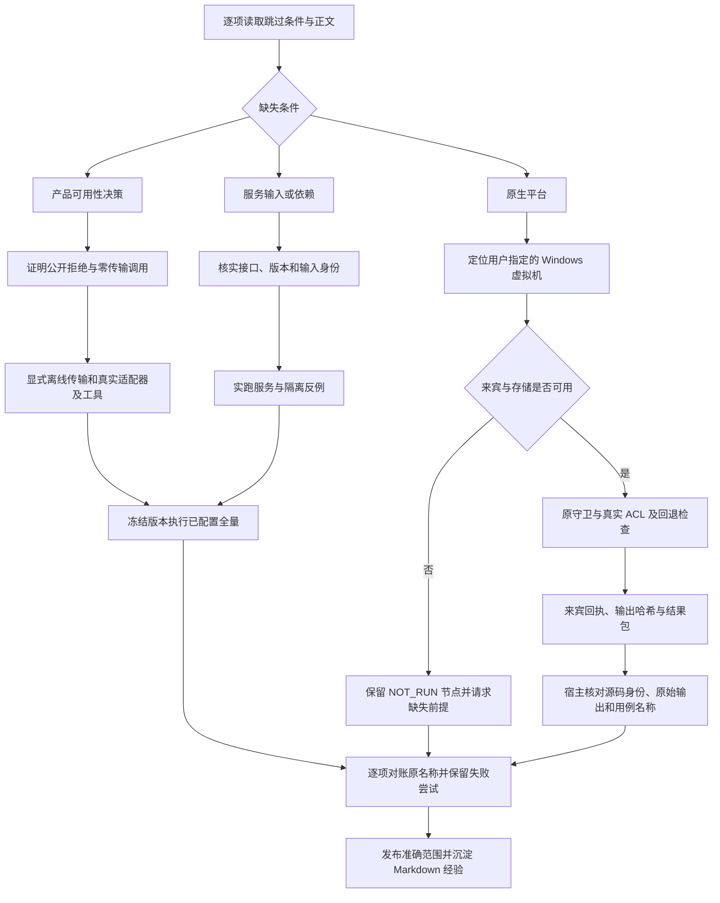

# 跳过项核查与发布验收 · 0.4.3

[English](release-0.4.3-acceptance.en.md) · [逐项机器回执](evidence/koder-skip-audit-20261027.json) · [脱敏全量 TAP](evidence/koder-skip-audit-final.tap) · [上一版修复](release-0.4.2-acceptance.zh-CN.md)

## 结果

原 **21 项跳过均已有实际 PASS**：14 项离线提供方协议、3 项原兼容 Core 集成，以及在真实 Windows 虚拟机中执行的 4 项原守卫。另有 3 项真实 Windows ACL 操作全部通过。公开 Skill 以 **0.4.3** 正式发布，并保留各项结论范围。

冻结的私人候选 `c7ae14b44fb9f41bed6599af5132519de30e19f3` 执行 `npm test`：**1489 项，1485 通过、0 失败、0 取消、4 项平台跳过**。完整命令耗时 **446.70 秒**。执行前后 2629 个跟踪源码、542 个 Core 源文件、54 个移动端依赖文件及隔离 Python 依赖清单身份一致。这是源码与实际集成检查，没有新增桌面 Agent 自主行为结论。

| 对象 | 总数 | 通过 | 失败 | 取消 | 跳过 |
|---|---:|---:|---:|---:|---:|
| 保留的 0.4.2 私人回归 | 1482 | 1461 | 0 | 0 | 21 |
| 配齐条件的私人 macOS 回归 | 1489 | 1485 | 0 | 0 | 4 |
| 独立 Windows 原守卫 | 4 | 4 | 0 | 0 | 0 |
| 独立 Windows 真实 ACL 操作 | 3 | 3 | 0 | 0 | 0 |

17 个原顶层用例由跳过变为执行；启用宿主集成后又发现并执行了 7 个嵌套用例，因此总数增加 7。安装场景仅拆为各自有时限的文件，原断言没有删除或改变。机器台账逐项对应原名称，并注明哪些标题明确改称“离线适配器”或“显式共享笔记”。

## 实际补齐与修复

**提供方决策与协议覆盖。** 14 个原正文使用本地传输夹具，但公开提供方停用后被整项跳过。直接去掉跳过时，14 项都在预期的公开拒绝处失败。新测试夹具先从公开 CLI 证明拒绝及零传输调用，再经已有进程内测试接点，调用真实归一化适配器、CLI 文件工具及原报文/私有状态断言。没有显式离线传输就报错。提供方公开可用性没有放开，也没有声称付费 API 或真实云端通过。加上独立可用性检查的定向结果为 28/28。

**兼容 Core 与依赖。** 三项集成要求显式 Core 和 Python 路径。第一轮缺少 `argon2`，尚未到服务行为；在自有目录安装依赖并保留下载报告后，旧记忆版 Core 虽能启动，却没有宿主和个性化接口。切换到原兼容 Core 后，宿主检查及七项嵌套回归通过。未配置时的跳过信息现在明确列出两个环境变量及配置说明。

**共享记忆与项目隔离同时成立。** 实际诊断证明任务事实已同步到原服务。旧断言却期待另一项目自动收到这段任务历史，与现行源码、文档及独立入口测试的会话隔离规则冲突。修正后先证明自动历史不会串入，再执行真实 `memory add` 与 `memory sync`，证明用户明确保存的笔记可跨项目复用。独立 CLI 进程、真实 ACK 丢失、原移动端 TypeScript/SQL 契约、服务重启、全局遗忘及会话撤销断言均保留。定向集成及隔离检查 26/26；没有放松产品过滤条件，也没有冒充真手机。

**定向之后继续全量。** 首轮冻结回归为 1483 通过、0 断言失败、2 项整文件超时取消、4 项 Windows 跳过。5 次完整安装原先累计在两个 60 秒文件内；拆成独立文件并核对测试正文身份后，5 个原场景全部通过。完整依赖实体包另一次构建实测用了 145 秒，因此一次性构建预算改为 180 秒；各测试文件仍为 60 秒，并发仍为 2。后续一次全量在该构建预算内仍然超时，尚未进入测试；分阶段诊断随后在 102.54 秒完成，前置与复制 51.22 秒、内核 7.94 秒、压缩 31.32 秒、清理 11.75 秒。先前耗时波动的确切原因未复现，失败回执保留；最终完整运行沿用相同预算并重新构建自己的归档。这是测试调度与初始化预算修复，没有降低产品验收条件，也不用于宣称性能上涨。

所有未成功尝试均保留：缺依赖、Core 版本不兼容、过期上下文断言、全量文件超时，以及一次打包命令缺输出父目录。补建自有目录后保存新命令回执，旧输出没有覆盖。

## 原 21 项逐项台账

原 TAP 编号来自保留的 0.4.2 输出。PASS 的范围以末列为准，原英文场景名保留以便精确查找。

| ID | 原 TAP | 原场景 | 结果 | 范围 |
|---|---:|---|---|---|
| S01 | 189 | Kimi Responses: real CLI file-tool continuation retains private protocol state | PASS | 离线适配器＋真实 CLI 工具 |
| S02 | 190 | Alibaba Token Plan openai: real CLI file-tool continuation retains private protocol state | PASS | 离线适配器＋真实 CLI 工具 |
| S03 | 191 | Alibaba Token Plan responses: real CLI file-tool continuation retains private protocol state | PASS | 离线适配器＋真实 CLI 工具 |
| S04 | 192 | Alibaba Token Plan anthropic: real CLI file-tool continuation retains private protocol state | PASS | 离线适配器＋真实 CLI 工具 |
| S05 | 193 | Volcano Coding Plan openai: real CLI file-tool continuation retains private protocol state | PASS | 离线适配器＋真实 CLI 工具 |
| S06 | 194 | Volcano Coding Plan responses: real CLI file-tool continuation retains private protocol state | PASS | 离线适配器＋真实 CLI 工具 |
| S07 | 195 | Volcano Coding Plan anthropic: real CLI file-tool continuation retains private protocol state | PASS | 离线适配器＋真实 CLI 工具 |
| S08 | 196 | Volcano API openai: real CLI file-tool continuation retains private protocol state | PASS | 离线适配器＋真实 CLI 工具 |
| S09 | 197 | Volcano API responses: real CLI file-tool continuation retains private protocol state | PASS | 离线适配器＋真实 CLI 工具 |
| S10 | 198 | Volcano API anthropic: real CLI file-tool continuation retains private protocol state | PASS | 离线适配器＋真实 CLI 工具 |
| S11 | 447 | default CLI gateway obtains original Core lease; second host cannot subscribe and shutdown releases it | PASS | 兼容 Core 实际集成 |
| S12 | 448 | host review regressions use configured Core, original SDK and the independently bundled CLI | PASS | 兼容 Core 实际集成 |
| S13 | 748 | Kimi K3 official international endpoint receives its supported token field and reasoning control | PASS | 离线适配器＋真实 CLI 工具 |
| S14 | 751 | Kimi China and international Chat Completions complete real file-tool continuations with nullable SSE fields | PASS | 离线适配器＋真实 CLI 工具 |
| S15 | 752 | Kimi, DeepSeek and Kimi Code Messages routes retain thinking signatures through actual file-tool results | PASS | 离线适配器＋真实 CLI 工具 |
| S16 | 753 | DeepSeek and Kimi Code Responses preserve opaque reasoning and actual file-tool call IDs | PASS | 离线适配器＋真实 CLI 工具 |
| S17 | 1127 | formal service: separate CLI processes, actual ACK loss, mobile SQL contract, restart and shared forget | PASS | 兼容 Core 实际集成 |
| S18 | 1409 | modified native ACL program is refused before execution | PASS | Windows 虚拟机守卫；SYSTEM 特权身份 |
| S19 | 1410 | a redirected ACL program is refused before execution | PASS | Windows 虚拟机守卫；SYSTEM 特权身份 |
| S20 | 1411 | an explicit native privacy refusal does not invoke another reader | PASS | Windows 虚拟机守卫；SYSTEM 特权身份 |
| S21 | 1412 | a blocked native host uses the original reader within the same deadline | PASS | Windows 虚拟机守卫；SYSTEM 特权身份 |

## Windows 虚拟机实际结果

用户指定的本机虚拟机已完成剩余检查。早期发现仅约 17 GiB 可用空间、未定位到可用虚拟机；后来空间已补齐，打开已校验的 UTM 后也看到了以前注册的虚拟机记录。此前结果仅代表当时有限检索。本任务新建独立的 80 GiB 来宾，其他虚拟机保持原状。[旧节点](evidence/koder-skip-audit-before-windows-20261027.json)继续保留。

来宾为 **Windows 11 Pro ARM64，10.0.26300.9457**，使用 UTM 5.0.8、4 个 CPU、8 GiB 内存。Node 22.23.2 ARM64、Microsoft ISO 和 UTM 下载均核对官方哈希；首次损坏的 Node 下载保留并拒绝使用。用户分别同意屏幕上的 Windows 和 Guest Tools 协议，并亲自完成新账户凭据设置。

重启后，由官方来宾代理以 **NT AUTHORITY\SYSTEM** 身份执行冻结的验收包。实测发现厂商无人值守安装曾把 UAC 设为零，已恢复为一，并在测试前核实新的开机时间及最终值。Secure Boot 回读为 true。TPM 接口返回 `0x80284001`，本次 ACL 验收不签 TPM 功能通过。没有采集凭据，也没有为运行测试削弱保护。

[Windows 返回回执](evidence/windows-native-20261027.json)、[四项守卫原始 TAP](evidence/windows-original-four.stdout)和[三项真实操作 TAP](evidence/windows-native-smoke.stdout)证明：

- 原四项守卫全部通过、零跳过，耗时 **0.466 秒**；正文中的子进程结果桩仍明确保留。
- 三项真实操作全部通过、零跳过，耗时 **12.237 秒**：原程序收紧自有空目录并由独立 ACL 读取确认；拒绝非空公开夹具且 ACL/内容不变；原 PowerShell 回退程序收紧另一个自有空目录。
- 原源码、程序与测试执行前后哈希一致；返回 ZIP 与来宾计算的哈希一致，宿主逐一复核原始输出哈希及原用例名称。

外围批处理最初写出空退出码文件，因为 `echo 0>...` 将数字解释成了重定向句柄。已修正写法，并实际验证退出码 0 与 2 的受控样例；测试验收依据是保留的 Node 退出码和原始 TAP，不是空标记。首次 Mac 解压还把 Windows ZIP 的反斜杠作为普通文件名保留；第二次先验证并规范化成员路径，再核对内容哈希不变。这两次回收问题均保留记录。

这些结果属于真实 Windows 虚拟机内、特权服务身份下的定向检查，不能推导普通用户兼容性、完整 Windows 产品套件或 Windows Koder→Cursor Agent 行为。私人产品源码与程序未包含在公开发布中。

[核查图 SVG](diagrams/windows-audit.zh-CN.svg) · [可编辑源文件](diagrams/windows-audit.zh-CN.mmd)

## 公开 Skill 分发

额外的压缩包级检查发现六处文首来源引用指向核心包未包含的文档。两份经验文档现已改用固定发布标签 URL，六处均核对到绑定来源。[包内来源回执](evidence/release-0.4.3-package-links.json)保留首次拒绝与修正结果。发布字节验收还会下载这些来源并比对哈希。

[公开 CI 回执](evidence/release-0.4.3-ci.json)绑定实际受测提交，Linux x64、macOS Intel、Windows x64 各通过 50 项工具测试。[Windows 安装回执](evidence/release-0.4.3-windows.json)记录 PowerShell 5.1 与 7 的安装、共享文件修订、旧写入者拒绝与受保护卸载。五个任务均通过，完整安装原始产物另随发布提供。这些托管检查没有执行四项私人 ACL 用例。

Personal Agent Growth 0.4.3 增加[跳过核查协议](../references/regression-repair.md)与逐项证据。61 文件核心包、双语手册、32 份模板及原 16 张渲染图继续保留，另加入两张 Windows 核查图。私人 Koder 候选仍为运行时版本 0.4.14，与其原协议单独交接，没有替换生产安装。

[本机回执](evidence/release-0.4.3-local.json)记录 52 项工具测试通过、61 文件核心包 127 项检查，以及中文空格路径安装、搬迁、两类经验读取、卸载后记忆哈希保持一致。[图示回执](evidence/release-0.4.3-diagrams.json)记录 11 个 Mermaid 块解析及两张 Windows 核查图的实际渲染。这些证明公开分发行为，与四项私人 Windows 原生检查分开。本次没有新增付费模型回合、Windows Koder→Cursor Agent 接续、关闭应用后的唤醒或完整任务效率实验。
