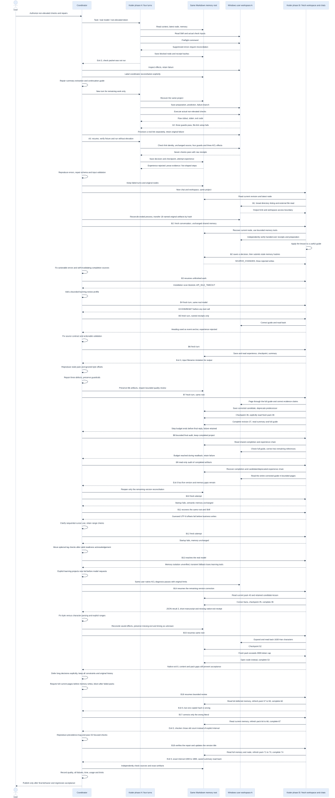

# Windows Agent continuation acceptance · 0.4.4

[中文](release-0.4.4-acceptance.zh-CN.md) · [Practical tutorial](windows-agent-continuation.en.md) · [Compatibility](compatibility.en.md)

Bounded Windows Koder CLI continuation passed after 22 recorded launch attempts. A real model read the Skill and shared Markdown, resumed in a second workspace, executed seven non-elevated checks, reviewed the evidence, corrected a candidate lesson, and completed revision 74. This was coordinator-assisted recovery; all failed launches remain in the ledger.

## Execution method

A live Koder CLI Agent on Windows 11 Pro ARM64 reviews installation and memory protection, then produces a sourced continuation guide in a second workspace. MiniMax-M3 makes actual model requests through the existing user's configuration. The launcher only supplies the task and captures identity, commands, output and file hashes.

The process uses medium integrity, elevation false, and an Administrators group marked deny-only. This is ordinary execution under a filtered administrator token, not a separately created standard account. Two workspaces bind the same physical Markdown root and project ID. Fresh conversations recover by reading files; the old chat is not pasted into the prompt.

## Actual sequence

| Turn | Observed work | Preserved stopping condition |
|---|---|---|
| A | Read Skill and memory | Error-suppressing preflight required reconciliation; the check packet did not run |
| A2 | Saved preparation and predictions, ran the original packet | Three guards and three ACL operations passed; one symlink fixture could not be created. The 16-step budget was later exhausted |
| A3 | Recovered, revised the fixture judgment, verified a separately provisioned real link, executed without elevation | All seven checks passed. Prose evidence was rejected and the turn reached its budget |
| A4 | Corrected evidence format | List-shaped steps exposed an incomplete tool contract; no experience saved |
| B | New workspace, actual shared-memory recovery | Excessive directory output and a general-file workspace boundary |
| B2 | Independently verified 18 artifact copies and TAP/receipt consistency; wrote a guide and checker | A decision changed memory hashes, then three experience writes reused stale sources |
| B3 | Recovered fresh memory and the revised Skill | An unnecessary installation scan hit the shell reconciliation gate; the model later timed out. The guide and experience store were unchanged |
| B4 | Selected the restricted `learning-review` harness | The model connection reset before any tool call. No experience or completion was written |
| B5 | Revised and read back the guide | Added a Markdown heading as an event anchor; experience rejected. The node hash was unchanged. An incomplete TODO update also failed |
| B6 | Corrected the guide, saved and read back an experience, checkpoint and summary | Exit 3: delivery checking misread an input filename suffix as an output. Pack reads also reused stale text, and the guide tail was not read fully |
| B7 | Read the full guide in UTF-8 pages, corrected the candidate experience, deprecated its predecessor, checkpointed revision 36 and read the fresh pack | Completed revision 37 and read the summary; budget exhausted before the final reply |
| B8 | Recovered completion and corrected remaining guide references; read the English Skill reference | Budget exhausted during the final guide readback; frozen snapshot retained |
| B9 | Read-only audit recovered the same project and read the complete guide | Exit 0, but found version-attribution and durable-memory gaps; not overall acceptance |
| B10 | Attempted the bounded version reconciliation | Worker startup timed out before model work; all 1,684 memory file hashes unchanged |
| B11 | Recovered the same root, read both Skill references and named audit inputs | Guessed three UTF-8 offsets in parallel; invalid boundaries triggered the existing failure stop before business writes |
| B12 | Installed and verified the explicit paging contract | Startup failed before model work, with a diagnostic-log warning; memory hashes unchanged |
| B13 | Reached the actual model, read the named inputs and Skill | Conversation-memory isolation could not be verified; silent transient fallback removed learning tools. No semantic memory changed; exit 1 |
| B14 | Read shared revision 43, corrected facts, wrote an addendum and completed revision 46 | Final JSON result unverified/3: bytes were misread as a word-count requirement; the 734-Han-character addendum also missed the actual range. Summary omitted a corrected SKILL_NOT_FOUND. Native exit receipt and duration were not saved |
| B15 | Expanded and read back 1,630 Han characters, corrected the B14 failure record, completed revision 53 | Native exit 0, but a fresh pack exceeded the limit and the manuscript wrongly gave the checker precedence over content quality; not accepted |
| B16 | Read deferred history, corrected the quality rule, refreshed pack 57→59 and completed revision 60 | Native exit 0; independent readback found one copied guide-hash character was wrong. The original guide itself was unchanged |
| B17 | Corrected one copied hash, read the full current memory, refreshed pack 64→66 and completed revision 67 | Exit 0 and content within range, but checker chose a historical count instead of the explicit interval |
| B18 | Updated the version title, read back the artifact, refreshed current memory and completed/read the summary with the repaired range rule | Exit 0; content quality, exact explicit bounds and source checks passed |

The coordinator reconciled shell stops, installed narrow fixes, and provided feedback about remaining work. This is coordinator-assisted recovery, not evidence that Koder independently rewrote its entire runtime. The manual launches do not establish autonomous wakeups.

## Windows behavior

The original packet and its EPERM remain intact. A separately identified copy changes only the redirected-helper fixture setup: it consumes a real file symlink provisioned by SYSTEM, verifies its identity, and retains rejection plus zero-execution assertions. A3 evaluates the four guards and three actual ACL operations using the non-elevated token: seven pass, zero skipped. Verifier and helper bytes are unchanged. This does not establish ordinary-user symlink creation; Developer Mode and UAC were not weakened.

## Repairs and useful learning

The private candidate now splits visible output from protocol thinking before summary clipping; describes evidence and list inputs accurately; validates supplied candidate sources; gives a recovery path for stale references; and rejects completion sources that completion itself would invalidate. Dependent memory writes must be sequential and use freshly read immutable nodes. An explicit `learning-review` harness exposes named-file and memory operations for finishing work; shell, directory search and external operations are unavailable. It retains normal authorization and the 16-step limit. Twelve focused checks cover this harness and its existing integration. A later 18-check learning run verifies invalid-anchor rejection, unchanged bytes after rejection, and corrected exact-source persistence. The schema now distinguishes event IDs from Markdown headings and tells the model to copy returned source objects intact. These scripted tests are separate from live Agent evidence.

The Skill adds bounded preparation, receipt-based error classification, ordinary-token/fixture separation, workspace-aware artifact handoff, and experience readback. The second Agent verifies 18 named original-file copies with their source paths and hashes. The semantic memory store is not copied.

Quality requires pre-execution preparation, raw results, same-root recovery, an accurate executable guide, saved/read-back experience, and a valid summary. Exit zero, tool counts, or an Agent's completion claim cannot substitute for those checks.

Three further defects were reproduced and repaired: explicit project-pack reads now refresh disk state while retaining prior read evidence; action words embedded in input filenames no longer invent output targets; workspace file reads honor bounded UTF-8 byte pages. The latter retains the 80 KB file cap, path confinement and hardlink rejection. Forty-four focused pagination, search and delivery checks pass; twenty focused learning checks cover fresh reads and conflicts. Earlier failed test attempts remain in the private audit trail. B11 then exposed an incomplete tool description: a byte offset is a returned cursor, not a fixed stride. The tool contract and review hints now require sequential nextOffset use; seven existing pagination/profile checks pass without relaxing range guards or the step limit.

B7 corrected the B6 experience and retained its deprecated predecessor. B9 then found version gaps despite exiting zero. B16 corrected the acceptance rule and verified fresh packs after bounded reads. B17 then corrected one copied hash in the addendum; the frozen guide remained unchanged. The B2 hash is explicitly historical; the current B8 guide is frozen by hash. Read the guide together with its addendum. Both candidate lessons retain their project scope and untested status; task acceptance does not promote a general capability.

The repeated startup failure exposed optional diagnostic logging on the critical startup path. Its synchronous Windows ACL check ran before the readiness acknowledgement. The candidate now acknowledges readiness only after command loading and admission, then performs the same log privacy checks. The 15-second startup limit and ACL validation remain intact. Twenty-six focused diagnostics, update recovery and cancellation checks pass, including a regression that fails against the old ordering. This identifies a contributing startup bottleneck, not every possible resource or provider failure.

B13 exposed a separate failure: an explicitly requested learning project silently continued without learning tools after memory isolation could not be verified. Explicit project sessions now stop before a model request if persistent memory or the learning runtime is unavailable. Ordinary conversations retain the documented temporary-memory behavior. Twenty-three related checks and four explicit-project cases pass; the first two new cases failed against the old behavior. A subsequent diagnosis under the same non-elevated user verified both memory and log ACLs using the unchanged native helper and deadline. This establishes current readiness, not the exact cause of the earlier refusal; the real CLI rechecks independently.

B14 exposed two manuscript-checking defects: the Chinese byte unit was treated as a character count, and explicit ranges were not recognized. Three tests reproduced these failures. The repair excludes byte metadata and respects exact range endpoints; all 52 related checks pass. This did not excuse the short Agent artifact: B15 expanded it, and the accepted final addendum contains 1,721 Han characters within the original 1,000–1,800 range. B14 also omitted a failed Skill lookup from its summary after recovering with the correct ID. Its durable completion is retained, but is not accepted as delivery success. The missing native exit receipt and duration remain unknown; a raw JSON result is not a process exit receipt. The launcher now saves a starting receipt and the immediate process result before the potentially expensive memory inventory.

B15 exposed a real long-running-project limit: decision history outgrew the mandatory pack. The repair keeps the 4,000-token cap and all goal, constraint and prohibition sections. Oversized decisions remain unchanged on disk and are explicitly deferred with their document ID, hash and paging instructions. Native memory writes require complete observed pages of that version; partial or stale reads do not satisfy the guard. A failed fresh-pack read also blocks dependent writes until reconciliation and a successful fresh read. Thirty learning checks pass, including fresh-session restoration and failure/partial-read controls. B16 through B18 then exercised this deferred-read path and successful fresh-pack reads with the live model.

B17 exposed a further range-selection defect: the prompt mentioned the existing 1,717-character manuscript before stating the required 1,000–1,800 interval. The checker selected the earlier count and widened it to 1,546–1,888. The actual manuscript was within the user's interval, but that did not make the rule correct. A reproduced failure and 53 passing focused checks establish the repair: an explicit interval takes precedence over an incidental single count, without changing its endpoints. The original B17 fields remain in the ledger.

## Time, usage and cost

All failed turns count toward this task's elapsed time and usage. Across 22 launch attempts, saved durations total 4667.421 launcher wall seconds, including the pre-call memory inventory; B14 has no saved duration and is excluded from this sum, not treated as zero; the first-to-last execution span is 62031.939 seconds, including intervening repair and transport time. Later publication and regression work is outside that span. The machine ledger reports real process times and persisted native token usage. Provider billing and complete coordinator/repair overhead are unavailable, so cost stays unknown. This repaired task is not a controlled comparison and establishes no speedup.

## Retained results and regression

- [Live Agent ledger](evidence/windows-koder-agent-20261027.json) and [quality checks](evidence/windows-agent-quality-20261028.json) bind identities, read/write calls, memory hashes and actual outcomes.
- Exact Agent artifacts: [frozen guide](evidence/windows-agent-guide.zh-CN.txt), [required version addendum](evidence/windows-agent-guide-addendum.zh-CN.txt), [summary](evidence/windows-agent-summary.zh-CN.txt), [current memory](evidence/windows-agent-memory.zh-CN.txt), [context](evidence/windows-agent-context.zh-CN.txt), [candidate lesson](evidence/windows-agent-experience.zh-CN.txt), and [deprecated predecessor](evidence/windows-agent-experience-deprecated.zh-CN.txt). These Chinese task artifacts are preserved byte-for-byte; the tutorials and architecture documentation are bilingual.
- The configured macOS private-candidate regression completed **1523 tests: 1519 pass, 0 fail, 0 cancelled, 4 Windows platform skips**. The four unchanged Windows guards have separate real non-elevated evidence. This is not a full Windows product suite. [Regression receipt](evidence/koder-agent-regression-20261028.json).
- [Cleanup receipt](evidence/windows-agent-cleanup-20261028.json): all owned audit tasks removed, temporary provider copy removed, UAC still enabled, and the owned VM actually stopped before regression.
- The earlier run with eight cancellations is preserved. The accepted run used the original bounds and concurrency after the owned audit VM was stopped. Source and dependency manifests matched before and after.

Private candidate source commit: `30d3f0f06d8050b0f6103c2fe6bfe6ffb34f1247`. The public Skill is a separate distribution; it does not install this private runtime.

## Distribution and limits

The public Skill passed 52 utility tests on each hosted operating system: Ubuntu 24.04, macOS 26 Intel and Windows Server 2025. PowerShell 5.1 and 7 also completed installation, shared-file recovery and removal. These CI runs use test processes, not model Agents. [CI receipts](evidence/release-0.4.4-ci.json) · [Windows installation receipts](evidence/release-0.4.4-windows.json).

Local checks verified the 63-file core, all 20 rendered diagrams and their sources, 32 templates, installation into a Unicode/space path, relocation, experience reading and removal with memory retained. Six packaged source references resolved to four versioned sources. [Local receipts](evidence/release-0.4.4-local.json) · [Source-link checks](evidence/release-0.4.4-package-links.json). The release's separate `RELEASE-VERIFICATION.json` records final published-byte and network-install verification without creating a self-referential archive.

The public release includes the portable Skill, bilingual documentation, editable diagrams and sanitized receipts. Native learning commands require the separate Koder candidate identified by its source commit. Installing this Skill does not install private Koder code.

Windows Cursor, a separate standard account, the full Windows product suite, cross-device synchronization, app-closed wakeups and general efficiency improvements remain outside this trial. The original 21-skip audit remains in the [0.4.3 report](release-0.4.3-acceptance.en.md).

