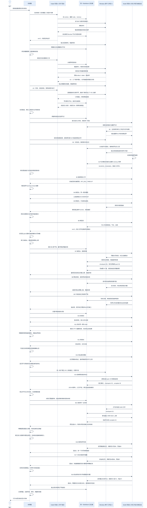

# Windows Agent 接续验收 · 0.4.4

[English](release-0.4.4-acceptance.en.md) · [实用教程](windows-agent-continuation.zh-CN.md) · [兼容性](compatibility.zh-CN.md)

经过 22 次有原始输出记录的启动，限定范围内的 Windows Koder CLI 接续通过：真实模型读取 Skill 和同一 Markdown 记忆，在第二工作区恢复，执行七项非提升权限检查，复习证据、纠正候选经验，并完结到修订 74。这是有协调器参与的接续；所有失败回合均保留。

## 执行方式

真实 Koder CLI Agent 在 Windows 11 Pro ARM64 上复核安装与记忆目录保护，再到第二工作区交付有来源的接续指南。MiniMax-M3 通过用户已有配置发生真实模型请求；启动器仅负责传入任务和保存身份、命令、输出及文件哈希。

被测进程为中等完整性、非提升令牌，管理员组标记 deny-only。这是过滤管理员令牌下的普通执行，不等于独立创建的标准账户。两个工作区绑定同一物理 Markdown 根和项目 ID，新对话实际读取文件恢复，没有把旧聊天粘进提示词。

## 真实过程

| 回合 | 实际工作 | 保留的停止原因 |
|---|---|---|
| A | 读 Skill 和记忆 | 错误抑制预检触发对账要求，检查包未运行 |
| A2 | 写预习与预测，执行原始检查包 | 三项保护及三项 ACL 操作通过，一项无法创建符号链接夹具；后来耗尽 16 步预算 |
| A3 | 恢复并调整夹具判断，核对独立预置的真实链接，保持非提升执行 | 七项通过，经验来源文本被拒，随后耗尽预算 |
| A4 | 改正来源格式 | 步骤数组暴露不完整工具契约，未保存经验 |
| B | 新工作区实际恢复共享记忆 | 全目录输出超限，一般文件工具也遇到工作区边界 |
| B2 | 独立核对 18 份副本及 TAP/回执，写指南与核对脚本 | 写决策改变 memory 哈希，随后三次经验仍用旧来源被拒 |
| B3 | 读取最新记忆和修订后的 Skill | 多余的安装目录扫描触发 Shell 对账要求，之后模型超时；指南及经验库未变 |
| B4 | 采用仅供复习收尾的 `learning-review` 配置 | 模型连接在任何工具调用前重置，没有写入经验或完结记录 |
| B5 | 修改并读回指南 | 自行把标题填成事件 anchor，经验被拒；节点哈希实际未变，另一次不完整 TODO 更新失败 |
| B6 | 修改指南，真实保存并读回经验、节点和总结 | 退出 3：交付检查误把输入文件名后缀当成输出；项目包仍返回旧正文，指南尾部也未完整读取 |
| B7 | 完整分页读指南，纠正经验并废弃前身，写节点 36 后读到新项目包 | 完结修订 37 并读回总结；最终回复前耗尽预算 |
| B8 | 恢复完结记录、修正指南剩余引用，实际读取英文 Skill 参考 | 最终读回途中耗尽预算，保留冻结快照 |
| B9 | 只读审计恢复同一项目并完整读指南 | 退出 0，但发现版本归属与长期记忆缺口，不等于全任务通过 |
| B10 | 尝试限定的版本对账 | 模型工作前启动监护超时，1,684 个记忆文件哈希均未改变 |
| B11 | 恢复同根记忆，读取中英文 Skill 和具名审计输入 | 并行猜测三处 UTF-8 偏移，非法边界触发原有失败停止规则，尚未写业务产物 |
| B12 | 安装并核对明确的分页契约 | 模型工作前再次启动失败，并出现日志告警；记忆哈希未变 |
| B13 | 真实模型读取指定输入与 Skill | 会话记忆隔离校验未通过后静默退回临时模式，未加载学习工具；语义记忆未变，退出 1 |
| B14 | 读共享修订 43，更正事实、写增补并完结至 46 | 最终 JSON 为 unverified/3：字节元数据误识别为字数要求，734 汉字正文也低于实际范围；总结漏记已纠正的 SKILL_NOT_FOUND。原生退出回执和耗时未保存 |
| B15 | 扩写并读回 1630 汉字，纠正 B14 失败记录，完结至修订 53 | 原生退出 0，但新项目包超限，正文错误地让检查器优先于内容质量，仍未验收 |
| B16 | 完整读取按需决策，纠正质量规则，新项目包 57→59，完结至 60 | 原生退出 0；独立读回发现增补中指南哈希抄错一个字符，指南原文件未变 |
| B17 | 局部纠正哈希、完整读当前记忆、刷新包64→66并完结修订67 | 退出0，正文实际达标；检查器仍错取历史字数，未用显式区间 |
| B18 | 补齐标题版本归属，读回产物、刷新记忆并完结读回总结，实际使用修正的区间规则 | 退出0；内容质量、明确区间与来源核查通过 |

协调器核对 Shell 停止的实际影响、安装局部修复，并给出剩余工作反馈。这是有协调器参与的接续，不能声称 Koder 独立改写全部运行时。人工调度启动也不等于自主唤醒。

## Windows 行为

原始检查包及 EPERM 失败保留。明确标记的副本只修改重定向 helper 的夹具准备：使用 SYSTEM 独立预置的真实文件链接、核对身份，保留拒绝和零执行断言。A3 使用非提升令牌执行四项保护及三项实际 ACL 操作，七项通过、零跳过；verifier 和 helper 字节未变。这不证明普通权限能够创建文件符号链接，也未通过削弱开发者模式或 UAC 条件获得通过。

## 修复与有效经验

私有候选版本修复摘要截短前的可见回复分离，明确来源和列表参数，校验候选经验提供的真实来源，给过期引用提供重读路径，并拒绝会被完结动作本身改变的来源。依赖前一写入的记忆操作顺序执行，引用重读后的不可变节点。显式选择的 `learning-review` 配置仅提供具名文件和记忆操作，不开放 Shell、目录搜索及对外操作，保留原权限规则与 16 步上限。该配置及既有集成的 12 项定向检查通过；后续 18 项学习检查还验证错误 anchor 被拒且无写入、改用正确来源可保存。工具契约明确事件 ID 与 Markdown 标题的区别，要求原样复制返回来源。这些脚本测试与真实 Agent 证据分开记录。

Skill 增加有界预习、按回执分类错误、区分令牌与夹具准备、遵守文件工作区范围的交接及经验读回。第二 Agent 独立核对 18 份原始产物副本的源路径与哈希；语义记忆库没有复制。

质量条件包括执行前预习、原始结果、同根恢复、准确可执行的指南、经验写入并读回、有效总结。退出零、工具数量或 Agent 自述不能代替这些条件。

又复现并修复三处断点：显式项目包读取从磁盘刷新，同时保留之前的读取证据；输入文件名中的动作词不再制造虚假的输出文件；工作区文件读取支持按 UTF-8 字节分页。原 80 KB 文件上限、路径约束和硬链接拒绝保持。分页、搜索及交付的 44 项定向检查通过；20 项学习检查覆盖刷新读取与冲突。之前失败的测试尝试保留在私有审计记录中。

B11 又暴露工具描述缺口：字节偏移是返回的游标，不能按固定步长推算。工具契约和复习提示已明确必须逐页等待并使用 nextOffset；7 项既有分页与配置检查通过，边界保护与步数限制未放宽。

B7 已纠正 B6 经验并保留废弃前身。B9 虽退出零，仍查出版本记录缺口；B16 纠正验收规则，通过有界按需读取核实新项目包；B17 再局部纠正增补中一个误抄的哈希，冻结指南不变。B2 哈希明确标为历史，当前 B8 指南按哈希冻结，必须结合补充说明使用。候选经验仍限本项目且为 untested，任务通过不等于晋升为通用能力。

重复启动失败暴露可选日志占用关键启动路径：同步 Windows ACL 校验原本发生在就绪确认前。候选版本仍在命令加载和授权检查完成后才确认就绪，随后执行相同日志隐私校验；15 秒启动时限和 ACL 校验均保留。26 项日志、更新恢复和取消检查通过，其中新增顺序回归可在旧代码复现失败。这确认了一处启动瓶颈，不代表所有资源或提供方故障都已消除。

B13 又暴露一处独立断点：明确指定学习项目时，记忆校验失败仍继续调用模型，学习工具却已消失。现在显式项目在持久记忆或学习运行时不可用时，会在模型请求前停止并报出诊断入口；普通对话保留原有临时记忆行为。23 项相关检查及 4 项显式项目用例通过，前两项新用例在旧行为下确实失败。随后同一非提权用户的原生诊断核实了记忆与日志 ACL，校验器和时限不变；这只证明当前条件可用，不能确定旧拒绝的具体原因，真实 CLI 仍独立复查。

B14 暴露两处正文检查错误：把“字节”误当字数，并且不识别明确的长度范围。三项测试复现后，修复排除字节元数据并保留范围的准确上下界；52 项相关检查通过。这不能抵消正文不足：B15 扩写后，最终验收的增补为 1721 汉字，符合原定 1000–1800。B14 在改用准确 ID 恢复后还漏记一次 Skill 查询失败。原完结保留，但不能据此宣告交付通过；缺失的原生退出回执和耗时保持未知，原始 JSON 结果不冒充进程退出回执。启动器已改为先落盘开始回执，进程返回后立即记录退出结果，再读取耗时可能较长的记忆清单。

B15 暴露持续项目的实际问题：决策历史过长，强制项目包溢出。修复保持 4000 token 上限，目标、约束、禁忌等小节仍强制注入；超长决策原文完整留盘，以 ID、哈希和分页方式明确提示按需读取。原生记忆写入必须先观察完整的当前版本，部分页或旧哈希均不够；显式项目包读取失败后，也必须先对账并成功读取新包，才能继续依赖写入。30 项学习检查通过，覆盖新会话恢复、部分读取和失败阻断；随后 B16 至 B18 已以真实模型验证该按需读取及新包读取路径。

B17 又暴露了区间选择缺陷：提示先提到现有正文 1717 汉字，后面明确要求 1000–1800，检查器却先取前者并放宽到 1546–1888。正文实际符合用户区间，并不能证明规则正确。新增复现用例先失败，修复后 53 项针对性检查通过：显式区间优先于附带的单个字数，端点不放宽。B17 的原字段保留在回执中。

## 耗时、用量与成本

所有失败回合都计入本次任务代价。22 次启动中已保存的启动器计时合计（含调用前记忆清单读取；B14 耗时未知，不计入且不当作零） 4667.421 秒；首末执行之间跨度 62031.939 秒，包含中间修复和传输等待，后续发布与回归不在该跨度中。机器回执保留真实进程耗时和已落盘的原生 token 用量。提供方账单与完整协调/修复开销不可得，费用保持 unknown。这是修复后的单任务实测，不是受控对比，不证明提速。

## 真实产物与回归

- [真实 Agent 回执表](evidence/windows-koder-agent-20261027.json)及[质量核查](evidence/windows-agent-quality-20261028.json)：关联身份、实际读写调用、记忆哈希和执行结果。
- Agent 原字节产物：[冻结指南](evidence/windows-agent-guide.zh-CN.txt)、[必须搭配的版本补充](evidence/windows-agent-guide-addendum.zh-CN.txt)、[总结](evidence/windows-agent-summary.zh-CN.txt)、[长期记忆](evidence/windows-agent-memory.zh-CN.txt)、[当前上下文](evidence/windows-agent-context.zh-CN.txt)、[候选经验](evidence/windows-agent-experience.zh-CN.txt)、[废弃前身](evidence/windows-agent-experience-deprecated.zh-CN.txt)。这些中文任务产物保留原文；安装、架构和教程均提供中英文版本。
- 私有候选的配置后 macOS 全量回归：**1523 项，1519 通过、0 失败、0 取消、4 项 Windows 平台跳过**。未改变的四项 Windows 保护检查有独立非提升实测，不冒充完整 Windows 产品套件。[回归回执](evidence/koder-agent-regression-20261028.json)。
- [清理回执](evidence/windows-agent-cleanup-20261028.json)：本任务定时项及临时凭据副本已清理，UAC 保持开启，本任务虚拟机已实际停止后再回归。
- 较早出现 8 项取消的运行保留。验收运行在关闭本任务虚拟机后执行，时限与并发不变；运行前后源码和依赖清单一致。

私有候选源码提交：`30d3f0f06d8050b0f6103c2fe6bfe6ffb34f1247`。公开 Skill 是独立分发，不会安装该私有运行时。

## 发布及范围

公开 Skill 在 Ubuntu 24.04、macOS 26 Intel、Windows Server 2025 各通过 52 项工具测试。PowerShell 5.1/7 也完成安装、共用文件恢复及卸载。这些 CI 是测试进程，不代替模型 Agent。[CI 回执](evidence/release-0.4.4-ci.json) · [Windows 安装回执](evidence/release-0.4.4-windows.json)。

本地核验覆盖 63 文件核心包、20 张渲染图及源文件、32 个模板、中文空格路径安装、搬迁、经验读取和卸载保留记忆。包内六条来源引用解析到四份版本化来源。[本地回执](evidence/release-0.4.4-local.json) · [来源链接检查](evidence/release-0.4.4-package-links.json)。发布页另附 `RELEASE-VERIFICATION.json`，保存最终发布字节及真实网络安装复验，避免压缩包自我引用。

公开发布包括可移植 Skill、中英文说明、可编辑图示及脱敏回执。原生学习命令要求证据中指定提交的独立 Koder 候选；安装 Skill 不会安装私有 Koder 代码。

Windows Cursor、独立标准账户、完整 Windows 产品测试、跨设备同步、宿主关闭后的唤醒与普遍效率提升均不在结论内。原 21 项跳过核查继续保留在 [0.4.3 报告](release-0.4.3-acceptance.zh-CN.md)。

