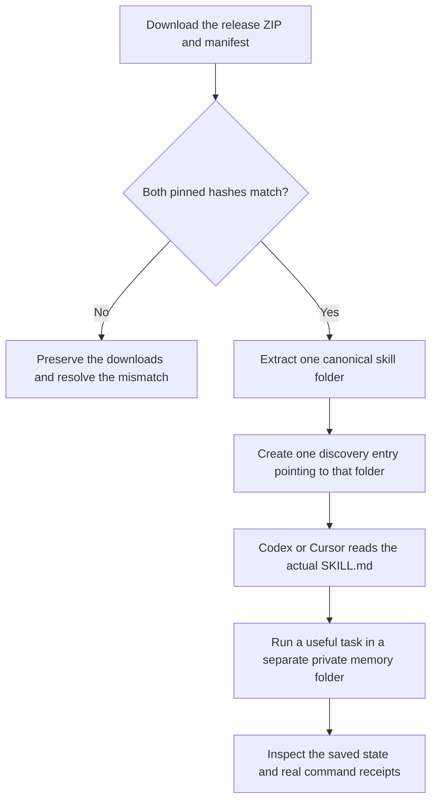
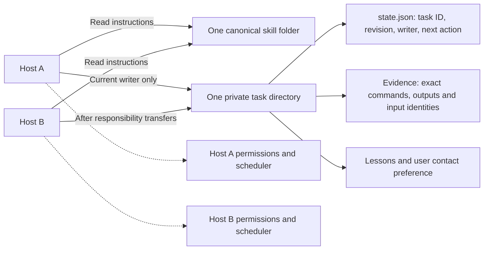
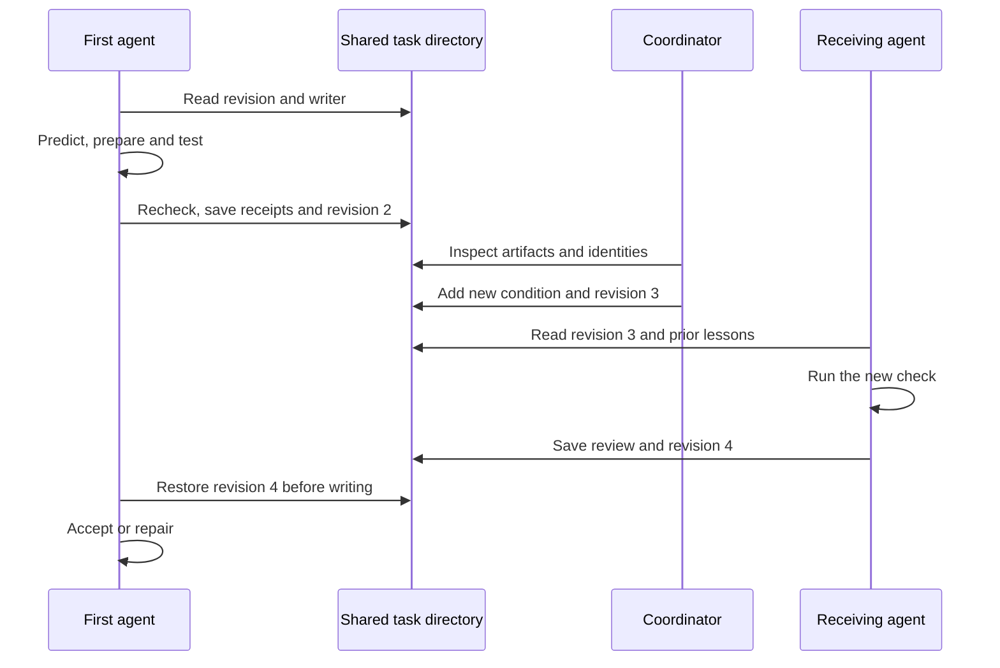
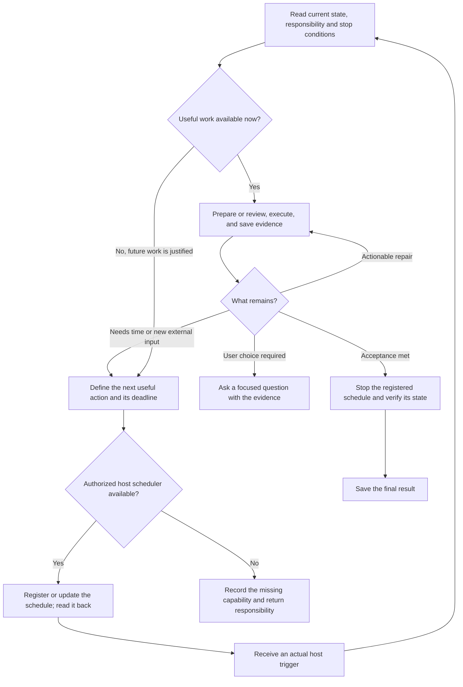
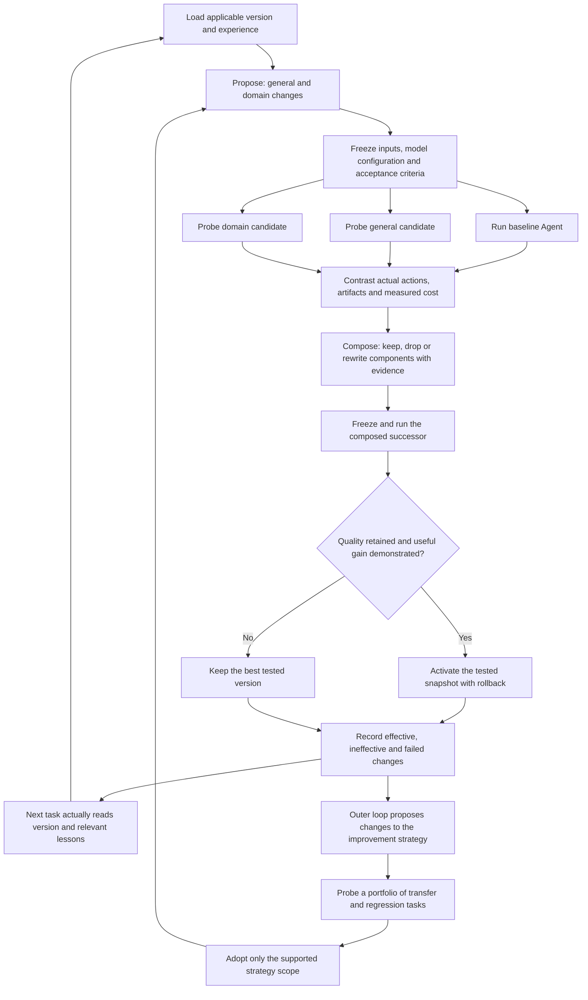
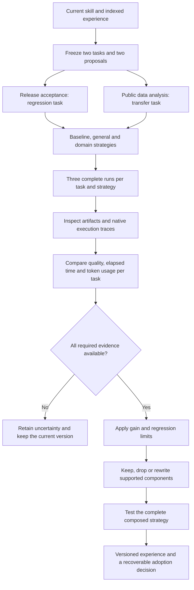

# Visual guide

[中文入口](visual-guide.zh-CN.md) · [Expanded diagrams for 0.4.1](mindmaps.en.md)

Use these diagrams with the [installation guide](install.md). They describe the intended workflow and the evidence needed to accept a result. Actual platform results are linked below; an arrow in a diagram is not an execution record.

## Install once, keep task memory separate

For the recommended installation, the discovery entry is `.agents/skills/personal-agent-growth`. It points to `<root>/skills/personal-agent-growth` through a macOS symbolic link or a Windows directory junction. The Windows root defaults to D: when available and otherwise C:; use a writable custom root when necessary. On macOS, the default root is `~/Desktop/AgentKnowledge`.

Both hosts must resolve the same task files. A copied directory with matching content does not establish shared mutable memory. Authentication, execution permissions, and scheduling remain with each host. Cross-device use needs an authorized transfer or synchronization method and explicit path mapping.

Removing the discovery link leaves the canonical skill and private task memory in place. The removal commands check the entry type before removing it; they refuse an ordinary directory. See the guide for updates and removal.

## Resume a task without losing newer facts

The revision numbers below are illustrative. The actual task chooses its writer, IDs, and revisions from its saved state.

A handoff is accepted when the receiving agent actually reads the saved revision, applies the relevant lesson, executes the next check, and writes back a verified result. Sending a prompt or seeing an activity indicator establishes only that stage. A late message must reread the current state and skip work already completed.

When a long terminal prompt is unreliable, put the complete task in a file, verify the transferred bytes, and send a short instruction to read its absolute path. Then inspect the agent's actual response and saved outputs. Successful file transfer proves delivery of the input file; it does not establish that the agent read or executed it.

## Decide whether to act now or arrange a wakeup

Scheduling is useful only when a later turn has work to do. The skill does not start a service by itself. Preserve the actual registration, trigger, execution, verification, and stop records separately. A manually continued chat, file timestamp, or `ACTIVE` setting cannot stand in for a real scheduled trigger.

## Compare, compose, and reuse

The inner loop changes the execution setup for one task. The outer loop uses evidence to improve how future changes are proposed, tested, composed, and retrieved. Both keep model weights unchanged. The agent may change project-owned workflow rules within the user's authorization; it cannot rewrite higher-priority host instructions or retroactively change the current experiment's acceptance criteria.

A composition may discard an entire proposal. It is not required to combine every edit. A new composition must pass its own real execution before activation. See the [measured local trial](recursive-improvement-trial.md); reduced checker process count does not establish lower total Agent cost.

## Read the results at the right level

| Question | Evidence to inspect | Recorded results |
|---|---|---|
| Do the package and manifest agree? | Checker command, exact inputs, raw output and exit code | [Release acceptance](release-0.3.2-acceptance.md) |
| Do installation, links and removal work? | Actual shell commands, file identities and preserved memory | [macOS](install-verification.md), [Windows](windows-install-verification.md) |
| Did an agent use shared memory and review its work? | Actual host behavior plus saved revisions, receipts and follow-up changes | [Agent behavior and limits](validation.md) |
| Did scheduled work really wake and stop? | Host trigger events, executed work and backend readback | [Codex continuation trial](validation.md#native-codex-continuation) |

The published Windows installation results use independent test processes. They do not prove Windows Koder or Cursor Agent behavior. That remains a separate acceptance requirement until the corresponding real-agent records have been inspected. The diagrams above are not a claim that this requirement has passed.

<!-- Copyright (C) 2026 KARMENLOOP Official Team
SPDX-License-Identifier: AGPL-3.0-only -->

## Compare complete tasks across domains

The task, not an individual checker process, is the unit of comparison. Each strategy completes both domains in fresh Agent sessions, with repeated runs and a fixed quality contract.

Cached input tokens remain part of input tokens; they are not added a second time. Actual billing can remain unknown. Interrupted sessions and conflicting clock readings are retained, rather than converted to successful or zero-cost runs.
